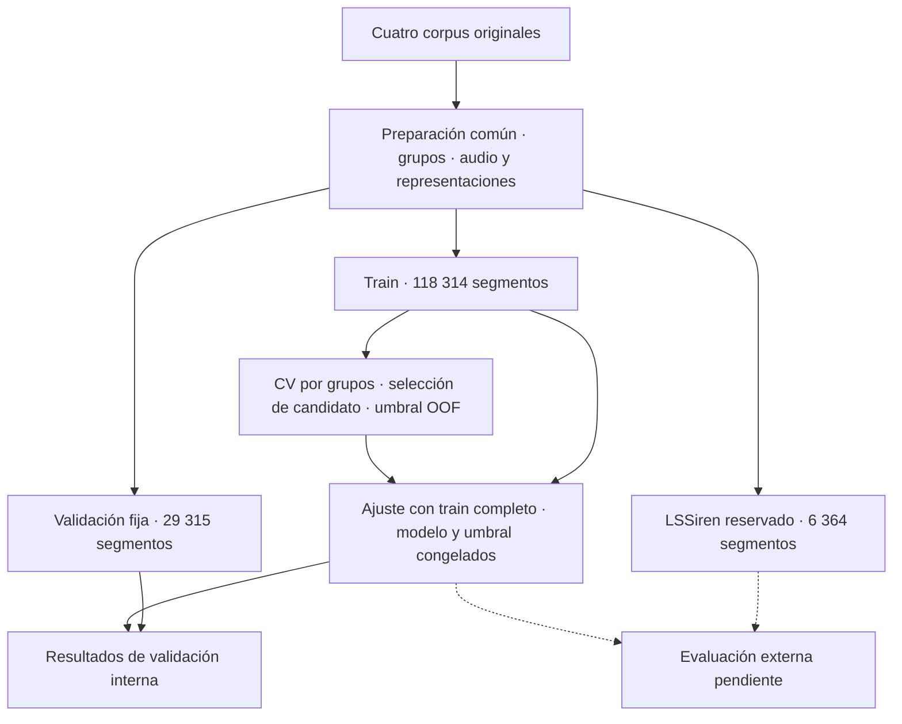
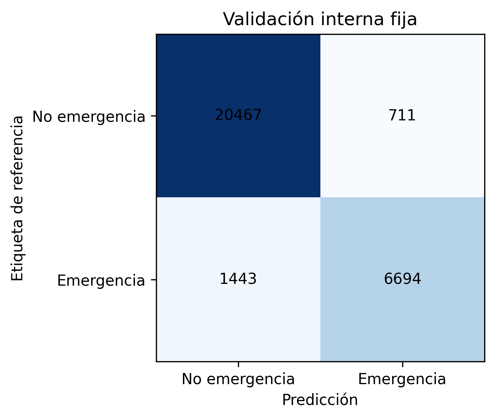

# Doppler ML · Reconocimiento acústico de sirenas

Proyecto de aprendizaje supervisado para clasificar ventanas de audio de tres segundos como **`EMERGENCY`** o **`NON_EMERGENCY`**. Compara regresión logística, Random Forest, SVM, una CNN compacta y ResNet18 sobre las mismas particiones, con trazabilidad desde la grabación original hasta las predicciones y el modelo exportado.

**Estado actual:** preparación y entrenamiento de los cinco modelos ejecutados en Kaggle, con resultados documentados del **12 de octubre de 2026**. ResNet18 obtiene el mayor F1 macro interno: **0,9057**. La evaluación externa, la robustez acústica y el prototipo permanecen pendientes.

GitHub reúne las fuentes, las notebooks ejecutadas y la documentación. Kaggle proporciona el entorno de ejecución y las versiones públicas enlazadas a continuación. Los [informes por modelo](docs/modelos/README.md) desarrollan la arquitectura, las fórmulas, los folds, las curvas de entrenamiento y la interpretación de resultados.

**Contenido:** [ejecuciones públicas](#ejecuciones-públicas) · [datos y preparación](#datos-y-preparación) · [protocolo](#protocolo-experimental) · [resultados](#resultados) · [reproducción](#reproducción-en-kaggle) · [artefactos](#organización-y-artefactos) · [documentación](#documentación).

## Ejecuciones públicas

| Orden y notebook | Fuente en GitHub | Ejecución pública en Kaggle | Documentación |
| --- | --- | --- | --- |
| 00 · Preparación de datos | [Notebook](notebooks/00_preparacion_insumos.ipynb) | [Preparación de datos](https://www.kaggle.com/code/jeancdevx/doppler-ml-preparacion-datos) | [Preparación del proyecto](docs/4/preparacion-de-los-datos.md) |
| 01 · Regresión logística | [Notebook](notebooks/01_regresion_logistica.ipynb) | [Regresión logística](https://www.kaggle.com/code/jeancdevx/doppler-ml-regresi-n-log-stica) | [Informe completo](docs/modelos/01_regresion_logistica.md) |
| 02 · Random Forest | [Notebook](notebooks/02_random_forest.ipynb) | [Random Forest](https://www.kaggle.com/code/jeancdevx/doppler-ml-random-forest) | [Informe completo](docs/modelos/02_random_forest.md) |
| 03 · SVM lineal y aproximación RBF | [Notebook](notebooks/03_svm.ipynb) | [SVM lineal y aproximación RBF](https://www.kaggle.com/code/jeancdevx/doppler-ml-svm-lineal-y-aproximaci-n-rbf) | [Informe completo](docs/modelos/03_svm.md) |
| 04 · CNN compacta | [Notebook](notebooks/04_cnn.ipynb) | [CNN compacta](https://www.kaggle.com/code/jeancdevx/doppler-ml-cnn-compacta) | [Informe completo](docs/modelos/04_cnn.md) |
| 05 · ResNet18 | [Notebook](notebooks/05_resnet18.ipynb) | [ResNet18](https://www.kaggle.com/code/jeancdevx/doppler-ml-resnet18) | [Informe completo](docs/modelos/05_resnet18.md) |

La preparación se ejecuta primero. Después, las cinco notebooks de modelos pueden ejecutarse en cualquier orden, adjuntando **la misma versión del paquete preparado**. Cada una contiene las utilidades que necesita y no importa módulos del repositorio.

## Problema y alcance

Las sirenas constituyen una señal acústica de advertencia que puede resultar difícil de reconocer en presencia de tráfico, ruido urbano y condiciones variables de captura. El proyecto estudia un componente de percepción acústica con potencial de integración futura en sistemas de asistencia a la conducción.

La salida actual es binaria: presencia del objetivo acústico según las etiquetas del corpus. `EMERGENCY` no certifica una emergencia real ni identifica el vehículo emisor. El experimento principal no distingue ambulancia, policía y bomberos como clases separadas, ni estima dirección, distancia o maniobras de conducción.

La comparación se centra en tres aspectos: capacidad de clasificación, comportamiento entre corpus y costo de inferencia. Se conservan la procedencia y los grupos conocidos para evaluar grabaciones reservadas sin repartir sus ventanas o canales entre entrenamiento y validación.

Consulta el [objetivo general](docs/2/2.3/2.3.1/objetivo-general.md), la [definición del problema](docs/2/definicion-del-problema.md) y la [delimitación del alcance](docs/2/2.5/delimitacion-del-alcance.md).

## Datos y preparación

### Corpus y etiquetas

| Corpus | Papel en el experimento | Correspondencia binaria |
| --- | --- | --- |
| AudioSet-EV v2, versión 0.2.0 | Desarrollo: train y validación fija | Distribución curada: `Positive_files` / `EV_Positives` → emergencia; `Negative_files` / `EV_Negatives` → no emergencia. Se contrasta la metadata y se conservan etiquetas originales disponibles. |
| sireNNet, versión 1 | Desarrollo: train y validación fija | `ambulance`, `firetruck`, `police` → emergencia; `traffic` → no emergencia. |
| A3Siren-Recordings | Desarrollo: train y validación fija | `Siren` → emergencia; `Noise` → no emergencia. Los ocho archivos de canal de cada track se conservan separados y agrupados. |
| LSSiren | Reserva para evaluación predictiva externa | `Ambulance` → emergencia; `Road` → no emergencia. |

El [origen de los corpus](docs/3/3.1/origen-de-los-datos.md) y las [fuentes de adquisición](docs/3/3.2/3.2.1/localizacion-y-obtencion-de-las-fuentes.md) documentan su procedencia, versiones e identificadores. LSSiren participó en la exploración descriptiva y preparación; permanece fuera del entrenamiento y la selección predictiva.

### Volumen de la ejecución documentada

El inventario contiene **32 429 archivos**. Tras excluir dos audios inválidos, 169 duplicados binarios y 54 archivos cortos, se preparan **32 204 archivos** y **153 993 segmentos**, incluyendo la reserva externa.

| Partición | Corpus incluidos | Segmentos | Emergencia | No emergencia | Grupos conocidos |
| --- | --- | --- | --- | --- | --- |
| Train | AudioSet-EV v2, sireNNet, A3Siren-Recordings | 118 314 | 33 274 | 85 040 | 24 363 |
| Validación interna fija | AudioSet-EV v2, sireNNet, A3Siren-Recordings | 29 315 | 8 137 | 21 178 | 6 090 |
| Generalización externa | LSSiren | 6 364 | 2 888 | 3 476 | 1 660 |

Son conteos de la ejecución v3 del 12 de octubre; los documentos metodológicos anteriores conservan sus cifras históricas. Las ventanas solapadas y los canales de una misma toma están relacionados: **153 993 segmentos no equivalen a 153 993 observaciones independientes**. Fuente: [conteos de preparación](docs/modelos/evidencia/preparacion/reports/split_counts.csv).

### Transformaciones y representaciones

| Etapa | Configuración efectiva |
| --- | --- |
| Audio | Remuestreo a **16 kHz**; promedio de canales dentro de cada WAV. En A3 se preservan los archivos de canal del track. |
| Amplitud | Normalización por pico de la grabación completa a **0,99**, antes de segmentar. |
| Segmentación | Ventanas completas de **3 s**, salto de **1,5 s** y solapamiento del 50 %. Se descartan clips cortos y colas incompletas. |
| STFT | FFT y ventana de **2 048 muestras**, Hann periódica, salto de **512**, centrado y padding constante cero. |
| Vector tabular | **21 características**: RMS, ZCR, frecuencia dominante, centroide, ancho de banda, rolloff al 85 %, flujo, planitud y 13 medias MFCC. |
| Log-Mel | **64 bandas × 94 frames**, entre 20 y 8 000 Hz; escala y normalización Slaney, potencia, referencia al máximo del segmento, rango de 80 dB; `float32`. |
| MFCC | DCT-II ortonormal sobre Mel en dB con **referencia 1**; órdenes 0–12 guardados como `mfcc_1`–`mfcc_13`. |
| Aumento nuevo | No se aplica en esta preparación; se registra que sireNNet ya puede contener versiones aumentadas de origen. |

Los modelos clásicos reciben el vector de 21 características. Las redes reciben el Log-Mel numérico; ResNet18 repite su canal tres veces y conserva la resolución 64 × 94. Sus entradas no usan un mapa RGB ni el recorte visual de ImageNet.

El contrato **`doppler-prepared-v3`** almacena una matriz `.npy` por partición. `segment_id` mantiene la unión entre metadata y representaciones; `representation_path` identifica el contenedor y `representation_row` su fila desde cero. Las redes acceden a los contenedores de desarrollo por memoria mapeada, evitando construir otra matriz completa. Los lectores también admiten el contrato v2 de matrices individuales.

Las convenciones completas y las fórmulas se desarrollan en [los informes por modelo](docs/modelos/README.md); las decisiones metodológicas, en [transformaciones](docs/4/4.3/transformaciones-de-datos.md) e [ingeniería de características](docs/4/4.4/ingenieria-de-caracteristicas.md). La [configuración exportada](docs/modelos/evidencia/preparacion/config/preparation_config.json) registra los parámetros efectivos.

## Protocolo experimental

### Modelos y configuración elegida

| Modelo | Entrada | Configuración del modelo final |
| --- | --- | --- |
| Regresión logística | 21 características | `StandardScaler` y regresión logística L2, solver `lbfgs`, pesos de clase balanceados y **C = 0,1**. |
| Random Forest | 21 características sin escalar | **300 árboles**, sin límite de profundidad, mínimo de **5 observaciones por hoja**, `max_features="sqrt"` y `balanced_subsample`. |
| SVM seleccionada | 21 características | `StandardScaler` → **Nyström RBF de 256 componentes**, gamma = 1/21 → `LinearSVC`, **C = 1**, pesos balanceados. Las dos variantes lineales también se evaluaron. |
| CNN compacta | Log-Mel de un canal | Tres bloques con **16, 32 y 64 canales**, GroupNorm, promedio global, dropout 0,3 y salida binaria; entrenada desde cero durante **10 épocas finales**. |
| ResNet18 | Log-Mel repetido en tres canales | Inicialización **ImageNet1K_V1**, cabeza binaria con dropout 0,3 y BatchNorm con estadísticas fijas; **4 épocas finales**, dos de cabeza y dos de ajuste fino. |

Las redes seleccionadas usan AdamW con tasa principal 0,001 y `weight_decay=0.0001`; en ResNet18, el backbone usa una tasa diez veces menor. La SVM exporta un margen sin calibrar; los demás modelos producen scores en [0,1], cuya calibración para producción no se ha demostrado. Cada artefacto conserva su propio umbral.

### Flujo de selección y evaluación



1. **Partición por origen.** Se asignan grupos antes de segmentar, con semilla **42** y una proporción objetivo de validación del **20 % de grupos** por estrato. Las relaciones conocidas de archivo, track, hash y procedencia se conservan; una dependencia que cruza particiones provoca rechazo.
2. **Selección dentro de train.** Los cinco modelos comparten **tres folds de `StratifiedGroupKFold`** sobre la etiqueta binaria. Los grupos permanecen indivisibles; la estratificación de CV no garantiza balance conjunto de corpus y clase.
3. **Transformaciones dentro del ajuste.** Regresión logística y SVM ajustan `StandardScaler` con las filas de entrenamiento del fold; Random Forest recibe características sin escalar. Las redes estiman media y desviación por banda únicamente con sus filas de ajuste.
4. **Parada interna de las redes.** Cada train del fold externo se divide en ajuste y parada con grupos separados. Se utiliza la primera partición de una división de cinco folds internos. El límite es 15 épocas, paciencia 3 y mejora mínima de BCE de 0,0001. La mediana de las mejores épocas fija el presupuesto final.
5. **Elección del candidato.** Se maximiza F1 macro medio de CV, con desempate por mayor recall y después menor tiempo de ajuste. La búsqueda comprende tres candidatos para cada modelo clásico y dos para cada red.
6. **Umbral operativo.** Las predicciones OOF —una puntuación por segmento de train obtenida fuera de su grupo— permiten buscar **recall ≥ 0,90 y FPR < 0,10**. Si no hay un punto viable, se usa el máximo F1 macro OOF y se registra la inviabilidad. Los cinco modelos necesitaron este fallback.
7. **Evaluación fija.** Se ajusta un modelo nuevo con todo train y se evalúa con parámetros y umbral congelados. Se reportan métricas por segmento, desglose por corpus, agregación por grupo e intervalos mediante **500 repeticiones de bootstrap de grupos**.

LSSiren no interviene en gradientes, escalamiento aprendido, parada, elección de candidatos ni selección del umbral. La evaluación externa utilizará el modelo, las transformaciones y el umbral ya congelados.

Más información: [división de datos](docs/4/4.5/division-del-conjunto-de-datos.md), [prevención de leakage](docs/4/4.5/4.5.4/prevencion-de-data-leakage.md), [evaluación interna](docs/4/4.5/4.5.5/protocolo-de-evaluacion-interna.md) y [generalización entre corpus](docs/4/4.5/4.5.6/protocolo-de-generalizacion-entre-corpus.md).

## Resultados

### Validación interna fija

Resultados por **segmento** sobre las mismas 29 315 ventanas, usando el umbral OOF propio de cada modelo. Valores redondeados a cuatro decimales; las exportaciones conservan su precisión original. La clase positiva es emergencia. AP significa *Average Precision*.

| Modelo | Accuracy | Precisión positiva | Recall positivo | F1 macro | FPR | ROC-AUC | AP |
| --- | --- | --- | --- | --- | --- | --- | --- |
| [Regresión logística](docs/modelos/01_regresion_logistica.md) | 0,8411 | 0,7264 | 0,6860 | 0,7984 | 0,0993 | 0,8816 | 0,7742 |
| [Random Forest](docs/modelos/02_random_forest.md) | 0,8655 | 0,7807 | 0,7170 | 0,8279 | 0,0774 | 0,9117 | 0,8363 |
| [SVM](docs/modelos/03_svm.md) | 0,8574 | 0,7602 | 0,7105 | 0,8185 | 0,0861 | 0,9043 | 0,8213 |
| [CNN compacta](docs/modelos/04_cnn.md) | 0,9168 | 0,8957 | 0,7924 | 0,8923 | 0,0355 | 0,9563 | 0,9261 |
| [ResNet18](docs/modelos/05_resnet18.md) | **0,9265** | **0,9040** | **0,8227** | **0,9057** | **0,0336** | **0,9630** | **0,9305** |

ResNet18 lidera las estimaciones globales; CNN obtiene F1 macro 0,8923 con 23 473 parámetros frente a los 11 177 025 de ResNet18. Esta diferencia plantea una comparación de desempeño y costo que deberá considerarse al elegir el modelo del prototipo. El ranking no incorpora una prueba de significación estadística entre modelos.

El intervalo aproximado del 95 % para F1 macro de ResNet18 es **[0,8770; 0,9220]**, mediante bootstrap de grupos con modelo y umbral fijos. Los intervalos de todas las métricas y los demás modelos están disponibles en [el índice comparativo](docs/modelos/README.md) y sus informes.

**Ningún modelo alcanza simultáneamente recall ≥ 0,90 y FPR < 0,10 por segmento en esta validación.** Todos tienen FPR global menor que 0,10, pero recall insuficiente. Los [criterios finales del proyecto](docs/2/2.4/criterios-de-exito.md), que también incluyen accuracy y F1 macro ≥ 0,95, requieren la evaluación posterior correspondiente; estos resultados internos no acreditan cumplimiento externo.

### Diferencias entre corpus

F1 macro por segmento con el mismo modelo y umbral utilizados en la tabla global:

| Modelo | AudioSet-EV v2 · 28 630 segmentos | sireNNet · 333 segmentos | A3Siren-Recordings · 352 segmentos |
| --- | --- | --- | --- |
| Regresión logística | 0,7983 | 0,6759 | 0,5081 |
| Random Forest | 0,8312 | 0,9649 | 0,2883 |
| SVM | 0,8230 | 0,8107 | 0,2787 |
| CNN compacta | 0,8991 | 0,9239 | 0,2751 |
| ResNet18 | 0,9170 | 0,9543 | 0,0728 |

AudioSet representa **97,66 %** de las ventanas de validación. A3 contiene solo **dos tracks**, uno positivo y uno negativo: el volumen de ventanas no amplía ese número de grabaciones independientes. ResNet18 genera 293 falsos positivos entre los 312 segmentos negativos A3, con FPR **0,9391**. El mejor resultado global convive, por tanto, con una limitación fuerte en ese corpus.

La etiqueta de archivo o track se hereda a sus ventanas, y hay **1 667 archivos sireNNet sin metadata de padre original o aumento**. SHA-256 identifica duplicados binarios, pero no versiones recodificadas del mismo audio. Estas limitaciones se conservan en [la evidencia de independencia](docs/modelos/evidencia/preparacion/reports/independence_scope.json).

### Ejemplo de evidencia visual



**ResNet18, validación fija:** TN = 20 467; FP = 711; FN = 1 443; TP = 6 694. El umbral congelado es `0.6547843813896179`. La matriz resume segmentos de los tres corpus de desarrollo; el desglose anterior evita atribuir ese resultado a todos los corpus por igual. [Versión SVG](docs/modelos/figuras/05_resnet18/validacion_matriz_confusion.svg).

Los cinco informes incluyen las **24 gráficas originales** de validación cruzada, precisión–recall, matrices de confusión, costo computacional y, en las redes, evolución de pérdidas y F1 de parada.

### Costo observado de inferencia

| Modelo | Dispositivo de latencia | p50, ms | p95, ms | Tamaño del artefacto final |
| --- | --- | --- | --- | --- |
| Regresión logística | CPU | 0,460 | 0,620 | 1,50 KiB |
| Random Forest | CPU | 65,707 | 67,690 | 86,393 MiB |
| SVM | CPU | 14,699 | 15,605 | 0,261 MiB |
| CNN compacta | Una Tesla T4, AMP | 0,967 | 1,615 | 0,096 MiB |
| ResNet18 | Una Tesla T4, AMP | 3,402 | 3,578 | 42,706 MiB |

Se midieron 100 repeticiones de un ejemplo tras 20 calentamientos. En CPU se incluye el pipeline sobre características precomputadas; en GPU, el forward sobre un tensor normalizado y residente en el dispositivo. **No incluyen adquisición del audio, segmentación, extracción ni latencia completa de una alerta.** CPU y GPU tampoco constituyen una comparación a igualdad de hardware. Los tiempos de búsqueda, ajuste y throughput están en [los informes de costo](docs/modelos/README.md#costo-observado-y-límites-del-benchmark).

## Reproducción en Kaggle

### 1. Preparar los datos

Crea una copia editable de la [ejecución de preparación](https://www.kaggle.com/code/jeancdevx/doppler-ml-preparacion-datos) o importa `notebooks/00_preparacion_insumos.ipynb`. Usa CPU y adjunta los cuatro corpus originales con sus WAV, estructura de clases y metadata.

Revisa `CFG["datasets"]` y las rutas bajo `/kaggle/input`; la [configuración de la ejecución documentada](docs/modelos/evidencia/preparacion/config/preparation_config.json) conserva las fuentes montadas. Ejecuta las celdas en orden. Si cambian las fuentes o la configuración, utiliza una carpeta de salida nueva para identificar otra preparación.

La preparación exporta `prepared_data_v3_completo.zip` y `prepared_data_v3_reportes.zip` bajo `/kaggle/working`. El paquete completo contiene los insumos de entrenamiento; el ZIP de reportes conserva evidencia y no lo sustituye. Adjunta la misma versión completa a todos los modelos, por ejemplo mediante un dataset propio de Kaggle.

### 2. Configurar el entrenamiento

Abre una copia de la notebook pública correspondiente o importa la fuente del repositorio. Con un único paquete completo adjunto, la detección es automática. Si existen varios paquetes, configura explícitamente **uno** de `prepared_zip` o `prepared_root`. Para señalar un ZIP:

```python
CFG["prepared_zip"] = "/kaggle/input/<dataset-preparado>/prepared_data_v3_completo.zip"
CFG["prepared_root"] = None
```

La ruta anterior es un ejemplo: reemplaza `<dataset-preparado>` por el montaje real y configura estos valores antes de ejecutar la lectura de insumos.

| Notebook | Entorno | Configuración relevante |
| --- | --- | --- |
| Preparación | CPU | Dos workers; cuatro corpus originales. |
| Regresión logística | CPU | Tres valores de `C`; pipeline con escalamiento y pesos de clase. |
| Random Forest | CPU | 300 árboles por candidato; `n_jobs=2`; tres candidatos. |
| SVM | CPU | Dos variantes lineales y una aproximación Nyström RBF de 256 componentes. |
| CNN compacta | GPU | Lote global **64**, `loader_workers=0`, AMP; hasta dos GPU disponibles. |
| ResNet18 | GPU | Lote global **128**, `loader_workers=0`, AMP; hasta dos GPU disponibles. |

Las dos redes documentadas se entrenaron con **dos Tesla T4**, mediante `DataParallel`. Para inicializar ResNet18, habilita Internet o adjunta los pesos oficiales `resnet18-f37072fd.pth` y configura `pretrained_weights_path`. La exportación final se recarga con su estado completo, sin descargar de nuevo pesos de ImageNet.

Las notebooks utilizan las bibliotecas del entorno y no las instalan ni actualizan automáticamente. La ejecución registrada usó Python 3.13.15, NumPy 2.1.3, pandas 2.3.3, scikit-learn 1.6.1 y, para las redes, PyTorch 2.11.0 + CUDA 12.8 y Torchvision 0.26.0. El extractor registró Librosa 0.11.0. Cada notebook conserva su reporte de entorno; estos valores describen la ejecución entregada, no garantizan qué versiones tendrá una sesión nueva.

### 3. Ejecutar y conservar la evidencia

Ejecuta todas las celdas del modelo en orden y conserva la notebook ejecutada, el ZIP de resultados y el ZIP de modelos. Compara versiones con los mismos hashes de preparación y folds; preserva el umbral completo de `inference.json`, sin sustituirlo por el umbral predeterminado del estimador.

Las semillas, los grupos y el registro de versiones permiten rastrear el experimento. Diferencias de hardware, bibliotecas o precisión pueden cambiar redondeos; las pruebas profundas de recarga registran tolerancias y alcance. Las instrucciones y ejemplos de inferencia de cada artefacto están en su informe, enlazado en la tabla de notebooks.

## Organización y artefactos

```text
doppler-ml/
├── README.md
├── notebooks/                 # Preparación y cinco modelos autocontenidos
├── docs/
│   ├── README.md              # Índice metodológico del proyecto
│   ├── 1/ … 5/                # Problema, datos, preparación y selección
│   └── modelos/
│       ├── README.md          # Comparación de resultados
│       ├── 01_…md … 05_…md    # Informes independientes de los modelos
│       ├── figuras/           # PNG y SVG originales
│       └── evidencia/         # Tablas, configuración y manifiesto de copias
└── data/                      # Datos y exportaciones locales, ignorados por Git
    ├── raw/
    ├── results/
    └── models/
```

Las matrices de audio preparado y los modelos binarios permanecen fuera del versionado de Git. La documentación conserva copias de tablas, JSON y figuras para que los resultados se puedan consultar desde GitHub.

### Paquete preparado

```text
prepared_data/
├── PREPARATION_READY.json
├── config/
├── metadata/
│   ├── metadata_segments.csv
│   ├── representation_manifest.csv
│   └── representation_containers.csv
├── splits/{train,validation,generalization}.csv
├── features/{acoustic_features,mfcc_features}.csv
├── representations/logmel/{train,validation,generalization}.npy
└── reports/artifact_hashes.json
```

`PREPARATION_READY.json` registra **`READY`**, versión del contrato, conteos e identidad de configuración y partición. El snapshot del ZIP completo puede conservar `reports/run_status.json` en `RUNNING`, porque se crea antes de escribir el cierre `COMPLETE`; el informe de preparación y las validaciones permiten interpretar ese orden. La reanudación comprueba fuentes, configuración, asignación de filas y contenido antes de reutilizar resultados.

### Exportaciones de cada modelo

Cada ejecución escribe en `/kaggle/working/entrenamiento/<modelo>/<run_id>/`:

| Carpeta | Contenido |
| --- | --- |
| `config/` | Configuración efectiva, contrato de entrada, preparación de origen y experimento congelado. |
| `tables/` | Folds, búsqueda, parámetros seleccionados, métricas, intervalos y costos. |
| `predictions/` | Scores OOF de train y predicciones de validación fija, unidos por `segment_id`. |
| `figures/` | Gráficas exportadas en PNG y SVG. |
| `models/` | `pipeline.joblib` en modelos clásicos o `model.pt` en redes; contrato de inferencia y umbral. |
| `reports/` | Estado, hashes, alcance de independencia y comprobaciones de recarga profunda. |
| `logs/` | Registro de ejecución, eventos JSONL y TensorBoard cuando está habilitado y disponible. |

`*_resultados.zip` conserva la evidencia sin pesos ni caché; `*_modelos.zip` conserva los modelos y su configuración. Ante un fallo, `*_diagnostico.zip` reúne los registros disponibles. Los ZIP se escriben mediante archivos temporales y se publican después de validar su integridad.

Los cinco entrenamientos entregados registran **`COMPLETE`**. Se contrastaron hashes de pesos, archivos de inferencia y configuración, coincidencia de folds y validación, y métricas globales, por corpus y por grupo recalculadas desde las predicciones. El [manifiesto documental](docs/modelos/evidencia/manifest.csv) distingue copias originales de derivados de inspección; [procedencia y comprobaciones](docs/modelos/evidencia/README.md) especifica qué se verificó y sus límites.

## Documentación

| Para ampliar información sobre… | Documento |
| --- | --- |
| Contexto, objetivo y alcance | [Resumen ejecutivo](docs/1/resumen-ejecutivo.md), [objetivos](docs/2/2.3/objetivos.md) y [alcance](docs/2/2.5/delimitacion-del-alcance.md). |
| Metas y método de aceptación | [Criterios de éxito](docs/2/2.4/criterios-de-exito.md). |
| Procedencia y comprensión del audio | [Recolección y comprensión](docs/3/recoleccion-y-comprension-de-los-datos.md). |
| Limpieza, normalización y características | [Preparación de datos](docs/4/preparacion-de-los-datos.md). |
| División, evaluación interna y reserva externa | [Protocolos de partición y evaluación](docs/4/4.5/division-del-conjunto-de-datos.md). |
| Modelos previstos y fundamento | [Selección del modelo](docs/5/seleccion-del-modelo.md). |
| Arquitectura, matemática, entrenamiento y resultados ejecutados | [Cinco informes independientes y comparación](docs/modelos/README.md). |
| Tablas originales, hashes y validación documental | [Procedencia de la evidencia](docs/modelos/evidencia/README.md). |
| Todos los apartados metodológicos | [Índice completo del proyecto](docs/README.md). |

## Estado y próximos hitos

| Etapa | Estado |
| --- | --- |
| Inventario, limpieza y preparación común | Ejecutada; paquete v3 validado y exportado. |
| Entrenamiento de los cinco modelos y validación interna | Ejecutados; resultados y artefactos documentados. |
| Selección de umbral que cumpla recall ≥ 0,90 y FPR < 0,10 en OOF | Ningún modelo encontró un punto viable; fallback registrado. |
| Evaluación predictiva externa en LSSiren | Pendiente, con configuración congelada. |
| Evaluación de robustez y perturbaciones acústicas | Pendiente. |
| Prototipo de inferencia en condiciones controladas | Pendiente. |

La siguiente evidencia requerida es la transferencia hacia LSSiren, seguida de los análisis de robustez y del prototipo definidos en el proyecto. La presentación actual permite revisar y reproducir el experimento de desarrollo, con sus resultados medidos y sus limitaciones entre corpus.
