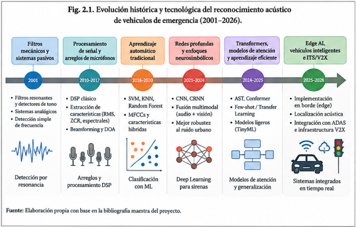

# 2.1.1. Vehículos de emergencia y necesidad de respuesta prioritaria

Los vehículos de emergencia constituyen un componente esencial de los sistemas de atención prehospitalaria, seguridad pública y respuesta ante situaciones críticas. Ambulancias, vehículos de bomberos y unidades policiales requieren desplazarse con prioridad dentro de redes urbanas en las que la congestión, las intersecciones semaforizadas y las condiciones variables de circulación pueden introducir retrasos durante el trayecto hacia el lugar del incidente o hacia los centros de atención. En este contexto, la reducción del tiempo de respuesta constituye una preocupación tanto operativa como de seguridad vial.

La relevancia temporal del desplazamiento de los servicios de emergencia puede observarse en el análisis realizado por Dubois et al. (2026), quienes utilizaron información del Fatality Analysis Reporting System (FARS) correspondiente a accidentes fatales registrados en Estados Unidos entre 1987 y 2020. El estudio analizó 310 001 siniestros con información válida sobre los principales intervalos temporales de respuesta de los servicios médicos de emergencia. Como referencia temporal, los autores emplearon un intervalo total inferior a 60 minutos para caracterizar la denominada golden hour. Durante el periodo estudiado, la mediana del tiempo entre el accidente y la notificación al EMS disminuyó de aproximadamente cinco minutos en 1987 a dos minutos en 2005 y se mantuvo alrededor de ese valor hasta 2020. Sin embargo, el intervalo entre la llegada a la escena y el hospital pasó de 26 minutos en 1987 a 30 minutos en 2003, antes de descender nuevamente hasta 28 minutos en 2020. Estos resultados muestran que las mejoras en la notificación inicial no necesariamente eliminan las dificultades asociadas al desplazamiento posterior del vehículo de emergencia.

Las diferencias territoriales también constituyen un factor relevante. Verma et al. (2023), mediante datos del FARS correspondientes a 2019 y características socioeconómicas de los condados estadounidenses, encontraron diferencias significativas en los tiempos de respuesta de los EMS según el contexto geográfico y socioeconómico. Los tiempos de llegada fueron menores en áreas metropolitanas que en áreas rurales, mientras que los condados con mayores ingresos familiares presentaron tiempos de llegada más cortos. En particular, el estudio reportó que el tiempo de llegada de los EMS fue aproximadamente 12 % menor en los condados con mayor ingreso familiar mediano. Estas conclusiones deben interpretarse dentro del contexto estadounidense y no como valores universales aplicables a cualquier sistema de emergencia.

La literatura sobre gestión inteligente del tránsito complementa esta perspectiva al demostrar que una parte de los retrasos puede abordarse mediante estrategias de priorización en intersecciones. Chen et al. (2024) desarrollaron un sistema de preempción semafórica que considera el desbordamiento de colas y los efectos de la interrupción sobre el tráfico no prioritario, mientras que Bairi et al. (2025) evaluaron mediante simulación SUMO/OMNeT++ un esquema de control basado en VANET y V2I para facilitar el paso de vehículos de emergencia. En este último caso, los autores reportaron una reducción promedio del tiempo de viaje de los vehículos de emergencia del 66,45 % frente a un esquema de control de tiempo fijo, dentro de las condiciones de simulación consideradas.

Por tanto, el dominio del problema no se limita al reconocimiento del vehículo de emergencia. Existe una cadena funcional que comienza con la presencia de una señal de emergencia, continúa con su detección e interpretación y puede culminar en una acción sobre el entorno vial. Esta evolución resulta relevante para el proyecto porque permite considerar el reconocimiento acústico como una fuente de información para sistemas de asistencia y transporte inteligente, en lugar de tratarlo únicamente como un problema aislado de clasificación de audio.

Figura 1. Síntesis conceptual de la evolución de los enfoques de reconocimiento acústico de vehículos de emergencia

| **Periodo** | **Paradigma**                               | **Modelos / técnica**                               | **Principio de inferencia**                       | **Ventaja principal**                               | **Limitación crítica**                            | **Fuentes**                                                                                                           |
|-------------|---------------------------------------------|-----------------------------------------------------|---------------------------------------------------|-----------------------------------------------------|---------------------------------------------------|-----------------------------------------------------------------------------------------------------------------------|
| 2001        | Determinista / analógico                    | Filtros mecánicos resonantes                        | Frecuencias estrechas y umbrales físicos          | Bajo costo y funcionamiento sin ML                  | Rigidez ante variaciones de señal                 | Fragoulis & Avaritsiotis (2001)                                                                                       |
| 2017        | Sensado multicanal                          | Beamforming + arreglo de micrófonos                 | Matriz espectral cruzada y geometría del arreglo  | Mejora de captación y localización                  | Mayor complejidad de hardware                     | Shen et al. (2017)                                                                                                    |
| 2020–2024   | Machine Learning clásico                    | SVM, Random Forest, Stacked Ensemble                | Características diseñadas a mano                  | Interpretabilidad relativa y costo moderado         | Dependencia de la calidad de features             | Jayakumar et al. (2024); Durgun & Durgun (2025)                                                                       |
| 2020–2024   | Deep Learning convolucional                 | CNN sobre audio/espectrogramas                      | Aprendizaje de patrones locales tiempo-frecuencia | Elimina parte del feature engineering manual        | Mayor demanda de datos/cómputo                    | Tran & Tsai (2020); Nanni et al. (2021)                                                                               |
| 2022        | Few-Shot / Metric Learning                  | Redes Prototípicas                                  | Comparación con prototipos de clase               | Adapta con pocos ejemplos                           | Sensibilidad al dominio/captura                   | Cantarini et al. (2022)                                                                                               |
| 2024        | Neurosimbólico / XAI                        | RegEx + representación Log-Mel                      | Patrones simbólicos interpretables                | Auditable y liviano                                 | Cobertura limitada a patrones definidos           | Pacheco et al. (2024)                                                                                                 |
| 2025–2026   | Transfer Learning / Transformers / Atención | AST, E-PANNs/CLAP, Conformer, CBAM-ResNet18         | Representaciones profundas y atención             | Capacidad para escenarios complejos y transferencia | Coste, datos y generalización siguen siendo retos | Banchero et al. (2025); Giacomelli et al. (2026); Moghimi et al. (2026); Rathod et al. (2026)                         |
| 2023–2026   | Edge AI / TinyML                            | EfficientNet, SVM, 1D-CNN+GRU y modelos cuantizados | Inferencia local en hardware restringido          | Baja latencia y operación local                     | Memoria/energía/latencia limitadas                | Chin et al. (2023); Durgun & Durgun (2025); Munirathinam & Vitek (2026); Lamrini et al. (2023)                        |
| 2024–2026   | Multimodal                                  | Audio + visión + fusión                             | Decisión combinada de modalidades                 | Complementar limitaciones sensoriales               | No siempre separa el aporte individual del audio  | Mecocci & Grassi (2024); Zohaib et al. (2024); Ephzibah et al. (2025); Rathod et al. (2026); Kristiawan et al. (2026) |

Tabla 1. Evolución de los paradigmas tecnológicos para el reconocimiento acústico de vehículos de emergencia
