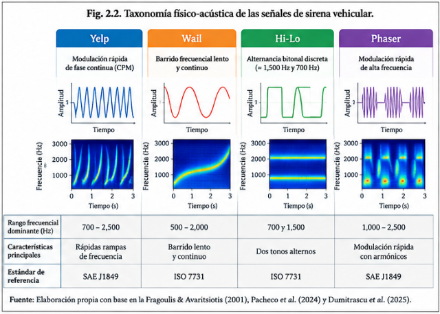

# 2.1.2. Señalización acústica y características de las sirenas de emergencia

La identificación acústica de un vehículo de emergencia se fundamenta en que sus sirenas presentan patrones temporales y espectrales que pueden ser diferenciados de otros sonidos presentes en el entorno vial. A diferencia de un tono estacionario, una sirena puede presentar variaciones de frecuencia y amplitud a lo largo del tiempo, generando una firma acústica cuya estructura puede analizarse mediante herramientas de procesamiento digital de señales.

La literatura revisada identifica distintos patrones de señalización, entre ellos Yelp, Wail, Hi-Lo y Phaser, aunque la denominación y configuración específica pueden variar según el sistema de sirena y el contexto normativo. Pacheco et al. (2024) estudian particularmente el patrón Hi-Lo mediante representaciones de espectrogramas Mel, mientras que Dumitrascu et al. (2025) desarrollan un detector específico para el patrón Yelp. En términos generales, Yelp se caracteriza por una modulación rápida de frecuencia; Wail presenta un barrido de frecuencia más lento y continuo; Hi-Lo alterna entre dos regiones frecuenciales diferenciadas; y Phaser presenta una modulación más compleja. Estas diferencias son relevantes porque determinan qué propiedades temporales y espectrales pueden utilizarse para identificar cada señal.

En particular, Pacheco et al. (2024) emplearon señales Hi-Lo y representaciones Log-Mel para evaluar dos estrategias de detección: una aproximación simbólica y una red neuronal convolucional. El estudio muestra que la transformación del sonido al dominio tiempo-frecuencia permite representar visualmente patrones asociados con la evolución de la frecuencia de la sirena y, posteriormente, utilizarlos como entrada para algoritmos de reconocimiento.

De manera complementaria, Fragoulis & Avaritsiotis (2001) demostraron una aproximación temprana basada en filtros resonantes mecánicos. Su sistema utilizó tres filtros ajustados alrededor de 700, 900 y 1100 Hz y buscaba identificar componentes característicos de la señal de sirena frente al ruido de tráfico. Este trabajo representa un antecedente significativo porque demuestra que la información frecuencial de la sirena puede utilizarse para su detección incluso antes de la incorporación generalizada de técnicas de aprendizaje automático. El cambio posterior hacia técnicas digitales permitió reemplazar configuraciones físicas rígidas por representaciones y algoritmos con mayor capacidad de adaptación.

La tabla de caracterización físico-acústica sintetiza los patrones de modulación relevantes para el reconocimiento. Los valores frecuenciales se interpretan como ejemplos asociados a una configuración o fuente específica, cuando están documentados, y no como constantes universales de cada patrón de sirena.

Figura 2. Evolución de las representaciones y características acústicas empleadas en la detección

| **Tipo** | **Patrón de modulación reportado**                                                      | **Caracterización frecuencial**                                                                                                                       | **Firma útil para reconocimiento**                                         | **Fuentes**                                         | **Alcance / precaución**                                                        |
|----------|-----------------------------------------------------------------------------------------|-------------------------------------------------------------------------------------------------------------------------------------------------------|----------------------------------------------------------------------------|-----------------------------------------------------|---------------------------------------------------------------------------------|
| Yelp     | Modulación rápida; la literatura la describe con modulación de fase/frecuencia continua | No consolidar un único rango universal; utilizar el rango sólo cuando la fuente lo explicite                                                          | Patrón no estacionario apto para seguimiento de la trayectoria frecuencial | Dobre & Dumitrascu (2024); Dumitrascu et al. (2025) | Los parámetros exactos dependen de la señal/protocolo estudiado                 |
| Wail     | Barrido frecuencial lento y continuo                                                    | No especificado de forma uniforme en el corpus congelado                                                                                              | Variación gradual de la frecuencia fundamental                             | Pacheco et al. (2024); Dumitrascu et al. (2025)     | No extrapolar un rango único a todas las sirenas                                |
| Hi-Lo    | Alternancia bitonal entre dos tonos discretos                                           | Dos regiones tonales alternantes; los valores concretos dependen de la configuración de la sirena y deben verificarse en la señal o fuente utilizada. | Firma temporal discreta y fácilmente distinguible en espectrograma         | Pacheco et al. (2024)                               | El valor corresponde a la configuración reportada, no a una constante universal |
| Phaser   | Modulación rápida y compleja; identificada como patrón en la literatura consultada      | No consolidado en el corpus verificado                                                                                                                | Mayor complejidad de modulación y contenido armónico                       | Pacheco et al. (2024); Dumitrascu et al. (2025)     | La evidencia disponible es principalmente taxonómica                            |

Tabla 2. Caracterización físico-acústica de las principales señales de sirena vehicular
