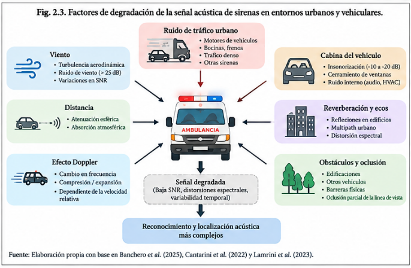

# 2.1.4. Degradación de la señal acústica en entornos urbanos y vehiculares

Entre la emisión de una sirena y su captura por un sistema automático existe un canal acústico sometido a múltiples perturbaciones. El tráfico, el viento, la distancia, las superficies reflectantes, el movimiento relativo entre la fuente y el receptor y las características del vehículo receptor pueden alterar la relación señal-ruido y modificar la estructura espectral de la señal.

Uno de los factores particularmente relevantes en aplicaciones embarcadas es el ruido aerodinámico. Banchero et al. (2025) estudiaron un sistema montado sobre un vehículo en movimiento y analizaron las dificultades de captación provocadas por el flujo de aire sobre los micrófonos externos. Su propuesta incorpora una estructura aerodinámica para disminuir el ruido del viento y las vibraciones antes de procesar la señal mediante modelos de inteligencia artificial. El sistema alcanzó una exactitud de detección de 98,86 % con datos simulados y 97,5 % durante mediciones realizadas en carretera, mostrando la diferencia entre un escenario controlado y un entorno dinámico real.

Otro factor es la propagación multicamino. En ambientes urbanos, las superficies de edificios, vehículos y otras estructuras pueden producir reflexiones que generan copias retardadas de la señal original. Furletov et al. (2026). desarrollaron y probaron en campo una unidad acústica para cruces inteligentes basada en cuatro micrófonos y algoritmos GCC-PHAT, precisamente con el objetivo de realizar localización acústica en condiciones urbanas y sin depender de visibilidad directa. Este tipo de infraestructura evidencia que la acústica puede aportar información incluso en configuraciones donde las cámaras u otros sensores basados en línea de visión pueden presentar limitaciones.

El efecto Doppler constituye otro fenómeno que debe considerarse cuando la fuente sonora y el receptor presentan movimiento relativo. La frecuencia percibida puede desplazarse respecto de la frecuencia emitida, por lo que un patrón de sirena observado por un receptor en movimiento no necesariamente coincide exactamente con el patrón registrado en condiciones estáticas. Jayakumar et al. (2024), por ejemplo, incorporaron transformaciones relacionadas con Doppler en su estrategia de aumento de datos para representar condiciones más próximas a un escenario vehicular.

A estos fenómenos se añaden la distancia y la atenuación de la señal, el ruido producido por motores y neumáticos, las bocinas, las condiciones meteorológicas y las estructuras físicas que pueden interponerse entre la fuente y el receptor. En conjunto, estos factores producen una señal más variable y menos separable que la disponible en una grabación limpia de laboratorio.

Figura 3. Factores del entorno urbano y vehicular que pueden modificar la captura acústica de una sirena.
