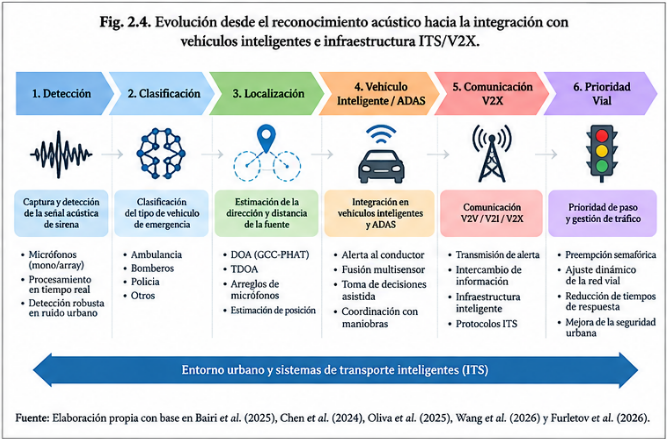

# 2.1.8. Integración con vehículos inteligentes, ADAS e ITS/V2X

La evolución del dominio conduce progresivamente desde el reconocimiento aislado de sonidos hacia sistemas de percepción integrados. En aplicaciones automotrices, la salida del detector acústico puede utilizarse para informar al conductor sobre la presencia y dirección de un vehículo de emergencia o combinarse con otras fuentes de percepción.

Banchero et al. (2025) plantean precisamente un sistema de detección y localización acústica orientado a aplicaciones de asistencia a la conducción. El sistema procesa ventanas de audio de manera continua y utiliza la información obtenida para representar al conductor la dirección, proximidad y trayectoria asociadas con sonidos de emergencia. Esto sitúa al reconocimiento acústico dentro del contexto más amplio de los Sistemas Avanzados de Asistencia al Conductor (ADAS).

La integración también puede producirse mediante fusión multimodal. Kristiawan et al. (2026), por ejemplo, combinaron un detector visual YOLOv5 con un analizador acústico basado en MFE ejecutado sobre un ESP32-S3. En una evaluación de campo de 11 días y 1 380 eventos, la confirmación mediante ambas modalidades redujo los falsos positivos reportados de 900 a 0; el sistema obtuvo una precisión de 100 %, especificidad de 100 %, recall de 87,1 % y exactitud de 99,4 %. Este resultado permite observar un compromiso importante: una regla de confirmación estricta puede reducir fuertemente los falsos positivos, pero la sensibilidad puede disminuir cuando una de las modalidades no detecta el evento.

Más allá del vehículo individual, la información obtenida por un detector puede utilizarse dentro de un Sistema Inteligente de Transporte (ITS). Las comunicaciones V2I y V2V permiten transmitir información entre vehículos e infraestructura para modificar dinámicamente el comportamiento de la red. Chen et al. (2024) desarrollaron un sistema de preempción semafórica que considera las colas generadas alrededor de la ruta del vehículo de emergencia y busca reducir los efectos negativos sobre el tráfico no prioritario.

En esta misma línea, Oliva et al. (2025) implementaron y probaron estrategias V2I para la prioridad de vehículos de emergencia y la seguridad de peatones en intersecciones inteligentes de Lioni, Italia. El estudio demuestra la transición desde conceptos de comunicación vehicular hacia escenarios de prueba en infraestructura real.

Por otro lado, Wang et al. (2026) propusieron CEVPDS, un esquema cooperativo de prioridad para vehículos de emergencia mediante comunicaciones V2X. Su planteamiento busca coordinar anticipadamente las maniobras de vehículos convencionales para facilitar el desplazamiento del vehículo de emergencia.

Figura 4. Posibles etapas de integración de la percepción acústica con sistemas vehiculares e infraestructura inteligente.

| **Año** | **Estudio**     | **Tecnología / comunicación**               | **Mecanismo de integración**                        | **Contexto de evaluación**                         | **Aporte al dominio**                                                       | **Limitación / alcance**                                             | **Fuente**                                  |
|---------|-----------------|---------------------------------------------|-----------------------------------------------------|----------------------------------------------------|-----------------------------------------------------------------------------|----------------------------------------------------------------------|---------------------------------------------|
| 2013    | Wang et al.     | CVIS / cooperativo vehículo–infraestructura | Preempción semafórica                               | Dos intersecciones de Taicang (China)              | Demuestra viabilidad de priorización mediante comunicación V-I              | No integra detección acústica                                        | https://doi.org/10.1155/2013/834976         |
| 2018    | Mu et al.       | Control de preempción basado en ruta        | Optimización de señales por recorrido               | Simulación/control de tráfico                      | Reduce retrasos y considera eficiencia de evacuación                        | Evaluación predominantemente de simulación                           | https://doi.org/10.1155/2018/1024382        |
| 2022    | Zhong & Chen    | Control de señales en tiempo real           | Preempción y recuperación de temporización          | Simulación de tráfico                              | Evalúa mejoras del tiempo de viaje del vehículo prioritario                 | No utiliza percepción acústica                                       | https://doi.org/10.1109/ACCESS.2022.3149920 |
| 2023    | Arikumar et al. | V2X                                         | Sistema de advertencia para vehículos de emergencia | Comunicación vehicular                             | Extiende la advertencia desde percepción local hacia la red                 | No es un detector acústico puro                                      | https://doi.org/10.3390/app13031950         |
| 2024    | Chen et al.     | IET ITS / preempción                        | Control considerando queue spillbacks               | Modelado/comparación de estrategias                | Introduce el efecto del tráfico no prioritario en la preempción             | No aborda la detección acústica                                      | https://doi.org/10.1049/itr2.12518          |
| 2025    | Oliva et al.    | V2I / C-ITS                                 | Priorización y seguridad peatonal                   | Ensayos de campo en Italia                         | Demuestra intercambio V2I en un entorno urbano real                         | El componente de percepción acústica no forma parte del estudio      | https://doi.org/10.3390/s25020485           |
| 2025    | Bairi et al.    | VANET / V2I                                 | Control dinámico del semáforo                       | Modelado y control inteligente                     | Conecta comunicaciones vehiculares con prioridad de emergencia              | Centrado en control y comunicaciones                                 | https://doi.org/10.1016/j.eij.2025.100700   |
| 2025    | Ibraheem et al. | Deep Learning + sincronización de señales   | Control inteligente de semáforos                    | Evaluación computacional                           | Integra percepción y sincronización para priorización                       | La fuente no representa detección acústica pura                      | https://doi.org/10.1109/ACCESS.2025.3644805 |
| 2025    | Ahmad et al.    | Connected emergency vehicles                | Estrategias de control de tráfico                   | Modelado/algoritmos de control                     | Equilibra reducción del tiempo de viaje y efectos sobre el flujo            | Mecanismo de percepción no acústico                                  | https://doi.org/10.1109/TITS.2024.3484771   |
| 2026    | Wang et al.     | V2X cooperativo                             | Prioridad de conducción y cambios de carril         | Esquema cooperativo                                | Muestra la transición de la alerta a decisiones cooperativas de circulación | Comunicación/control, no clasificación acústica                      | https://doi.org/10.3390/sym18020331         |
| 2026    | Furletov et al. | V2X + sensor acústico                       | Localización pasiva mediante GCC-PHAT               | Smart crossroads / escenarios urbanos y climáticos | Integra sensing acústico con infraestructura V2X                            | La precisión depende de ruido, reverberación y geometría del arreglo | https://doi.org/10.3390/smartcities9010017  |

Tabla 5. Evolución de la integración del reconocimiento acústico con sistemas ITS/V2X
