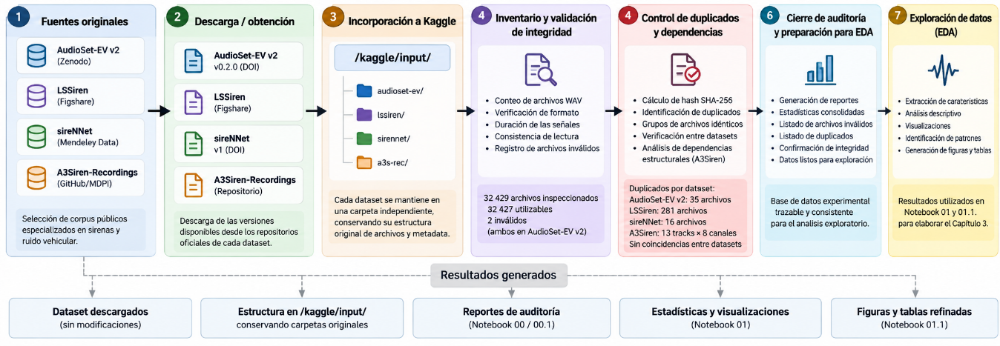

# 3.2.2. Incorporación de los datos al entorno experimental

Una vez obtenidas las fuentes, los archivos fueron incorporados al entorno de experimentación de Kaggle, utilizado como plataforma de ejecución para las etapas de auditoría y análisis exploratorio del proyecto. Cada dataset se mantuvo inicialmente como una fuente independiente, evitando la combinación prematura de los archivos y conservando su estructura original.

Dentro de estas estructuras se conservaron tanto los archivos de audio como los elementos de metadata disponibles. En AudioSet-EV v2 se mantuvieron las carpetas Positive_files y Negative_files junto con EV_Positives.csv y EV_Negatives.csv; en LSSiren se conservaron las carpetas Emergency Vehicle Sirens y Road Noises junto con Ambulance_final.csv y Road_final.csv; en sireNNet se mantuvieron las carpetas correspondientes a ambulance, firetruck, police y traffic; y A3Siren-Recordings fue incorporado conservando su organización por canales y grupos de grabación.

Figura 5. Flujo de adquisición, incorporación y validación de los datasets
