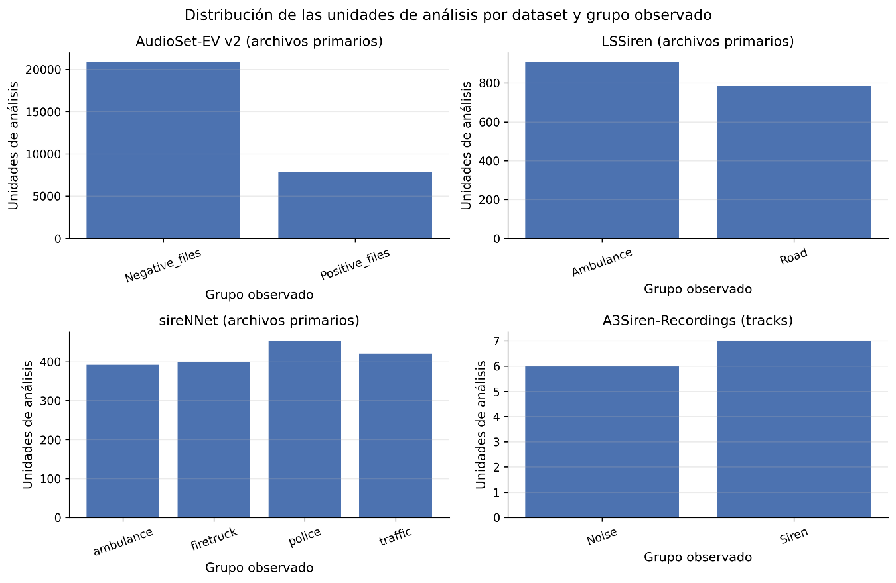

# 3.3.2. Distribución de las unidades de análisis

La exploración inicial mostró diferencias considerables en la escala de los corpus. AudioSet-EV v2 constituye la colección de mayor tamaño, con 28 816 archivos físicos, de los cuales 28 814 fueron utilizables; LSSiren contiene 1 834 archivos válidos; sireNNet contiene 1 675 archivos válidos; y A3Siren-Recordings contiene 104 archivos físicos. Sin embargo, en este último corpus los 104 archivos no representan 104 observaciones independientes, sino 13 tomas registradas mediante ocho canales cada una, por lo que la unidad lógica de análisis se estableció como el track.

En AudioSet-EV v2 se observaron 7 900 archivos en Positive_files y 20 916 en Negative_files. LSSiren presentó 932 archivos correspondientes a Ambulance y 902 a Road, mientras que sireNNet mantuvo cuatro grupos claramente diferenciados: 400 archivos de ambulance, 400 de firetruck, 454 de police y 421 de traffic. En A3Siren-Recordings, las 13 tomas se distribuyen en siete tracks Siren y seis Noise, con ocho canales asociados a cada toma.

Figura 6. Distribución de las unidades de análisis por dataset y grupo observado.
