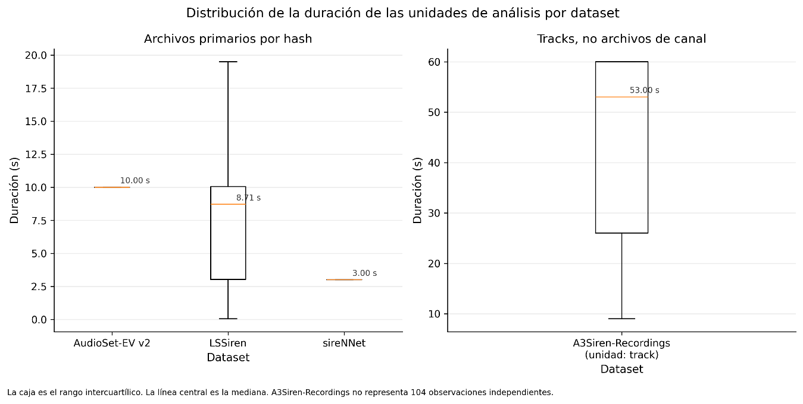

# 3.3.3. Distribución de la duración de las señales

La duración constituye una de las principales diferencias estructurales identificadas durante la exploración. En AudioSet-EV v2, los archivos utilizables presentan una duración muy concentrada alrededor de los 10 segundos: la mediana y los percentiles centrales se sitúan en 10 segundos y 21 382 archivos tienen exactamente esa duración. En LSSiren se observa una variabilidad considerablemente mayor, con una mediana de aproximadamente 8,73 segundos, un mínimo de 0,05 segundos y un máximo de 28,54 segundos. En sireNNet, las cuatro clases presentan una duración prácticamente fija alrededor de 3 segundos.

A3Siren-Recordings presenta una estructura temporal diferente. Debido a que su unidad lógica corresponde al track, las grabaciones presentan una duración mucho mayor, con una mediana de 53 segundos y valores que van aproximadamente de 9 a 60 segundos.

Estas diferencias indican que los corpus no utilizan una unidad temporal homogénea. Mientras algunos recursos proporcionan segmentos cortos y relativamente uniformes, otros conservan grabaciones de mayor duración que contienen eventos acústicos dentro de una secuencia temporal más extensa. Esta característica es relevante para la posterior preparación de los datos, aunque en esta etapa no se realizó ninguna segmentación ni modificación de la duración original.

Figura 7. Distribución de la duración de las unidades de análisis por dataset.

| **Dataset**        | **Grupo observado** | **Unidades resumidas** | **Mín. (s)** | **Mediana (s)** | **Media (s)** | **Máx. (s)** | **IQR (s)** |
|--------------------|---------------------|------------------------|--------------|-----------------|---------------|--------------|-------------|
| AudioSet-EV v2     | Negative_files      | 20 898                 | 0.975        | 10.000          | 9.928         | 10.011       | 0.000       |
| AudioSet-EV v2     | Positive_files      | 7 896                  | 1.000        | 10.000          | 9.844         | 10.010       | 0.000       |
| LSSiren            | Ambulance           | 910                    | 0.050        | 7.071           | 6.719         | 19.499       | 6.663       |
| LSSiren            | Road                | 783                    | 0.720        | 9.401           | 8.863         | 28.544       | 2.730       |
| sireNNet           | ambulance           | 392                    | 3.000        | 3.000           | 3.002         | 3.019        | 0.000       |
| sireNNet           | firetruck           | 400                    | 3.000        | 3.000           | 3.002         | 3.008        | 0.002       |
| sireNNet           | police              | 454                    | 3.000        | 3.000           | 3.000         | 3.000        | 0.000       |
| sireNNet           | traffic             | 421                    | 3.000        | 3.000           | 3.000         | 3.000        | 0.000       |
| A3Siren-Recordings | Noise               | 6                      | 60.000       | 60.000          | 60.000        | 60.000       | 0.000       |
| A3Siren-Recordings | Siren               | 7                      | 9.000        | 26.000          | 28.500        | 53.000       | 20.750      |

Tabla 9. Características temporales de las unidades analizadas.
