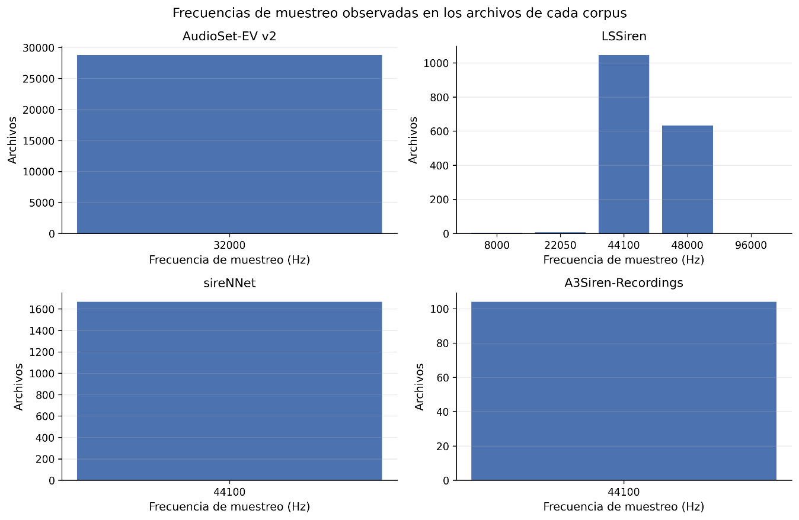

# 3.3.4. Frecuencia de muestreo y configuración de canales

La exploración también reveló diferencias importantes en las características técnicas de las señales. AudioSet-EV v2 presenta una estructura homogénea: los 28 814 archivos utilizables fueron registrados a 32 kHz y en un solo canal. De forma similar, los 1 675 archivos de sireNNet se encuentran a 44,1 kHz y en estéreo, mientras que los 104 archivos físicos de A3Siren-Recordings presentan 44,1 kHz, aunque cada archivo individual corresponde a un canal mono perteneciente a una estructura multicanal de ocho canales por track.

LSSiren, en contraste, presenta una heterogeneidad técnica considerable. Se identificaron cinco frecuencias de muestreo: 8 kHz, 22,05 kHz, 44,1 kHz, 48 kHz y 96 kHz. La mayor parte de los archivos se encuentra a 44,1 kHz, seguida por 48 kHz, pero también existen registros en las otras tres tasas. Asimismo, el corpus contiene tanto archivos mono como estéreo.

Desde el punto de vista exploratorio, esta heterogeneidad constituye una característica relevante del corpus. Una frecuencia de muestreo diferente modifica la frecuencia máxima representable por la señal y, por tanto, condiciona la interpretación directa de algunas variables espectrales. Por esta razón, las comparaciones posteriores entre corpus se realizaron manteniendo explícita la frecuencia de muestreo de cada fuente y sin realizar remuestreo durante esta etapa. La notebook de EDA señala específicamente que, en LSSiren, el límite de Nyquist varía entre archivos, por lo que una magnitud espectral expresada en hertz no debe interpretarse automáticamente como equivalente entre todas las tasas.

Figura 8. Frecuencias de muestreo observadas en los archivos de cada corpus.
