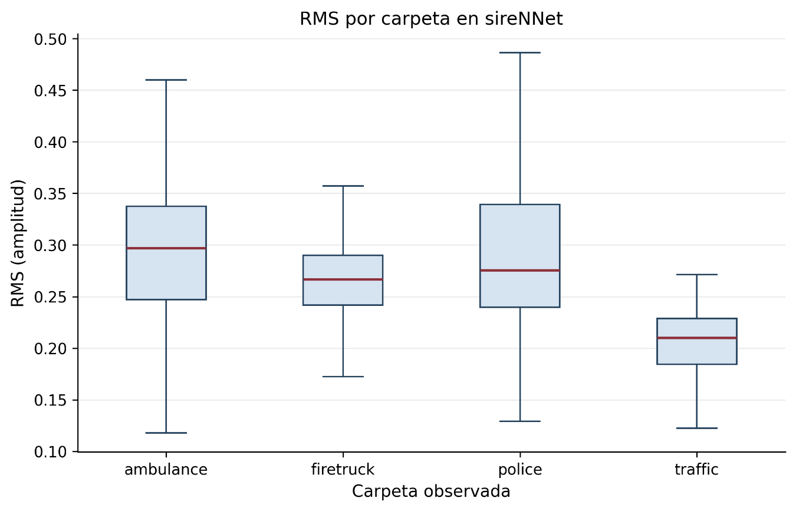

# 3.4.1. Variables temporales y energéticas

Las primeras variables consideradas fueron aquellas relacionadas con la amplitud y el comportamiento temporal de las señales. Entre ellas se incluyeron la amplitud RMS (Root Mean Square), la amplitud pico, el factor de cresta, la proporción de clipping y la proporción de silencio. Complementariamente, se analizó la tasa de cruces por cero (Zero-Crossing Rate, ZCR) como descriptor del comportamiento temporal de la señal. En esta etapa estos indicadores se utilizaron con fines descriptivos para observar diferencias entre grupos, sin utilizarlos como reglas de clasificación.

La amplitud RMS presentó diferencias descriptivas entre varios grupos de la muestra acústica. En AudioSet-EV v2 se reportaron medianas de 0,1040 para Negative_files y 0,1467 para Positive_files; en LSSiren, 0,0650 para Road y 0,2040 para Ambulance; y en sireNNet, 0,2970 para ambulance, 0,2666 para firetruck, 0,2757 para police y 0,2100 para traffic. Para A3Siren-Recordings se consignaron 0,0052 para Noise y 0,0104 para Siren. La tabla correspondiente contiene 48 y 56 observaciones de canal para esas categorías; el procedimiento de agregación por track debe comprobarse antes de atribuir esos valores a una población de tomas independientes.

Estos resultados muestran que la energía de la señal presenta diferencias descriptivas entre algunos de los grupos analizados. Sin embargo, la magnitud de estas diferencias no debe interpretarse aisladamente, ya que las distribuciones mantienen distintos grados de dispersión y solapamiento. En consecuencia, el RMS constituye un descriptor útil para caracterizar el comportamiento energético de las señales, pero no se establece a partir de este análisis como una variable suficiente para discriminar por sí sola las categorías.

Figura 9. Distribución de RMS por clase en sireNNet.

| **Dataset**        | **Grupo**      | **Observaciones de audio** | **RMS mediana** | **Pico mediano** | **Crest factor med.** | **Clipping med.** | **Silencio med.** |
|--------------------|----------------|----------------------------|-----------------|------------------|-----------------------|-------------------|-------------------|
| A3Siren-Recordings | Noise          | 48                         | 0.0052          | 0.0497           | 5.804                 | 0.00000           | 0.5705            |
| A3Siren-Recordings | Siren          | 56                         | 0.0104          | 0.0789           | 6.671                 | 0.00000           | 0.2605            |
| AudioSet-EV v2     | Negative_files | 200                        | 0.1040          | 0.8129           | 6.161                 | 0.00000           | 0.0554            |
| AudioSet-EV v2     | Positive_files | 200                        | 0.1467          | 0.7607           | 4.539                 | 0.00000           | 0.0251            |
| LSSiren            | Ambulance      | 200                        | 0.2040          | 0.7620           | 3.656                 | 0.00000           | 0.0157            |
| LSSiren            | Road           | 200                        | 0.0650          | 0.4089           | 6.111                 | 0.00000           | 0.0564            |
| sireNNet           | ambulance      | 150                        | 0.2970          | 0.9911           | 3.306                 | 0.00000           | 0.0085            |
| sireNNet           | firetruck      | 150                        | 0.2666          | 0.9999           | 3.624                 | 0.00001           | 0.0095            |
| sireNNet           | police         | 150                        | 0.2757          | 0.9915           | 3.450                 | 0.00000           | 0.0088            |
| sireNNet           | traffic        | 150                        | 0.2100          | 0.9999           | 4.593                 | 0.00001           | 0.0123            |

Tabla 10. Características energéticas de las señales analizadas
