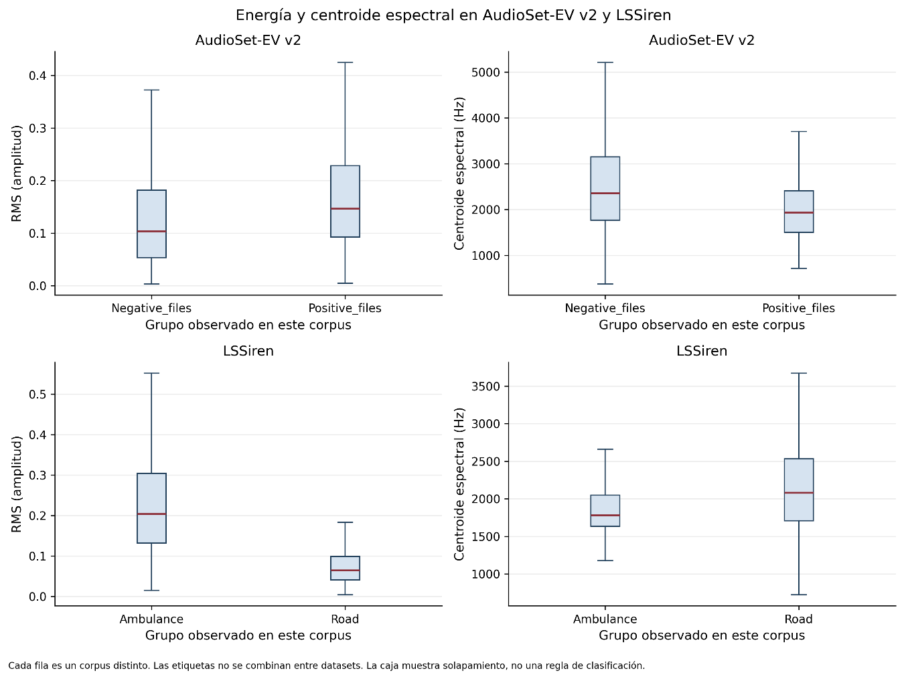

# 3.4.3. Características frecuenciales

El segundo grupo de variables corresponde al dominio frecuencial. Se analizaron la frecuencia dominante, el centroide espectral, el ancho de banda espectral, el roll-off espectral, el flujo espectral y la planitud espectral. El cálculo se realizó a partir de representaciones espectrales obtenidas con una FFT de 2048 puntos, salto de 512 muestras y ventana Hann. El roll-off se calculó al 85 % de la energía acumulada.

La frecuencia dominante se definió como el bin de mayor magnitud media, excluyendo la componente de corriente continua. El análisis se planteó únicamente como descriptor de la distribución energética del espectro; no se interpretó como una identificación directa del tipo de sirena.

A nivel agregado, las medianas observadas en la muestra fueron aproximadamente 43,1 Hz para A3Siren-Recordings, 343,8 Hz para AudioSet-EV v2, 107,7 Hz para LSSiren y 775,2 Hz para sireNNet. El centroide espectral presentó medianas de 1665,1 Hz, 2109,7 Hz, 1894,7 Hz y 2329,2 Hz, respectivamente. El ancho de banda mediano fue de 3970,0 Hz, 2194,0 Hz, 2545,4 Hz y 2700,6 Hz, mientras que el roll-off presentó medianas de 1729,0 Hz, 3969,7 Hz, 3195,5 Hz y 4023,5 Hz, respectivamente.

Los hertz conservan la misma unidad física entre corpus. Sin embargo, el ancho de banda disponible, la resolución frecuencial y la ventana temporal de análisis cambian cuando se utiliza la misma FFT y el mismo salto en muestras con frecuencias de muestreo distintas. Por ello, los descriptores calculados antes de armonizar las señales pueden presentar diferencias asociadas a la configuración técnica, además de las relacionadas con el contenido acústico.

Figura 10. Energía y centroide espectral en AudioSet-EV v2 y LSSiren.
