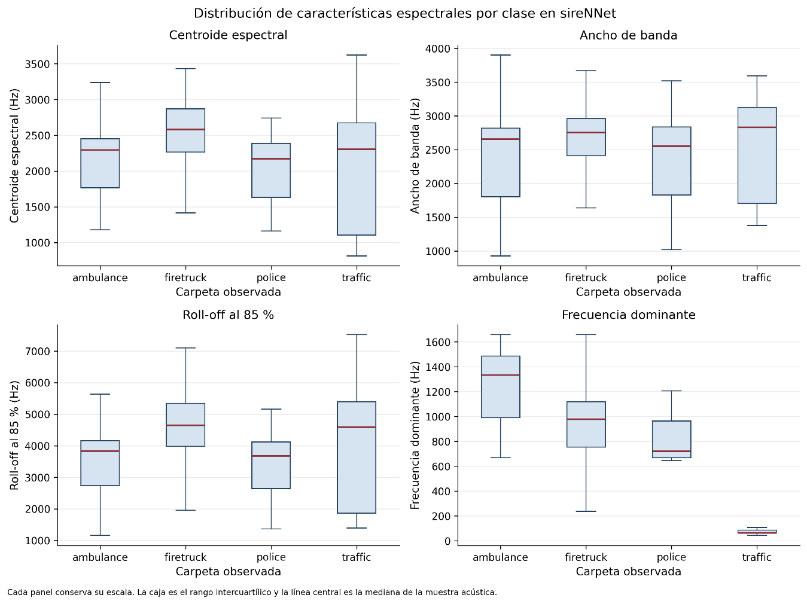

# 3.4.4. Comparación de características espectrales en sireNNet

El corpus sireNNet permite realizar un análisis más detallado debido a que proporciona cuatro grupos estructurados de manera uniforme: ambulance, firetruck, police y traffic. Para cada grupo se analizaron la frecuencia dominante, el centroide espectral, el ancho de banda y el roll-off, además del flujo espectral.

En la muestra de 150 observaciones por clase, la frecuencia dominante presentó medianas de 1335,1 Hz para ambulance, 979,8 Hz para firetruck, 721,4 Hz para police y 64,6 Hz para traffic. El centroide espectral presentó medianas de 2295,8 Hz, 2583,6 Hz, 2175,4 Hz y 2305,1 Hz, respectivamente. El ancho de banda fue de 2658,9 Hz, 2754,2 Hz, 2553,0 Hz y 2830,7 Hz, mientras que el roll-off al 85 % fue de 3835,3 Hz, 4652,4 Hz, 3681,7 Hz y 4592,4 Hz.

La comparación entre clases muestra que no todas las variables presentan el mismo comportamiento. Por ejemplo, la frecuencia dominante presenta diferencias particularmente marcadas entre algunos grupos, mientras que el centroide espectral presenta mayor similitud entre determinados pares. La evaluación descriptiva realizada por la Notebook 01 encontró que el centroide presenta diferenciación parcial entre ambulance y firetruck, solapamiento considerable entre ambulance y police, diferencias con solapamiento entre ambulance y traffic, y distintos grados de solapamiento en los demás pares.

Esto indica que la variabilidad acústica no queda representada de manera uniforme por un único descriptor. Las variables espectrales muestran comportamientos complementarios y distintos niveles de dispersión, lo que justifica examinarlas conjuntamente durante las etapas posteriores.

Figura 11. Distribución de características espectrales por clase en sireNNet.

| **Clase** | **n** | **Duración med. (s)** | **RMS mediana** | **ZCR mediana** | **Frec. dom. med. (Hz)** | **Centroide med. (Hz)** | **Bandwidth med. (Hz)** | **Roll-off med. (Hz)** | **Flux med.** |
|-----------|-------|-----------------------|-----------------|-----------------|--------------------------|-------------------------|-------------------------|------------------------|---------------|
| ambulance | 150   | 3.000                 | 0.2970          | 0.0627          | 1335.1                   | 2295.8                  | 2658.9                  | 3835.3                 | 0.0493        |
| firetruck | 150   | 3.000                 | 0.2666          | 0.0709          | 979.8                    | 2583.6                  | 2754.2                  | 4652.4                 | 0.0383        |
| police    | 150   | 3.000                 | 0.2757          | 0.0502          | 721.4                    | 2175.4                  | 2553.0                  | 3681.7                 | 0.0504        |
| traffic   | 150   | 3.000                 | 0.2100          | 0.0426          | 64.6                     | 2305.1                  | 2830.7                  | 4592.4                 | 0.0519        |

Tabla 11. Características acústicas descriptivas por clase en sireNNet
