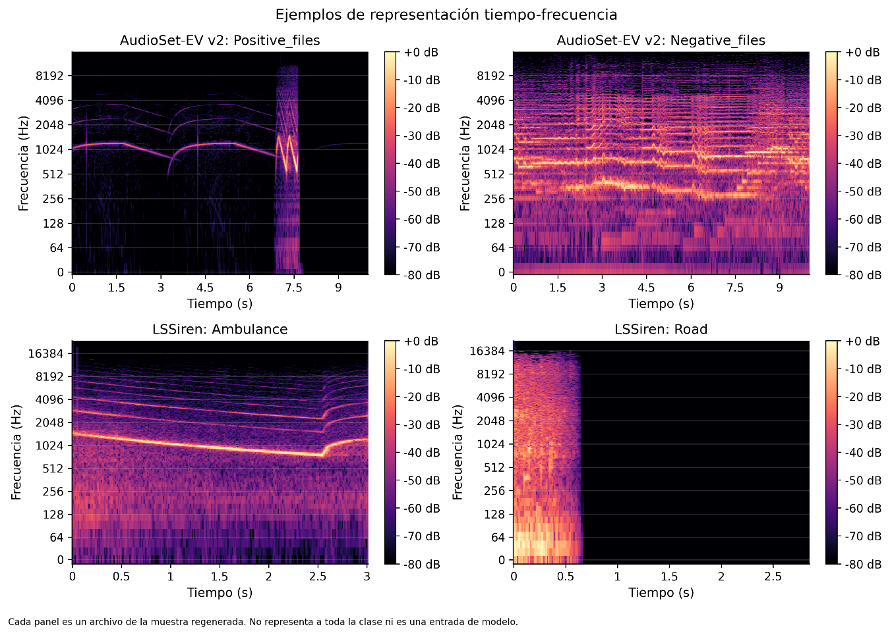

# 3.4.5. Representaciones tiempo-frecuencia

Además de los descriptores calculados directamente sobre la señal, se exploraron representaciones tiempo-frecuencia con el objetivo de observar visualmente la distribución de la energía en función del tiempo y la frecuencia. Se utilizaron espectrogramas obtenidos mediante STFT, así como representaciones Mel y Log-Mel. Estos análisis permitieron complementar la información proporcionada por los estadísticos escalares con una representación visual de la estructura acústica de las señales.

Los espectrogramas de AudioSet-EV v2 muestran, en el ejemplo positivo seleccionado, componentes organizadas en bandas que evolucionan temporalmente, mientras que el ejemplo negativo presenta una distribución más amplia y diferente del contenido espectral. En LSSiren, el ejemplo de Ambulance muestra estructuras espectrales sostenidas y variables a lo largo del tiempo, mientras que el ejemplo de Road presenta una distribución temporal distinta.

Estas representaciones permiten identificar visualmente patrones que no necesariamente quedan resumidos mediante una única estadística espectral. Sin embargo, los ejemplos mostrados corresponden a archivos individuales seleccionados de manera reproducible y, por tanto, no deben interpretarse como representación exhaustiva de las respectivas poblaciones. Asimismo, en esta etapa los espectrogramas y representaciones Log-Mel se utilizan únicamente con fines exploratorios y no como entradas definitivas de un modelo.

Figura 12. Ejemplos de representación tiempo-frecuencia de las señales analizadas.
