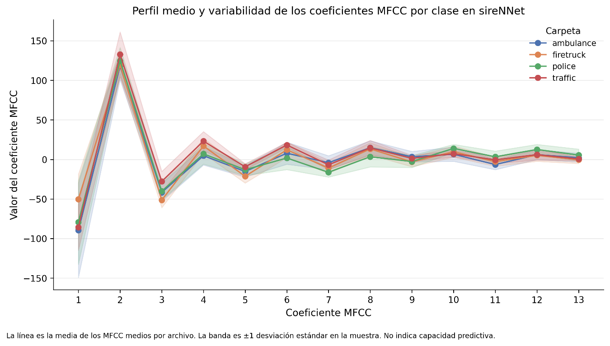

# 3.4.6. Coeficientes cepstrales Mel (MFCC)

Los Mel-Frequency Cepstral Coefficients (MFCC) fueron explorados como una representación compacta de la estructura espectral de las señales. En la notebook se utilizaron 13 coeficientes, calculados sobre la representación Mel con 64 bandas y los parámetros espectrales establecidos para el EDA.

En sireNNet, los perfiles medios de los 13 MFCC muestran comportamientos similares en algunos coeficientes y diferencias más evidentes en otros. La representación refinada incorpora además una banda de ±1 desviación estándar, permitiendo observar simultáneamente la posición media y la variabilidad de cada coeficiente entre las cuatro clases.

Este comportamiento resulta relevante desde el punto de vista exploratorio porque demuestra que una representación cepstral contiene variación asociada a las diferentes categorías observadas. No obstante, las bandas de dispersión también muestran que las clases no presentan perfiles completamente independientes y que existe variabilidad intraclase. Por ello, los MFCC se mantienen como variables candidatas para análisis posterior, pero no se establece en este punto que los 13 coeficientes deban incorporarse íntegramente al modelo.

Figura 13. Perfil medio y variabilidad de los coeficientes MFCC por clase en sireNNet.
