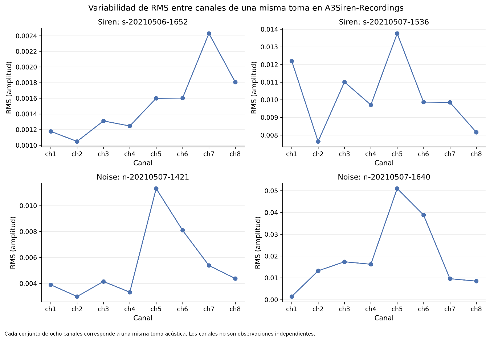

# 3.4.7. Variabilidad multicanal de A3Siren-Recordings

A3Siren-Recordings requiere un análisis específico debido a su estructura de captura. Las 13 tomas del corpus fueron registradas mediante ocho canales, dando lugar a 104 archivos WAV, pero los ocho archivos correspondientes a un mismo track representan una única toma acústica observada desde diferentes canales. Por esta razón, la exploración de este corpus se realizó preservando la relación track–canal.

El análisis de RMS por canal muestra que una misma toma puede presentar variaciones importantes entre ch1 y ch8. En la figura correspondiente se observan diferencias de amplitud entre canales tanto para señales Siren como para señales Noise. El resultado es consistente con la estructura del corpus y demuestra que la representación de una misma señal depende del canal utilizado para su captura.

Este comportamiento tiene una consecuencia metodológica importante: los canales no deben interpretarse como observaciones independientes. La unidad lógica de independencia debe mantenerse a nivel de track, aspecto que será necesario preservar en las posteriores particiones experimentales.

Figura 14. Variabilidad de RMS entre canales de una misma toma en A3Siren-Recordings.
