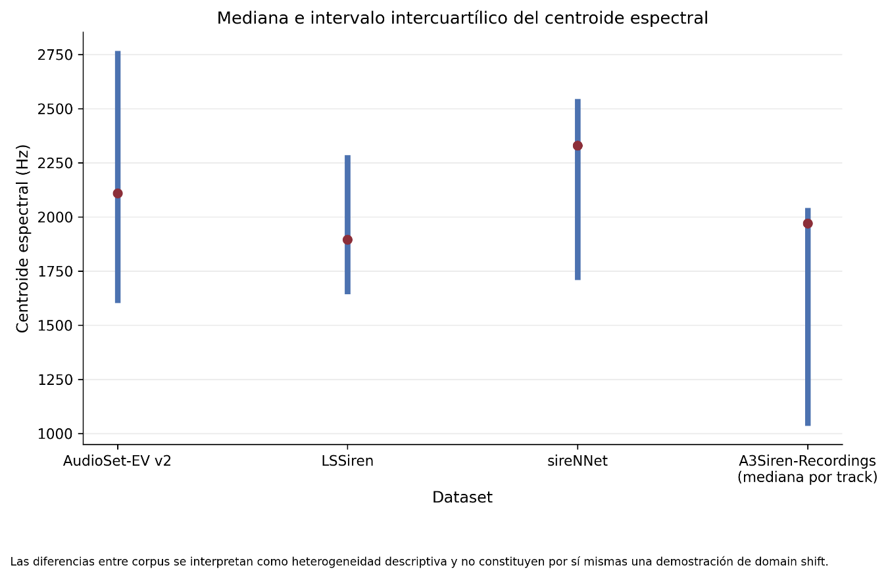

# 3.4.8. Comparación de las características acústicas entre corpus

Una comparación consolidada de los principales descriptores muestra diferencias entre los perfiles acústicos de los cuatro corpus. La muestra utilizada presenta medianas de RMS de 0,0081 para A3Siren-Recordings, 0,1294 para AudioSet-EV v2, 0,1200 para LSSiren y 0,2572 para sireNNet. Para ZCR, las medianas fueron 0,0143, 0,0764, 0,0477 y 0,0601, respectivamente. Asimismo, el centroide espectral presentó medianas de 1665,1 Hz, 2109,7 Hz, 1894,7 Hz y 2329,2 Hz en esos mismos corpus.

Las diferencias observadas deben interpretarse como heterogeneidad descriptiva entre corpus, ya que los datasets poseen diferentes propiedades técnicas y temporales. En particular, las distintas frecuencias de muestreo de LSSiren limitan la equivalencia directa de algunas variables expresadas en hertz, mientras que A3Siren presenta una estructura multicanal y unidades temporales mucho mayores. Por ello, esta comparación no se empleó para establecer una equivalencia entre las distribuciones ni para demostrar por sí sola la existencia de domain shift.

Figura 15. Mediana e intervalo intercuartílico del centroide espectral por dataset.

| **Dataset**        | **Observaciones de audio incluidas** | **Duración med. (s)** | **RMS mediana** | **ZCR mediana** | **Frec. dom. med. (Hz)** | **Centroide med. (Hz)** | **Bandwidth med. (Hz)** | **Roll-off med. (Hz)** |
|--------------------|--------------------------------------|-----------------------|-----------------|-----------------|--------------------------|-------------------------|-------------------------|------------------------|
| A3Siren-Recordings | 104                                  | 53.00                 | 0.0081          | 0.0143          | 43.1                     | 1665.1                  | 3970.0                  | 1729.0                 |
| AudioSet-EV v2     | 400                                  | 10.00                 | 0.1294          | 0.0764          | 343.8                    | 2109.7                  | 2194.0                  | 3969.7                 |
| LSSiren            | 400                                  | 8.75                  | 0.1200          | 0.0477          | 107.7                    | 1894.7                  | 2545.4                  | 3195.5                 |
| sireNNet           | 600                                  | 3.00                  | 0.2572          | 0.0601          | 775.2                    | 2329.2                  | 2700.6                  | 4023.5                 |

Tabla 12. Características acústicas consolidadas por corpus
