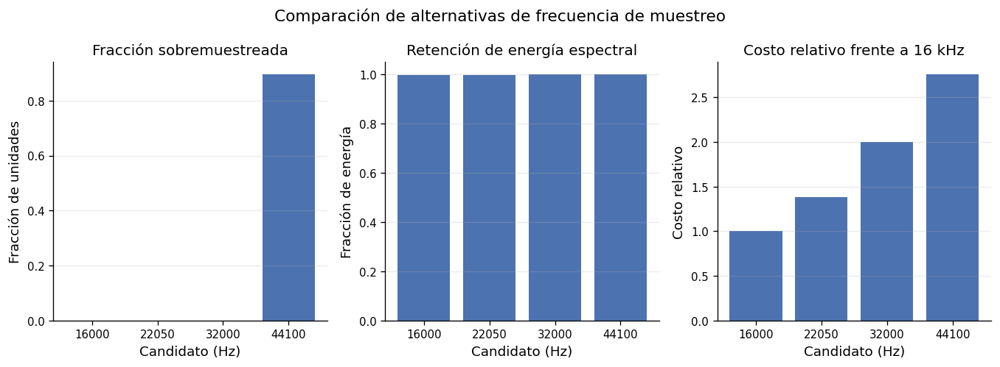

# 4.2.1. Armonización de frecuencia de muestreo

La frecuencia de muestreo constituye una condición fundamental para la construcción de una representación acústica homogénea, debido a que determina la cantidad de muestras disponibles por unidad temporal y la frecuencia máxima representable por la señal. Esta característica resultaba especialmente heterogénea en los datos disponibles. AudioSet-EV v2 presenta 32 kHz, sireNNet y A3Siren-Recordings 44,1 kHz, mientras que LSSiren incorpora señales registradas a 8, 22,05, 44,1, 48 y 96 kHz.

Para establecer una frecuencia de muestreo común no se adoptó directamente uno de los valores presentes en los corpus. La notebook de preparación evaluó cuatro candidatos: 16, 22,05, 32 y 44,1 kHz. Para cada alternativa se estimó la fracción de unidades que requerirían remuestreo, la retención media de energía espectral y el costo computacional relativo tomando 16 kHz como referencia.

Los resultados mostraron que las frecuencias de 16, 22,05 y 32 kHz cumplían los criterios establecidos para la comparación. La retención media de energía espectral fue de 99,829 % para 16 kHz, 99,915 % para 22,05 kHz y 99,968 % para 32 kHz. Por su parte, el costo relativo respecto de 16 kHz fue de 1,00; 1,378 y 2,00, respectivamente. La alternativa de 44,1 kHz fue descartada porque implicaba sobremuestrear aproximadamente el 89,55 % de las unidades, superando el límite máximo establecido para dicha operación.

La decisión de 16 kHz se considera una configuración de preparación y no una frecuencia óptima demostrada para la clasificación. La retención promedio de energía espectral no garantiza la conservación de todos los componentes discriminativos ni sustituye la evaluación del modelo. Al sobremuestrear una señal originalmente captada a 8 kHz no se recupera información por encima de su Nyquist original de 4 kHz. La banda de hasta 8 kHz de la representación preparada describe su límite de procesamiento, no la presencia de contenido adquirido en toda esa banda para cada archivo. El procedimiento de remuestreo y sus parámetros deberán recuperarse de la configuración ejecutada y mantenerse en inferencia.

Figura 17. Comparación de alternativas de frecuencia de muestreo

La adopción de 16 kHz implica una frecuencia de Nyquist de 8 kHz, por lo que las representaciones espectrales posteriores se limitaron a la banda físicamente representable después del remuestreo. En consecuencia, la política de frecuencia máxima empleada durante la transformación se definió como el Nyquist de la señal preparada, evitando introducir frecuencias que no pudieran ser representadas por la nueva tasa de muestreo.
