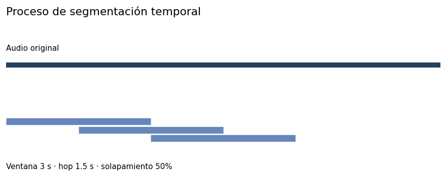

# 4.3.1. Segmentación temporal

La segmentación temporal tuvo como objetivo transformar las unidades acústicas originales en fragmentos de duración homogénea para facilitar la generación de características y representaciones tiempo-frecuencia comparables. Esta transformación respondió directamente a la heterogeneidad temporal observada durante la exploración de los datos, donde las duraciones presentaban diferencias importantes entre los cuatro corpus. En particular, A3Siren-Recordings utiliza tracks considerablemente más largos que los archivos de AudioSet-EV v2, LSSiren y sireNNet, por lo que mantener las grabaciones completas como unidades de entrada habría generado representaciones de dimensiones y escalas temporales diferentes.

La preparación reportada utiliza ventanas de 3,0 segundos, desplazamiento de 1,5 segundos y solapamiento del 50 %. El requisito de cobertura considerado durante la selección de ventana debe expresarse con su denominador: proporción de unidades capaces de generar al menos un segmento, fracción de duración cubierta o fracción de muestras utilizadas. Estos indicadores no son equivalentes. El informe consigna 153 993 segmentos y 54 unidades sin segmento; el criterio exacto de elegibilidad, la política de remanentes y el denominador del indicador de cobertura deberán reconciliarse con el manifiesto de preparación antes de declarar alcanzado un porcentaje específico.

Figura 18. Proceso de segmentación temporal

| **Ventana (s)** | **Hop (s)** | **Solapamiento** | **Segmentos generados** | **Unidades sin segmento** |
|-----------------|-------------|------------------|-------------------------|---------------------------|
| 3,0             | 1,5         | 50 %             | 153 993                 | 54                        |

Tabla 16. Configuración de la transformación temporal
