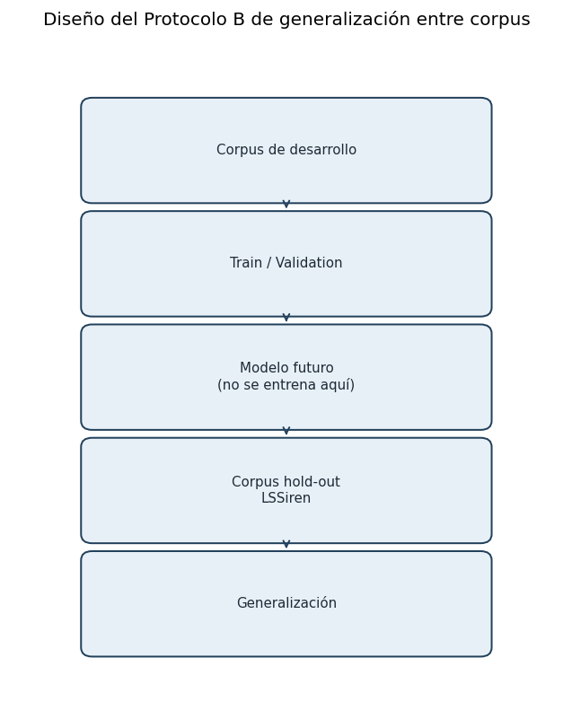

# 4.5.6. Protocolo de generalización entre corpus

LSSiren se estableció como corpus de evaluación predictiva externa considerando la disponibilidad de las dos categorías binarias, su cantidad de unidades y su heterogeneidad técnica. La preparación reporta 1 693 archivos conservados, distribuidos en 910 EMERGENCY y 783 NON_EMERGENCY. La evaluación utilizará los segmentos elegibles generados mediante las reglas de preparación congeladas.

El corpus ya participó en la exploración descriptiva y en el análisis de alternativas de preparación. Por ello, se describe como reservado para la evaluación predictiva externa y no como completamente desconocido durante todo el diseño metodológico. A partir del cierre del protocolo, sus predicciones y métricas no se utilizarán para ajustar el modelo, el umbral ni las transformaciones.

La evaluación externa medirá transferencia hacia LSSiren dentro de sus condiciones y etiquetas. No demostrará automáticamente desempeño en otras ciudades, contextos regulatorios, sensores o conducción real. Las diferencias respecto de la validación interna se analizarán como evidencia de transferencia entre las poblaciones evaluadas y se acompañarán de sus limitaciones de procedencia y etiquetado.

Figura 19. Diseño del Protocolo B de generalización entre corpus
