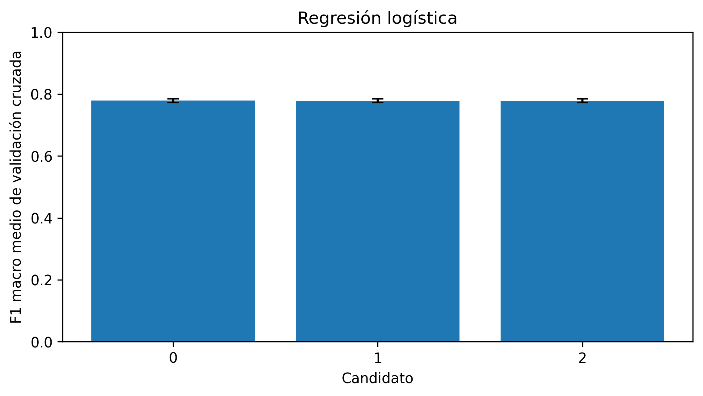
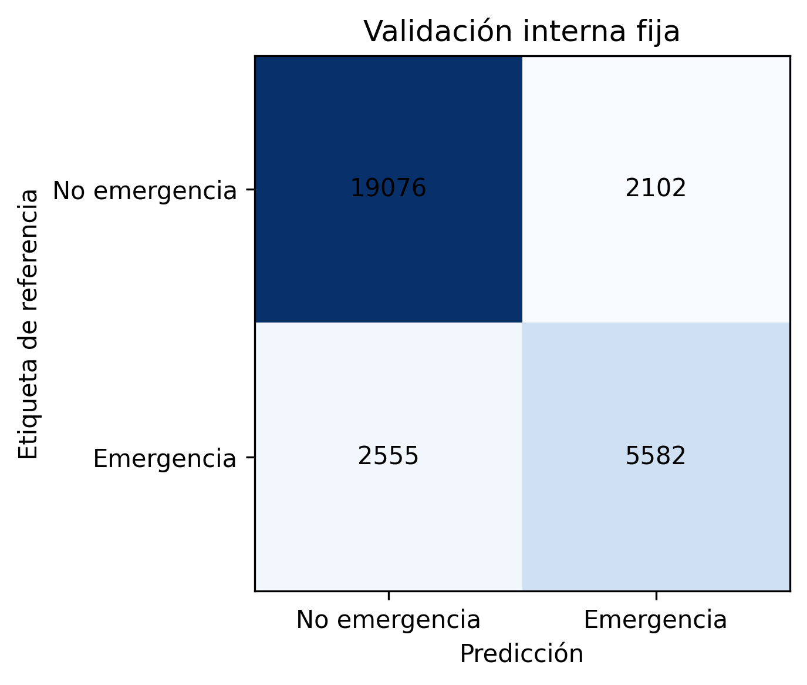
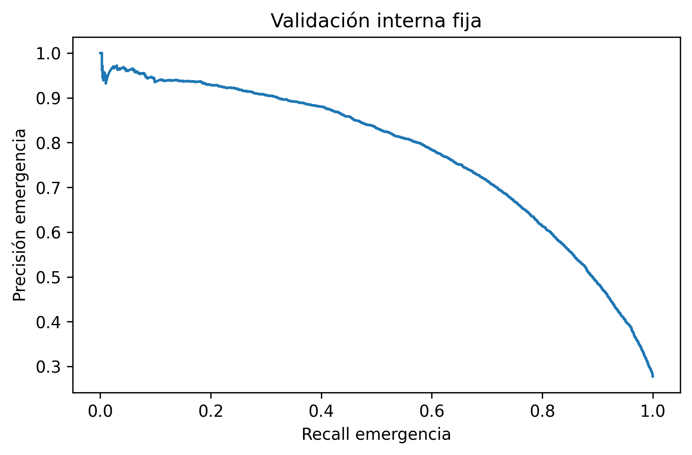
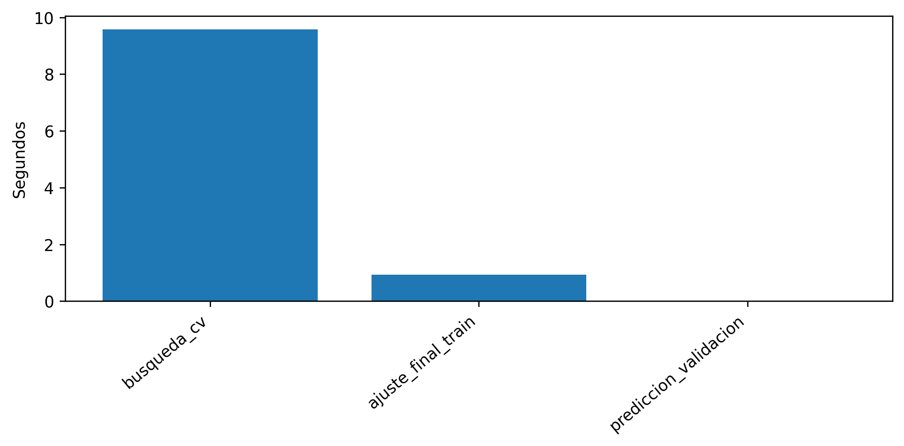

# Regresión logística: documentación del modelo entrenado

Este documento describe la ejecución entregada del **12 de octubre de 2026**, desde el audio de origen hasta el artefacto final. Explica el procedimiento que realmente ejecutó la notebook, los parámetros guardados y las métricas exportadas. Las fórmulas desarrollan esas operaciones; las interpretaciones se distinguen de las mediciones. Se puede leer de manera independiente de los informes de los otros modelos.

El modelo obtuvo **F1 macro = 0,798429**, **recall de emergencia = 0,686002** y **FPR = 0,099254** en 29 315 segmentos de validación interna fija. El umbral exportado es **`0.6254996498568315`**. La búsqueda OOF no encontró un umbral que satisficiera simultáneamente recall ≥ 0,90 y FPR < 0,10; se utilizó la alternativa prevista de máximo F1 macro OOF. El recall por segmento de la validación fija tampoco alcanza 0,90. **La evaluación externa de LSSiren sigue pendiente.**

## Guía de lectura

- [1. Identidad de la ejecución y fuentes](#seccion-1)
- [2. Corpus, etiquetas y limpieza previa](#seccion-2)
- [3. Preprocesamiento de la señal](#seccion-3)
- [4. Las 21 características que recibe el modelo](#seccion-4)
- [5. Particiones, grupos y folds](#seccion-5)
- [6. Arquitectura y matemática de la regresión logística](#seccion-6)
- [7. Búsqueda de candidatos y ajuste seleccionado](#seccion-7)
- [8. Umbral OOF y restricciones operativas](#seccion-8)
- [9. Resultados de la validación interna fija](#seccion-9)
- [10. Figuras originales y lectura técnica](#seccion-10)
- [11. Entorno, tiempos y costo computacional](#seccion-11)
- [12. Artefacto final, trazabilidad y recarga](#seccion-12)
- [13. Alcance de las conclusiones y trabajo pendiente](#seccion-13)

<a id="seccion-1"></a>

## 1. Identidad de la ejecución y fuentes

| Campo | Valor |
| --- | --- |
| Notebook | [01_regresion_logistica.ipynb](../../notebooks/01_regresion_logistica.ipynb) |
| Modelo | `01_regresion_logistica` |
| Estado de entrenamiento | `COMPLETE` |
| Inicio UTC | `2026-10-12T07:19:26.685959+00:00` |
| Cierre de entrenamiento UTC | `2026-10-12T07:20:41.601496+00:00` |
| Semilla de preparación y entrenamiento | 42 |
| Evaluación externa | `external_evaluated=false`; `holdout_evaluated=false` |
| Resultados originales | `data/results/01_regresion_logistica_resultados/` |
| Modelo original | `data/models/01_regresion_logistica_modelos/models/` |
| Configuración efectiva | [config/training_config.json](evidencia/01_regresion_logistica/config/training_config.json) |
| Experimento congelado | [config/frozen_experiment.json](evidencia/01_regresion_logistica/config/frozen_experiment.json) |
| Estado exportado | [reports/run_status.json](evidencia/01_regresion_logistica/reports/run_status.json) |

La clase positiva es `EMERGENCY=1`; la negativa, `NON_EMERGENCY=0`. El problema es clasificación binaria de ventanas: no distingue ambulancia, bomberos y policía como salidas separadas, no estima distancia ni dirección y no localiza el inicio exacto de un evento. El marco del proyecto se encuentra en [objetivos](../2/2.3/objetivos.md), [alcance](../2/2.5/delimitacion-del-alcance.md) y [modelos considerados](../5/5.1/modelos-considerados.md).

Las tablas y figuras enlazadas en `evidencia/01_regresion_logistica/` y `figuras/01_regresion_logistica/` son copias de las exportaciones, con igualdad de SHA-256 comprobada. Los archivos de `inspeccion/` son derivados identificados: lectura de parámetros y recálculo de métricas existentes, sin volver a entrenar. [El manifiesto](evidencia/manifest.csv) permite distinguir ambos orígenes. Los archivos binarios permanecen en `data/models`; no se incorporan a la documentación.

<a id="seccion-2"></a>

## 2. Corpus, etiquetas y limpieza previa

### 2.1. Origen de la etiqueta binaria

| Corpus | Etiqueta positiva | Etiqueta negativa | Participación |
| --- | --- | --- | --- |
| AudioSet-EV v2 | Rutas documentadas `Positive_files` / `EV_Positives`, contrastadas con metadata | `Negative_files` / `EV_Negatives` | Entrenamiento y validación fija |
| sireNNet | `ambulance`, `firetruck`, `police` | `traffic` | Entrenamiento y validación fija |
| A3Siren-Recordings | `Siren` | `Noise` | Entrenamiento y validación fija, agrupando los canales de cada track |
| LSSiren | `Ambulance` | `Road` | Reserva exclusiva para generalización externa |

Se conserva la procedencia y, en AudioSet, las etiquetas originales cuando están disponibles. La etiqueta de archivo o track se hereda a cada ventana. Una ventana positiva puede contener intervalos sin sirena o ruido dominante: las etiquetas son débiles respecto de la actividad exacta dentro de esos tres segundos. No se introdujo una nueva anotación temporal ni aumento de datos en esta ejecución (`new_augmentation=false`). Las versiones aumentadas que pudiera traer sireNNet pertenecen al corpus de origen.

### 2.2. Qué se excluyó realmente

El inventario inicial contiene **32 429 archivos**. Se excluyeron lógicamente dos audios inválidos de AudioSet-EV v2 y 169 duplicados exactos: 20 de AudioSet, 141 de LSSiren y 8 de sireNNet. Quedaron 32 258 archivos después de esta limpieza. A continuación se descartaron 54 archivos demasiado cortos para una ventana completa: 21 de AudioSet y 33 de LSSiren. La preparación final usa **32 204 archivos** y genera **153 993 segmentos**, incluyendo la reserva externa.

| Corpus | Conservados tras limpieza | Duplicados excluidos | Inválidos excluidos | Cortos excluidos después |
| --- | --- | --- | --- | --- |
| AudioSet-EV v2 | 28 794 | 20 | 2 | 21 |
| sireNNet | 1 667 | 8 | 0 | 0 |
| A3Siren-Recordings | 104 | 0 | 0 | 0 |
| LSSiren | 1 693 | 141 | 0 | 33 |

La deduplicación usa SHA-256 de archivos: detecta igualdad binaria, pero no audios iguales que hayan sido recodificados o modificados. Las alertas de silencio, clipping y posible cancelación al promediar canales se registran; su existencia no equivale a aplicar un filtro nuevo de eliminación. Evidencia: [limpieza](evidencia/preparacion/reports/cleaning_summary.csv), [validaciones finales](evidencia/preparacion/reports/final_preparation_validation.csv) y [alcance de independencia](evidencia/preparacion/reports/independence_scope.json).

<a id="seccion-3"></a>

## 3. Preprocesamiento de la señal

### 3.1. Decodificación, canales, remuestreo y amplitud

El audio se decodifica a valores numéricos, se promedian los canales que contiene cada WAV y se convierte a `float32`. Para un WAV con $C$ canales:

$$
x_{mono}[n]=\frac{1}{C}\sum_{c=1}^C x_c[n].
$$

Los ocho WAV de canal de un track A3 se conservan como fuentes separadas. El promedio anterior se aplica **dentro de cada WAV**, no entre esos ocho archivos. Todos los canales y ventanas de un track comparten grupo para impedir que se distribuyan entre entrenamiento y validación.

Si la tasa original difiere, `librosa.resample(..., res_type="soxr_hq")` lleva la señal a **16 000 Hz**. Después se normaliza el pico de **la grabación completa**, antes de segmentar:

$$
a=\max_n|x_{mono}[n]|,\qquad
\widetilde x[n]=\begin{cases}0,99\,x_{mono}[n]/a,&a>0,\\x_{mono}[n],&a=0.\end{cases}
$$

El factor se calcula después del remuestreo. Esta operación homogeniza el máximo digital de cada grabación, pero no recupera el nivel de presión sonora original, no elimina distorsión por clipping y puede amplificar una señal con pico muy pequeño. El RMS posterior expresa energía relativa dentro de una grabación normalizada, no decibelios SPL calibrados. Como el pico usa toda la grabación, una implementación en flujo continuo necesitaría resolver explícitamente esta dependencia; no se ha medido aquí una normalización causal en línea.

### 3.2. Ventanas y dependencia temporal

Se extraen **48 000 muestras** por ventana (3 s), con salto de **24 000 muestras** (1,5 s): solapamiento del 50 %. Para una señal de $L$ muestras:

$$
N_{ventanas}=\begin{cases}1+\left\lfloor\dfrac{L-48000}{24000}\right\rfloor,&L\ge48000,\\0,&L<48000.\end{cases}
$$

La ventana $i$ comienza en $i\,24000$ y termina antes de $i\,24000+48000$. Se descartan clips cortos y colas incompletas; no hay relleno para producir ventanas de audio adicionales. El relleno de borde de la STFT que se explica enseguida es una operación distinta. Los segmentos solapados están correlacionados y no deben tratarse como grabaciones independientes. Multiplicar el número de ventanas por 3 s cuenta audio repetido por solapamiento, no duración única de captura.

### 3.3. STFT reutilizada para las representaciones

Para cada segmento se calcula una única STFT con ventana Hann periódica de 2 048 muestras, salto de 512, `center=True` y relleno constante cero. Si $x_p$ denota la señal con 1 024 ceros añadidos a cada borde:

$$
D[k,t]=\sum_{n=0}^{2047}x_p[t\,512+n]h[n]e^{-j2\pi kn/2048},\qquad
h[n]=\tfrac12\left(1-\cos\tfrac{2\pi n}{2048}\right).
$$

Se conservan $k=0,\dots,1024$, con $f_k=k\,16000/2048$. La separación entre bins es **7,8125 Hz**, la ventana de análisis dura **128 ms** y los centros de frames están separados **32 ms**. Hay $1+\lfloor48000/512\rfloor=94$ frames por segmento: magnitud y potencia tienen dimensión **1 025 × 94**. Se define $A[k,t]=|D[k,t]|$ y $P[k,t]=A[k,t]^2$. La resolución efectiva también depende de la ventana; la separación entre bins no garantiza distinguir dos tonos separados exactamente por esa cantidad. Estas dimensiones se derivan del código ejecutado y de la [convención de STFT de Librosa 0.11.0](https://librosa.org/doc/0.11.0/generated/librosa.stft.html).

### 3.4. Mel, decibelios y diferencia entre MFCC y Log-Mel

Un banco $B\in\mathbb R^{64\times1025}$ proyecta la potencia a 64 bandas entre 20 y 8 000 Hz:

$$
M[m,t]=\sum_{k=0}^{1024}B[m,k]P[k,t].
$$

El banco usa escala Slaney (`htk=False`) y normalización por área (`norm="slaney"`). Los triángulos están distribuidos según esa escala; no se aplica la fórmula HTK $2595\log_{10}(1+f/700)$ como sustitución. [La API de Mel](https://librosa.org/doc/0.11.0/generated/librosa.filters.mel.html) identifica estas opciones.

Para las redes, el Log-Mel exportado usa $R=\max_{m,t}M[m,t]$, piso $\epsilon=10^{-10}$ y rango de 80 dB:

$$
L_0[m,t]=10\log_{10}\max(M[m,t],\epsilon)-10\log_{10}\max(R,\epsilon),
$$

$$
L[m,t]=\max\left(L_0[m,t],\max_{m,t}L_0[m,t]-80\right).
$$

Así se obtiene una matriz **64 × 94 `float32`**, con máximo relativo 0 dB y piso de hasta −80 dB. La referencia al máximo corresponde al segmento completo; elimina el nivel absoluto de su espectrograma. Una señal enteramente nula produce un caso degenerado con la referencia limitada por el mismo piso, no una medición de intensidad física.

Los MFCC reutilizan $M$, pero transforman a dB con **`ref=1.0`**, no con `ref=max`. Sobre esa matriz de dB, también limitada a 80 dB respecto de su máximo, se aplica DCT-II ortonormal sin lifter y se promedian 13 coeficientes en el tiempo. Confundir ambas referencias cambia especialmente el coeficiente de orden cero y deja de reproducir los insumos empleados.
<a id="seccion-4"></a>

## 4. Las 21 características que recibe el modelo

El clasificador consume un vector $x\in\mathbb R^{21}$ por `segment_id`, construido al unir `features/acoustic_features.csv` y `features/mfcc_features.csv`. Las uniones se validan por clave única; no dependen de la coincidencia accidental del orden de filas. Los valores entran como `float32`, sin imputación de NaN, sin selección adicional y sin variables de corpus, track o procedencia como predictores. La metadata se usa para trazabilidad, etiquetas y agrupación.

En las ecuaciones siguientes, $T=94$, $K=1025$, $N=48000$ y los promedios de características espectrales se toman sobre frames:

| Posición | Nombre canónico | Definición efectiva y unidad |
| --- | --- | --- |
| 1 | `rms` | $\sqrt{\frac1N\sum_n x[n]^2}$; amplitud digital relativa después de normalizar el archivo. |
| 2 | `zcr` | Media de las tasas de cruces por cero de frames de 2 048 muestras, salto 512; proporción adimensional. |
| 3 | `dominant_frequency` | $f_{\arg\max_k\frac1T\sum_t A[k,t]}$, poniendo a cero la magnitud media del bin DC antes del `argmax`; Hz. |
| 4 | `spectral_centroid` | $\frac1T\sum_t\frac{\sum_k f_k A[k,t]}{\sum_k A[k,t]}$; Hz. |
| 5 | `spectral_bandwidth` | $\frac1T\sum_t\sqrt{\frac{\sum_k A[k,t](f_k-c_t)^2}{\sum_k A[k,t]}}$, con $c_t$ centroide del frame; Hz. |
| 6 | `spectral_rolloff` | Media de la primera frecuencia que acumula el 85 % de la **magnitud** de cada frame; Hz. |
| 7 | `spectral_flux` | Media de la norma euclidiana de cambios entre magnitudes normalizadas consecutivas; adimensional. |
| 8 | `spectral_flatness` | Media del cociente entre medias geométrica y aritmética de la magnitud elevada al cuadrado, con piso; adimensional. |
| 9–21 | `mfcc_1` … `mfcc_13` | Medias temporales de los órdenes DCT 0 … 12, respectivamente; coeficientes cepstrales. |

### 4.1. Convenciones que cambian el valor calculado

La ZCR se calcula con `librosa.feature.zero_crossing_rate`, con `center=True` por defecto. Esa función prolonga los valores de los extremos mediante padding de borde; no usa los ceros de la STFT. Con sus valores por defecto, valores cercanos a cero se ajustan por un pequeño umbral y cero se considera del signo positivo. Conceptualmente suma indicadores de cambios de signo por frame; la implementación divide por la longitud del frame, incluyendo la primera posición sin cruce. [Referencia de ZCR](https://librosa.org/doc/0.11.0/generated/librosa.feature.zero_crossing_rate.html).

Para el flujo espectral se define:

$$
Q[k,t]=\frac{A[k,t]}{\sum_k A[k,t]+10^{-10}},\qquad
\mathrm{flux}=\frac1{T-1}\sum_{t=1}^{T-1}\sqrt{\sum_k\big(Q[k,t]-Q[k,t-1]\big)^2}.
$$

Incluye aumentos y disminuciones; no rectifica las diferencias ni se limita a una medida de onsets. El rolloff y el centroide ponderan **magnitud**, porque el extractor pasa `S=mag`; escribir estas ecuaciones con potencia describiría otro vector. En frames de energía nula se usan las convenciones numéricas de Librosa para evitar divisiones inválidas; no se aplica la división formal por cero de la tabla.

La planitud ejecutada usa `librosa.feature.spectral_flatness(S=mag)` con los valores por defecto de Librosa 0.11.0: `power=2.0`, `amin=1e-10`. Para $V[k,t]=\max(A[k,t]^2,10^{-10})$:

$$
\mathrm{flatness}=\frac1T\sum_t\frac{\exp\left(\frac1K\sum_k\log V[k,t]\right)}{\frac1K\sum_k V[k,t]}.
$$

La [definición de la API](https://librosa.org/doc/0.11.0/generated/librosa.feature.spectral_flatness.html) confirma esos valores. **Discrepancia de metadata:** `feature_definitions.json` menciona un piso de $10^{-12}$; ese texto no corresponde a la llamada que se ejecutó. Aquí se documenta el código y su versión, y se conserva el JSON original como evidencia, sin corregir silenciosamente la exportación.

### 4.2. DCT y orden de los MFCC

Si $D_M[m,t]$ es el Mel en dB con referencia 1, el coeficiente de orden $q$ es:

$$
C_q[t]=\alpha_q\sum_{m=0}^{63}D_M[m,t]\cos\left[\frac{\pi q}{64}\left(m+\frac12\right)\right],
\quad \alpha_0=\frac1{\sqrt{64}},\quad \alpha_q=\sqrt{\frac2{64}}\ (q>0).
$$

La característica almacenada es $\overline C_q=\frac1{94}\sum_tC_q[t]$. `mfcc_1` corresponde al orden $q=0$, y `mfcc_13` al orden $q=12`; el sufijo del CSV comienza en uno aunque el orden matemático comienza en cero. No hay deltas, delta-deltas ni desviaciones temporales añadidas. Esta compresión conserva resúmenes del segmento y pierde el orden detallado de modulaciones que las redes pueden explotar. [Opciones de MFCC](https://librosa.org/doc/0.11.0/generated/librosa.feature.mfcc.html).

La preparación nombra cuatro frecuencias con sufijo `_hz`. Los lectores las convierten a los nombres canónicos de la tabla, manteniendo unidades y orden. Que un JSON descriptivo use nombres distintos no introduce cuatro variables adicionales.

Orden exacto y política de escalamiento: [config/feature_contract.json](evidencia/01_regresion_logistica/config/feature_contract.json). Rangos observados exclusivamente en train: [tables/feature_ranges_train.csv](evidencia/01_regresion_logistica/tables/feature_ranges_train.csv). Los MFCC no tienen unidades Hz ni una interpretación directa como probabilidad de emergencia.

<a id="seccion-5"></a>

## 5. Particiones, grupos y folds

### 5.1. Separación fija antes de segmentar

Se reserva LSSiren completo como `generalization`. Los otros tres corpus se dividen por grupos, antes de crear ventanas. Para cada estrato de corpus y composición de etiquetas del grupo, se ordenan identificadores, se barajan con `numpy.random.default_rng(42)` y se asigna a validación un número de grupos cercano al 20 %, redondeado y limitado para conservar grupos en ambos lados cuando es posible. Esto no exige exactamente un 20 % de segmentos: la duración de las grabaciones y el número de canales varían.

| Partición | Corpus | Emergencia | No emergencia | Segmentos | Archivos | Grupos conocidos |
| --- | --- | --- | --- | --- | --- | --- |
| generalization | LSSiren | 2 888 | 3 476 | 6 364 | 1 660 | 1 660 |
| train | A3Siren-Recordings | 944 | 1 560 | 2 504 | 88 | 11 |
| train | AudioSet-EV v2 | 31 333 | 83 143 | 114 476 | 23 018 | 23 018 |
| train | sireNNet | 997 | 337 | 1 334 | 1 334 | 1 334 |
| validation | A3Siren-Recordings | 40 | 312 | 352 | 16 | 2 |
| validation | AudioSet-EV v2 | 7 848 | 20 782 | 28 630 | 5 755 | 5 755 |
| validation | sireNNet | 249 | 84 | 333 | 333 | 333 |

Totales: **train = 118 314 segmentos / 24 440 archivos / 24 363 grupos**, **validation = 29 315 / 6 104 / 6 090**, **generalization = 6 364 / 1 660 / 1 660**. Train tiene 33 274 positivos y 85 040 negativos; validación fija tiene 8 137 positivos y 21 178 negativos. LSSiren conserva 2 888 positivos y 3 476 negativos únicamente como reserva.

La proporción de emergencia en train es 28,123 %; en validación, 27,757 %. Las cifras corresponden a esta ejecución v3. Los conteos de documentos anteriores —por ejemplo, 118 349 y 29 280— pertenecen a evidencia histórica y no describen estas particiones.

### 5.2. Qué significa un grupo y qué independencia se comprobó

Se preservan los grupos declarados en el paquete. Las relaciones de archivo, track, hash y columnas recuperables `source_video_id`, `original_recording_id`, `augmentation_parent_id` se unen en componentes de dependencia, en vez de sustituir silenciosamente los grupos originales. Una relación conocida que cruce particiones provoca rechazo. Los identificadores de grupo se usan para dividir datos, no como entrada del predictor.

El reporte de entrenamiento registra **cero grupos conocidos cruzando splits**. En A3, 104 archivos pertenecen a 13 tracks: train tiene 11 tracks (6 positivos y 5 negativos) y validación solo 2 (uno positivo y uno negativo). Los ocho canales de cada track están juntos. La agrupación evita fuga entre estos canales, aunque cada canal sigue contribuyendo como un ejemplo distinto al entrenamiento y a la métrica por segmento.

Hay **1 667 archivos de sireNNet sin metadata de padre original o de aumento**. Por ello, la separación garantiza las dependencias identificadas, pero no demuestra independencia de todas las versiones aumentadas aguas arriba. Tampoco se realizó búsqueda de duplicados perceptuales. Una cifra grande de segmentos no elimina estas limitaciones. Evidencia: [tables/leakage_audit.csv](evidencia/01_regresion_logistica/tables/leakage_audit.csv) y [reports/independence_scope.json](evidencia/01_regresion_logistica/reports/independence_scope.json).

### 5.3. Validación cruzada de selección

Solo train se subdivide con `StratifiedGroupKFold(n_splits=3, shuffle=True, random_state=42)`. La estratificación de CV se hace sobre la etiqueta binaria, manteniendo cada grupo indivisible; no se estratifica conjuntamente por corpus y clase. La validación fija no se usa para elegir candidatos ni umbral.

| Fold, índice desde cero | Train del fold externo | Validación del fold externo | Positivos externos | Negativos externos | Grupos externos |
| --- | --- | --- | --- | --- | --- |
| 0 | 79 114 | 39 200 | 11 052 | 28 148 | 8 099 |
| 1 | 78 303 | 40 011 | 11 065 | 28 946 | 8 101 |
| 2 | 79 211 | 39 103 | 11 157 | 27 946 | 8 163 |

Cada uno de los 118 314 segmentos aparece una vez en validación externa de CV, generando una puntuación OOF (*out of fold*). Las cinco notebooks comparten exactamente asignaciones de folds e identificadores de validación fija. El SHA-256 registrado para las asignaciones es:

```text
3528557381804ea80cf8a9fd230bbe0c37f24e721094162609a2c41f83a2154d
```

La distribución de corpus no queda equilibrada automáticamente: el fold 2 contiene 320 segmentos positivos A3 y **ningún segmento negativo A3**. Ambos valores de la etiqueta sí existen globalmente en cada fold. Por ello, los resultados globales de CV no equivalen a una estimación estable por corpus, particularmente en A3. El detalle completo se conserva en [tables/cv_distribution.csv](evidencia/01_regresion_logistica/tables/cv_distribution.csv).

Las métricas de CV y el umbral OOF forman parte de la selección sobre desarrollo. Como se eligió el candidato usando estos folds, su puntuación OOF no es una estimación completamente independiente de esa selección. El procedimiento no implementa una evaluación externa anidada que repita toda la selección. La validación fija aporta otra partición de desarrollo; la evidencia de generalización a otro corpus requiere LSSiren, todavía pendiente.

<a id="seccion-6"></a>

## 6. Arquitectura y matemática de la regresión logística

### 6.1. Pipeline y escalamiento

La arquitectura efectiva es **`StandardScaler → LogisticRegression`**. Para cada característica $j$, el escalador ajustado en el subconjunto de entrenamiento calcula media y desviación poblacional:

$$
\mu_j=\frac1n\sum_i x_{ij},\qquad
\sigma_j=\sqrt{\frac1n\sum_i(x_{ij}-\mu_j)^2},\qquad
z_{ij}=\frac{x_{ij}-\mu_j}{\sigma_j}.
$$

Se usa `ddof=0`. Si una característica fuese constante, `StandardScaler` emplearía escala uno para evitar división por cero. Se ajusta dentro del pipeline en cada fold y, finalmente, con todo train. No usa etiquetas para calcular medias ni incorpora validación. El escalamiento evita que las unidades Hz dominen numéricamente a variables adimensionales y hace coherente la penalización L2 entre coordenadas; no cambia la cantidad de variables.

### 6.2. Función de puntuación y frontera

$$
\eta_i=b+\sum_{j=1}^{21}w_jz_{ij},\qquad
p_i=\sigma(\eta_i)=\frac1{1+e^{-\eta_i}}.
$$

Se obtiene una probabilidad paramétrica de clase positiva con `predict_proba(... )[:,1]`; las clases almacenadas son `[0,1]`. Hay **21 coeficientes y un intercepto**, más los parámetros del escalador. El criterio exportado es $p_i\ge\tau$, con $\tau=0.6254996498568315$; usar `pipeline.predict()` aplicaría la frontera por defecto y no reproduce necesariamente las etiquetas exportadas.

Para $0<\tau<1$, esta decisión equivale a $w^Tz+b\ge\log(\tau/(1-\tau))$. En coordenadas originales es un hiperplano con coeficientes $w_j/\sigma_j$ e intercepto $b-\sum_jw_j\mu_j/\sigma_j$. La estandarización no convierte a la regresión logística en un modelo no lineal respecto de las 21 características. La sigmoide transforma el score, pero no cambia el carácter lineal de la frontera.

### 6.3. Pérdida, regularización y desbalance

`class_weight="balanced"` asigna a cada clase $c$ el peso $a_c=n/(2n_c)$, calculado con el subconjunto que ajusta el estimador. En el ajuste final:

| Clase | Ejemplos | Peso final |
| --- | --- | --- |
| NON_EMERGENCY | 85 040 | 0,695637 |
| EMERGENCY | 33 274 | 1,777875 |

Las contribuciones totales de ambas clases se igualan: $n_0a_0=n_1a_1=n/2$. No se generan muestras sintéticas, no se iguala cada corpus y no se reduce el peso de una grabación larga por pertenecer a un grupo.

Con $s_i=a_{y_i}$ y $S=\sum_i s_i$, la función objetivo L2 puede escribirse:

$$
J(w,b)=\frac1S\sum_i s_i\left[-y_i\log p_i-(1-y_i)\log(1-p_i)\right]+\frac{\|w\|_2^2}{2SC},\qquad C=0,1.
$$

El intercepto no se penaliza con este solver. Multiplicar por $SC$ produce el objetivo equivalente $C\sum_i s_i\ell_i+\tfrac12\|w\|_2^2$; no debe omitirse el factor $S$ al escribir la versión promedio. La ecuación sigue la [formulación de scikit-learn 1.6.1](https://scikit-learn.org/1.6/modules/linear_model.html#logistic-regression). Un $C$ menor refuerza la regularización relativa a los errores de ajuste.

El gradiente muestra cómo se aprende la frontera:

$$
\nabla_w J=\frac1S\sum_i s_i(p_i-y_i)z_i+\frac{w}{SC},\qquad
\frac{\partial J}{\partial b}=\frac1S\sum_i s_i(p_i-y_i).
$$

La sigmoide y la pérdida logística permiten una optimización convexa del predictor lineal. `lbfgs` aproxima la información de segundo orden con memoria limitada. La configuración usa `penalty="l2"`, `tol=1e-4`, `max_iter=5000`, intercepto habilitado y `random_state=42`; el artefacto final registra **35 iteraciones**. La notebook rechaza advertencias de no convergencia, por lo que no presenta un ajuste incompleto como candidato válido.

Los pesos de clase modifican la distribución efectiva de ajuste. Que la salida esté en [0,1] no implica calibración sobre la prevalencia de producción. No se ajustó Platt, isotónica ni una evaluación específica de calibración; las probabilidades deben interpretarse como scores del modelo entrenado.

### 6.4. Coeficientes realmente guardados

El intercepto estandarizado es **-0,424512495**; el intercepto equivalente en unidades originales es **3,728862632**. El escalador registra 118 314 muestras. Cada fila muestra media y desviación finales, coeficiente sobre una variable estandarizada y razón de odds para un aumento de una desviación estándar manteniendo las demás variables constantes:

| Característica | Media train | Desviación train | Coeficiente $w_j$ | Razón de odds $e^{w_j}$ |
| --- | --- | --- | --- | --- |
| rms | 0,183206 | 0,102169 | 0,129543 | 1,138308 |
| zcr | 0,146575 | 0,080778 | 1,002904 | 2,726188 |
| dominant_frequency | 546,593506 | 731,422228 | 0,092922 | 1,097377 |
| spectral_centroid | 1808,637718 | 658,838541 | -2,039192 | 0,130134 |
| spectral_bandwidth | 1583,279337 | 398,704421 | 0,075839 | 1,078788 |
| spectral_rolloff | 3438,399495 | 1252,981911 | 0,055654 | 1,057232 |
| spectral_flux | 0,044392 | 0,017777 | 0,282259 | 1,326122 |
| spectral_flatness | 0,039952 | 0,083330 | -0,031298 | 0,969187 |
| mfcc_1 | -79,653225 | 88,060884 | 0,568806 | 1,766158 |
| mfcc_2 | 64,042715 | 33,511547 | -0,778087 | 0,459284 |
| mfcc_3 | -13,914098 | 25,170594 | -0,998213 | 0,368537 |
| mfcc_4 | 11,225429 | 16,174543 | -0,826963 | 0,437376 |
| mfcc_5 | -4,807089 | 13,032042 | -0,095580 | 0,908845 |
| mfcc_6 | 3,889356 | 10,700041 | 0,445664 | 1,561527 |
| mfcc_7 | -1,124878 | 9,612027 | 0,516754 | 1,676576 |
| mfcc_8 | 0,841937 | 8,880423 | 0,269969 | 1,309924 |
| mfcc_9 | -1,087588 | 7,184458 | 0,093116 | 1,097589 |
| mfcc_10 | 1,153677 | 6,708075 | 0,208583 | 1,231931 |
| mfcc_11 | -1,403971 | 6,023558 | 0,119422 | 1,126845 |
| mfcc_12 | 0,363875 | 5,715431 | 0,009595 | 1,009641 |
| mfcc_13 | -1,832337 | 5,403559 | -0,135585 | 0,873205 |

Por ejemplo, el coeficiente de `zcr` es positivo y el de `spectral_centroid` negativo. Eso describe la asociación condicional de este ajuste, no una regla causal sobre sirenas. Las características pueden estar correlacionadas: comparar solo el signo o el tamaño de un coeficiente no constituye una importancia aislada ni garantiza estabilidad entre corpus. Las razones de odds tampoco son multiplicadores directos de probabilidad.

La tabla se extrajo del pipeline entregado, sin reajustarlo: [inspeccion/feature_parameters.csv](evidencia/01_regresion_logistica/inspeccion/feature_parameters.csv). Todos estos números pertenecen al modelo final, no al promedio de los tres modelos de CV.

<a id="seccion-7"></a>

## 7. Búsqueda de candidatos y ajuste seleccionado

### 7.1. Presupuesto realmente explorado

| trial | C |
| --- | --- |
| 0,000000 | 0,100000 |
| 1,000000 | 1,000000 |
| 2,000000 | 10,000000 |

Se compararon **3 candidatos × 3 folds = 9 ajustes de selección**. Los candidatos anteriores son el conjunto completo ejecutado; el informe no supone una búsqueda más amplia de kernels, arquitecturas o regularización.

### 7.2. Regla de elección y resultados de CV

La selección ordena por **F1 macro medio descendente**, después **recall medio descendente** y, solo si persiste empate, **suma del tiempo de ajuste ascendente**. Se exige completar los tres folds. Estas métricas utilizan el umbral predeterminado **0.5**, antes de buscar el umbral operativo OOF. La desviación estándar se calcula entre tres folds con divisor muestral (`ddof=1`); las barras de error no son intervalos de confianza.

| Candidato | F1 macro medio | Desv. estándar F1 | Recall medio | FPR medio | Tiempo de ajuste total, s | Folds completos |
| --- | --- | --- | --- | --- | --- | --- |
| 0 | 0,778435 | 0,006103 | 0,776401 | 0,177972 | 2,512305 | 3 |
| 1 | 0,778126 | 0,005820 | 0,776103 | 0,178256 | 2,529279 | 3 |
| 2 | 0,778103 | 0,005872 | 0,776043 | 0,178256 | 2,541169 | 3 |

Los tres valores de C producen resultados muy próximos. C=0,1 gana por F1 medio, no por una diferencia grande ni por superar la meta de recall. Las probabilidades y el escalador se vuelven a ajustar en cada fold.

Detalle de los folds del candidato **0**:

| Fold | Filas con gradientes/ajuste | Filas de evaluación externa del fold | F1 macro | Recall | FPR | ROC-AUC | AP | Ajuste, s | Predicción, s |
| --- | --- | --- | --- | --- | --- | --- | --- | --- | --- |
| 0 | 79 114 | 39 200 | 0,776056 | 0,764839 | 0,175323 | 0,872170 | 0,764930 | 0,842294 | 0,032261 |
| 1 | 78 303 | 40 011 | 0,773880 | 0,778220 | 0,183756 | 0,872380 | 0,763230 | 0,842044 | 0,029135 |
| 2 | 79 211 | 39 103 | 0,785370 | 0,786143 | 0,174837 | 0,876624 | 0,770346 | 0,827967 | 0,026595 |

Para las redes, `train_segments` cuenta las filas `fit`, sin incluir la parada interna; por eso no coincide con todo el train del fold externo mostrado en la sección 5. Para los modelos clásicos coincide con ese train completo. Las filas de evaluación externa del fold siguen siendo las mismas entre modelos.

### 7.3. Configuración final congelada

| Parámetro congelado | Valor |
| --- | --- |
| C | 0.1 |

Se ajusta un estimador final nuevo con todas las filas de train. Los modelos clásicos vuelven a aprender sus transformaciones y parámetros; las redes vuelven a estimar su normalizador y entrenan el número de épocas fijado desde CV. El umbral se conserva a partir de las puntuaciones OOF del candidato elegido, sin buscar otro sobre la validación fija.

Fuentes: [tables/hyperparameter_candidates.csv](evidencia/01_regresion_logistica/tables/hyperparameter_candidates.csv), [tables/hyperparameter_summary.csv](evidencia/01_regresion_logistica/tables/hyperparameter_summary.csv), [tables/cv_results.csv](evidencia/01_regresion_logistica/tables/cv_results.csv) y [tables/selected_parameters.csv](evidencia/01_regresion_logistica/tables/selected_parameters.csv).

<a id="seccion-8"></a>

## 8. Umbral OOF y restricciones operativas

### 8.1. Barrido exacto de puntuaciones

El candidato elegido aporta una puntuación OOF a cada uno de los **118 314 segmentos de train**, predicha por un modelo cuyo conjunto de ajuste y parada no incluía su grupo. Se ordenan scores descendentes y se acumulan TP y FP por bloques de valores iguales. Los umbrales son los scores únicos; la comparación de clase es **`score >= threshold`**. Se añade un umbral `nextafter(max_score, +inf)` para incluir la solución sin predicciones positivas. Por eso el barrido contiene **118 025 umbrales candidatos**.

Tratar todos los empates como bloque evita resultados que dependan del orden arbitrario de ejemplos con el mismo score. El costo principal es ordenar, de orden $O(n\log n)$, y un barrido lineal; no se recalculan miles de matrices completas ni se utiliza una rejilla aproximada de 1 000 puntos.

El conjunto admisible se define:

$$
\mathcal T_{viable}=\{\tau:\mathrm{recall}(\tau)\ge0,90\ \land\ \mathrm{FPR}(\tau)<0,10\}.
$$

Si existe, se escoge el máximo F1 macro dentro de él. Si está vacío, se toma el máximo F1 macro de todo el barrido, con desempate por mayor recall y después mayor umbral. La igualdad FPR = 0,10 no sería suficiente: el límite es **estricto**.

### 8.2. Resultado y evidencia de inviabilidad

El reporte registra **`feasible_on_training_oof=false`**. La búsqueda no garantiza cumplimiento por el hecho de fijar estas metas. Los dos extremos siguientes permiten comprobar por qué no hay intersección:

| Punto del barrido OOF | Umbral | Recall | FPR | F1 macro |
| --- | --- | --- | --- | --- |
| Menor FPR que alcanza recall ≥ 0,90 | 0,292873097 | 0,900012021 | 0,393214958 | 0,678480756 |
| Mayor recall con FPR < 0,10 | 0,631160834 | 0,669561820 | 0,099976482 | 0,791321337 |

Para obtener el recall requerido en OOF se necesita al menos FPR **0,393214958**; al restringir FPR se alcanza como máximo recall **0,669561820**. Los valores describen el conjunto OOF de desarrollo y su curva discreta, no una frontera demostrada en producción.

El umbral final es **`0.6254996498568315`**, elegido por la alternativa explícita de máximo F1 macro. Comparación OOF recomputada:

| Política | Umbral | F1 macro | Precisión positiva | Recall | FPR | TN | FP | FN | TP |
| --- | --- | --- | --- | --- | --- | --- | --- | --- | --- |
| Predeterminado | 0,500000 | 0,778425 | 0,630506 | 0,776432 | 0,178034 | 69 900 | 15 140 | 7 439 | 25 835 |
| Seleccionado OOF | 0,625500 | 0,791497 | 0,719790 | 0,674881 | 0,102799 | 76 298 | 8 742 | 10 818 | 22 456 |

La media de F1 entre folds de la sección anterior puede diferir del F1 calculado sobre todas las predicciones OOF juntas: F1 es una función no lineal de conteos, y los folds tienen tamaños diferentes. Esta tabla usa la unión de predicciones OOF, no el promedio de sus F1.

ROC-AUC y AP no cambian al mover el umbral sobre los mismos scores. El punto OOF seleccionado no es una nueva ejecución de entrenamiento ni la métrica de validación fija. No se recalibraron scores al pasar del modelo de folds al ajuste con train completo.

Fuentes: [reports/threshold_selection.json](evidencia/01_regresion_logistica/reports/threshold_selection.json) y [inspeccion/documentation_calculations.json](evidencia/01_regresion_logistica/inspeccion/documentation_calculations.json). El barrido íntegro permanece en `data/results/01_regresion_logistica_resultados/tables/threshold_search.csv`; las 118 314 predicciones originales, en `predictions/selected_oof_predictions.csv`.

<a id="seccion-9"></a>

## 9. Resultados de la validación interna fija

### 9.1. Unidad, umbral y fórmulas de evaluación

El estimador final entrenado con train se evalúa sobre **29 315 segmentos** de grupos reservados de los mismos corpus de desarrollo, usando el umbral OOF congelado. Los conteos se definen respecto de `EMERGENCY=1`: TP positivos detectados, FN positivos omitidos, FP negativos declarados emergencia y TN negativos correctamente rechazados.

$$
\mathrm{accuracy}=\frac{TP+TN}{TP+TN+FP+FN},\quad
\mathrm{precision}_+=\frac{TP}{TP+FP},\quad
\mathrm{recall}_+=\frac{TP}{TP+FN},\quad
\mathrm{FPR}=\frac{FP}{FP+TN}.
$$

$$
F1_+=\frac{2TP}{2TP+FP+FN},\qquad
F1_-=\frac{2TN}{2TN+FP+FN},\qquad
F1_{macro}=\frac{F1_++F1_-}2.
$$

Las clases se promedian con igual peso en F1 macro; esto no iguala el peso de corpus ni grupos. La precisión responde cuántas alertas son verdaderas dentro de la muestra; FPR responde qué fracción de los negativos genera alertas. No son complementos entre sí. Si una precisión o un F1 tiene denominador nulo, el evaluador usa `zero_division=0`.

ROC-AUC resume el ordenamiento continuo de positivos sobre negativos; admite la lectura $P(s_+>s_-)+\tfrac12P(s_+=s_-)$. AP acumula precisión a medida que crece recall por niveles de score:

$$
AP=\sum_k(R_k-R_{k-1})P_k,
$$

considerando puntos ordenados hacia recall creciente. AP no es necesariamente el área calculada por interpolación trapezoidal de la curva PR. Ambos valores usan scores, sin reducirlos primero a predicciones binarias. No se exportó una gráfica ROC en estas ejecuciones. [Convenciones de métricas de scikit-learn](https://scikit-learn.org/1.6/modules/model_evaluation.html#precision-recall-f-measure-metrics).

### 9.2. Matriz de confusión y métricas globales

| Etiqueta real / predicción | No emergencia | Emergencia |
| --- | --- | --- |
| No emergencia | 19 076 | 2 102 |
| Emergencia | 2 555 | 5 582 |

| Métrica por segmento | Valor |
| --- | --- |
| Accuracy | 0,841139 |
| Precisión de emergencia | 0,726445 |
| Recall de emergencia | 0,686002 |
| F1 macro | 0,798429 |
| FPR | 0,099254 |
| ROC-AUC | 0,881569 |
| Average Precision (AP) | 0,774164 |
| F1 de emergencia, derivado | 0,705644 |
| F1 de no emergencia, derivado | 0,891214 |
| Tasa de omisión, 1 − recall | 0,313998 |
| Especificidad, 1 − FPR | 0,900746 |

Ejemplos de sustitución: recall = 5582 / 8 137 = **0,686002**; FPR = 2102 / 21 178 = **0,099254**; accuracy = (19076 + 5582) / 29 315 = **0,841139**. El clasificador que siempre declara no emergencia obtendría accuracy **0,722429**, por lo que accuracy sola no describe la detección de sirenas.

El modelo omite **2 555** ventanas positivas. El FPR global es inferior a 0,10, pero **recall < 0,90**, por lo que no satisface ambos criterios por segmento. Además, estos criterios están medidos en una partición interna de desarrollo; su cumplimiento externo no se ha comprobado.

### 9.3. Desglose por corpus

| Corpus | Segmentos | Precisión positiva | Recall | F1 macro | FPR | ROC-AUC | AP |
| --- | --- | --- | --- | --- | --- | --- | --- |
| A3Siren-Recordings | 352 | 0,135135 | 0,250000 | 0,508058 | 0,205128 | 0,297756 | 0,112446 |
| AudioSet-EV v2 | 28 630 | 0,728950 | 0,679536 | 0,798263 | 0,095419 | 0,882507 | 0,770500 |
| sireNNet | 333 | 0,812925 | 0,959839 | 0,675920 | 0,654762 | 0,944110 | 0,984066 |

| Corpus | TN | FP | FN | TP |
| --- | --- | --- | --- | --- |
| A3Siren-Recordings | 248 | 64 | 30 | 10 |
| AudioSet-EV v2 | 18 799 | 1 983 | 2 515 | 5 333 |
| sireNNet | 29 | 55 | 10 | 239 |

En AudioSet, el FPR por segmento queda por debajo de 0,10, pero el recall es aproximadamente 0,680. En sireNNet se recuperan 239 de 249 positivos, a costa de 55 falsos positivos entre 84 negativos: el FPR sube a 0,655. En A3 solo se detectan 10 de 40 segmentos positivos y hay 64 falsas alarmas entre 312 negativos. Un umbral único no conserva la misma relación de errores entre corpus.

AudioSet aporta **28 630 de 29 315 segmentos (97,663 %)**. Las métricas globales están dominadas por ese corpus, aunque F1 macro balancee las dos clases. A3 aporta 352 segmentos, pero provienen de **solo dos tracks**: uno de emergencia con 40 ventanas y otro negativo con 312. Una gran cantidad de errores puede estar concentrada en una misma grabación; no corresponde presentarla como 352 experimentos independientes.

La prevalencia positiva es 27,4118 % en AudioSet, 74,7748 % en sireNNet y 11,3636 % en A3. Una política siempre negativa lograría accuracy de 88,6364 % en A3: por eso su accuracy se interpreta junto con recall, FPR, ranking y conteos. Diferencias de captura, etiqueta y distribución pueden explicar parte de la variación, pero estos resultados no identifican causalmente cuál factor produjo el fallo. No se invierten etiquetas ni se retoca el umbral mirando A3 después de evaluar.

### 9.4. Intervalos por bootstrap de grupos

La notebook genera **500 repeticiones** con semilla 42. En cada repetición toma 6 090 grupos de validación con reemplazo y concatena todos los segmentos de cada grupo elegido, repitiéndolos cuando el grupo se selecciona varias veces. Después calcula las métricas por segmento con el modelo y umbral fijos. Los percentiles 2,5 y 97,5 forman los intervalos aproximados del 95 %:

| Métrica | Límite inferior | Límite superior | Repeticiones finitas |
| --- | --- | --- | --- |
| f1_macro | 0,788354 | 0,807779 | 500 |
| recall_emergency | 0,668437 | 0,703510 | 500 |
| fpr | 0,091785 | 0,106819 | 500 |
| roc_auc | 0,872014 | 0,889741 | 500 |

El remuestreo por grupos conserva el bloque de ventanas correlacionadas y los canales agrupados. Las métricas de cada remuestreo continúan siendo por segmento: un grupo largo aporta más filas. El bootstrap no está estratificado por corpus ni etiqueta y no vuelve a entrenar ni seleccionar hiperparámetros o umbral. Por tanto, los intervalos son condicionales al modelo y partición observados, no incluyen toda la incertidumbre del proceso de modelado y no son una validación externa. Con solo dos tracks A3, tampoco producen evidencia abundante e independiente de ese dominio.

El límite superior de recall, **0,703510**, sigue por debajo de 0,90. El punto de FPR y su intervalo se interpretan por separado; que el punto esté debajo de 0,10 no hace que todo el intervalo tenga que estarlo. La comparación de intervalos entre modelos no sustituye una prueba pareada sobre sus errores compartidos.

### 9.5. Agregación por grupo: «algún segmento positivo»

Para cada par `(dataset, group_id)` se define:

$$
y_g=\max_{i\in g}y_i,\qquad s_g=\max_{i\in g}s_i,\qquad
\widehat y_g=\mathbf1[s_g\ge\tau].
$$

Hay **6 090 grupos**, con 1 828 positivos y 4 262 negativos. Con el mismo umbral, la matriz es:

| Etiqueta real del grupo / predicción | No emergencia | Emergencia |
| --- | --- | --- |
| No emergencia | 3 442 | 820 |
| Emergencia | 251 | 1 577 |

| Métrica por grupo | Valor |
| --- | --- |
| Accuracy | 0,824138 |
| Precisión de emergencia | 0,657906 |
| Recall de emergencia | 0,862691 |
| F1 macro | 0,805938 |
| FPR | 0,192398 |
| ROC-AUC | 0,911146 |
| Average Precision (AP) | 0,825189 |

El máximo puede detectar un grupo positivo aunque muchas de sus ventanas se omitan, y puede convertir un grupo negativo en falsa alarma con un único segmento erróneo. Bajo una hipótesis ilustrativa de ventanas independientes con FPR $p$, la probabilidad de alguna falsa alarma en $m$ ventanas sería $1-(1-p)^m$; **esa independencia no se cumple necesariamente aquí** y la expresión no se utiliza para calcular el reporte.

El resultado por grupo no reemplaza al resultado por segmento ni demuestra sensibilidad por evento temporal, latencia de detección o falsas alarmas por hora. Puede superar una meta en una unidad de análisis mientras falla en otra. A3 agrupa canales del track; AudioSet y sireNNet utilizan las dependencias recuperadas. Definición exportada: [reports/group_metric_definition.json](evidencia/01_regresion_logistica/reports/group_metric_definition.json).

Fuentes numéricas: [tables/validation_metrics.csv](evidencia/01_regresion_logistica/tables/validation_metrics.csv), [tables/validation_by_corpus.csv](evidencia/01_regresion_logistica/tables/validation_by_corpus.csv), [tables/validation_cluster_bootstrap_ci.csv](evidencia/01_regresion_logistica/tables/validation_cluster_bootstrap_ci.csv) y [tables/validation_group_any_event.csv](evidencia/01_regresion_logistica/tables/validation_group_any_event.csv). Las métricas globales, por corpus y por grupo se recomputaron desde `validation_predictions.csv` y coinciden con estas exportaciones.

<a id="seccion-10"></a>

## 10. Figuras originales y lectura técnica

Todas las imágenes de esta sección provienen de la ejecución entregada. Se conservaron sin redibujarlas ni agregar puntos o anotaciones a sus archivos. Cada PNG tiene una versión SVG para ampliar o exportar.

### 10.1. F1 macro de candidatos



Cada barra es el F1 macro medio de tres folds al umbral predeterminado; las barras de error muestran desviación estándar muestral. Gana el candidato 0, con media 0,778435. El eje de candidato es un identificador de configuración, no el número de épocas ni una progresión temporal. El gráfico no muestra el F1 posterior al ajuste del umbral.

[Versión SVG](figuras/01_regresion_logistica/validacion_cruzada.svg).

### 10.2. Matriz de confusión de validación fija



Filas: etiqueta real; columnas: predicción. Los conteos son TN=19076, FP=2102, FN=2555, TP=5582, usando el umbral 0.6254996498568315. Son cantidades absolutas por segmento, sin normalización por corpus ni duración. El color resalta volumen, por lo que debe leerse junto a los conteos y tasas.

[Versión SVG](figuras/01_regresion_logistica/validacion_matriz_confusion.svg).

### 10.3. Curva precisión–recall



La curva barre los scores del modelo final sobre la validación fija; AP=0,774164. Su extremo de recall completo refleja la prevalencia positiva global, aproximadamente 0,277571. El punto operativo congelado tiene recall 0,686002 y precisión 0,726445; la imagen original no lo marca por separado. La curva PR no representa FPR ni demuestra por sí sola el cumplimiento de recall/FPR simultáneos.

[Versión SVG](figuras/01_regresion_logistica/validacion_precision_recall.svg).

### 10.4. Costos registrados



La figura exportada grafica las fases de `runtime_rows`: búsqueda CV, ajuste final y predicción de validación. La tabla completa de costos añade descubrimiento, verificación y lectura. Los ejes están en segundos; no incluyen toda la experiencia de ejecución, esperas manuales o descarga como fases independientes. En redes, hay timers anidados de verificación y lectura que no deben sumarse como tiempos disjuntos.

[Versión SVG](figuras/01_regresion_logistica/costo_computacional.svg).

<a id="seccion-11"></a>

## 11. Entorno, tiempos y costo computacional

### 11.1. Entorno efectivamente registrado

| Componente | Valor |
| --- | --- |
| Python exportado | 3.13.15 |
| NumPy | 2.1.3 |
| pandas | 2.3.3 |
| scikit-learn | 1.6.1 |
| SciPy | 1.16.3 |
| Matplotlib | 3.10.0 |
| joblib | 1.6.0 |
| CPU disponibles | 4 |
| RAM física del entorno, GiB | 31,347 |
| Workers CPU configurados | 2 |
| GPU de ejecución | No detectada |

Estas son las versiones del **entrenamiento en Kaggle**, no las del entorno local usado después para leer tablas. El entorno de preparación registró Librosa **0.11.0**, SoundFile **0.14.0** y remuestreo `soxr_hq`. Las rutas originales de datasets, reserva de disco, `prepared_cache`, heartbeat y demás opciones están conservadas en [config/training_config.json](evidencia/01_regresion_logistica/config/training_config.json) y [la configuración de preparación](evidencia/preparacion/config/preparation_config.json).

### 11.2. Tiempos exportados de las fases

| Fase | Segundos |
| --- | --- |
| descubrimiento_insumos | 20,324826 |
| verificacion_hashes_publicados | 2,587712 |
| lectura_y_auditoria_metadata | 10,462913 |
| busqueda_cv | 9,573315 |
| ajuste_final_train | 0,939717 |
| prediccion_validacion | 0,019153 |

Los tiempos son mediciones de esa ejecución, con los insumos disponibles y el estado de caché correspondiente. No representan estimaciones de complejidad teórica ni un benchmark repetido con igualdad de condiciones entre todas las ejecuciones. En redes, la segunda verificación de hashes está dentro del timer de lectura de representaciones: sumar ambas filas contaría trabajo repetido en el total. El tiempo de búsqueda incluye el trabajo de sus candidatos y folds; tampoco debe sumarse otra vez el total de `fit_seconds` de esos folds.

Para referencia del trabajo compartido anterior, la preparación registró descubrimiento 73,617 s, inventario 500,400 s y extracción 2 016,066 s. Su timer `total_through_validation` es 5 126,702 s y **no es otra fase disjunta para sumar**. Ese costo común de preparar audio no está incluido en la latencia de ningún clasificador.

### 11.3. Inferencia sobre representaciones precomputadas

| Medición | Valor |
| --- | --- |
| p50 por vector, ms | 0,459513 |
| p95 por vector, ms | 0,620473 |
| Calentamientos | 20 |
| Repeticiones de latencia | 100 |
| Lote de throughput | 2 048 |
| Tiempo medido de ese lote, s | 0,000911 |
| Throughput, segmentos/s | 2249106,068203 |
| Pico RSS de proceso reportado, MiB | 748,480469 |
| Archivo final, MiB | 0,001462 |

La latencia usa un vector de 21 características previamente calculadas y llama al pipeline completo: incluye el escalamiento y/o mapa Nyström cuando existen, o el bosque completo. Se hacen 20 calentamientos y 100 mediciones de un vector; se reportan percentiles p50 y p95. El throughput mide una llamada con hasta 2 048 vectores. Excluye decodificación, remuestreo, ventanas y extracción acústica. El throughput por lotes no debe confundirse con el inverso de la latencia de una sola muestra.

El pico RSS reportado es del proceso, no del archivo del estimador ni una medida aislada del costo de la inferencia. El tiempo de lote es inferior a un milisegundo: su tasa derivada es sensible a resolución del reloj, batching y ruido de medición. Se conserva como resultado de esta ejecución, sin proyectarla directamente a hardware embebido.

Los modelos clásicos se midieron en CPU y las redes en GPU. Las tasas no son una comparación de rendimiento a igualdad de hardware, y una notebook en Kaggle no prueba las restricciones temporales de un prototipo en vehículo. Ventana de 3 s, salto de 1,5 s y tiempos de preparación son componentes adicionales para una evaluación de respuesta completa.

Fuentes: [reports/environment.json](evidencia/01_regresion_logistica/reports/environment.json), [tables/computational_cost.csv](evidencia/01_regresion_logistica/tables/computational_cost.csv) y [tables/latency.csv](evidencia/01_regresion_logistica/tables/latency.csv).

<a id="seccion-12"></a>

## 12. Artefacto final, trazabilidad y recarga

### 12.1. Qué se conserva

| Archivo o grupo | Contenido y función |
| --- | --- |
| `data/models/01_regresion_logistica_modelos/models/pipeline.joblib` | Estado final del modelo ajustado con todas las filas de train |
| [models/inference.json](evidencia/01_regresion_logistica/models/inference.json) | Umbral y contrato de inferencia; también normalización en redes |
| [config/frozen_experiment.json](evidencia/01_regresion_logistica/config/frozen_experiment.json) | Parámetros elegidos, umbral, hashes de entradas y folds, y alcance de desarrollo |
| [config/training_config.json](evidencia/01_regresion_logistica/config/training_config.json) | Configuración efectiva completa de la ejecución |
| [reports/artifact_hashes.json](evidencia/01_regresion_logistica/reports/artifact_hashes.json) | Hashes publicados de configuración, insumos y artefactos |
| `predictions/validation_predictions.csv` en resultados originales | segment_id, corpus, archivo, grupo, etiqueta, score y clase de validación fija |
| `predictions/selected_oof_predictions.csv` en resultados originales | Predicción OOF elegida para cada fila de train |
| `logs/events.jsonl` y `logs/training.log` en resultados originales | Eventos, etapas, duración y diagnósticos de recursos |

El modelo entregado ocupa **1 533 bytes**. Su SHA-256 se recalculó localmente y coincide con el hash publicado:

```text
0773d7b46a6d35fe9384e483ce2922e05325d43f74f8333089be0f4587243bb6
```

El `inference.json` y todas las configuraciones de `data/models` también coinciden con sus equivalentes y hashes de `data/results`. Un peso sin su transformación de entrada, normalización, orden de características y umbral no constituye el mismo predictor efectivo.

### 12.2. Identidad del paquete y asignaciones

El archivo [PREPARATION_READY.json](evidencia/preparacion/PREPARATION_READY.json) certifica la preparación validada y registra:

```text
schema_version: doppler-prepared-v3
config_sha256: 99ce56b293aa68b45200ecd833b58da177d6391d4834d79cc8d7328b3a0cfba3
file_split_sha256: 59b34975f30f52ad8725ae116957c2079501d2de9321a68c72999bef363b19f7
files: 32204
segments: 153993
features_scaled: false
external_evaluated: false
```

`config_sha256` corresponde a la identidad de configuración serializada canónicamente por la preparación. El hash del **archivo** `config/preparation_config.json` en `input_sha256` es `daed1f14b16c9cf9653abc2095d66592e125f582e69e1b3497691368f8763521`: son objetos de hash distintos, por lo que esos valores no deben compararse como si fuesen el mismo digest.

Las asignaciones OOF tienen hash `3528557381804ea80cf8a9fd230bbe0c37f24e721094162609a2c41f83a2154d`. La reanudación de preparación contrasta fuentes, configuración, plan de filas y checksums antes de reutilizar resultados; los ZIP se generan temporalmente y se verifican antes de publicar el nombre final. Esas garantías corresponden al código de preparación, no a que el entrenamiento final guarde todo el estado para reanudar un optimizador.

**Estado del snapshot de preparación:** su `reports/run_status.json` contiene `RUNNING`, mientras `PREPARATION_READY.json` indica `READY` y las validaciones finales pasan. El código crea el ZIP completo antes de escribir `preparation_complete` y `COMPLETE`; por eso un snapshot de ese ZIP conserva el estado anterior. No se ha reescrito la evidencia. Los cinco reportes de entrenamiento sí registran `COMPLETE`. El READY habilita el consumo del paquete validado; no debe citarse ese JSON de estado de preparación como si dijera COMPLETE.

### 12.3. Uso correcto del pipeline guardado

El `pipeline.joblib` incluye sus transformaciones aprendidas: escalador en regresión logística y SVM, mapa Nyström en la SVM elegida y árboles en Random Forest. El siguiente flujo aplica el umbral exportado a vectores **ya preparados** de 21 características:

```python
import json
from pathlib import Path
import joblib
import numpy as np

artifact_root = Path("data/models/01_regresion_logistica_modelos")
pipeline = joblib.load(artifact_root / "models/pipeline.joblib")
contract = json.loads((artifact_root / "config/feature_contract.json").read_text())
inference = json.loads((artifact_root / "models/inference.json").read_text())
x = feature_frame.loc[:, contract["order"]].to_numpy(dtype=np.float32)
if not np.isfinite(x).all():
    raise ValueError("Características no finitas")
scores = pipeline.predict_proba(x)[:, 1]
predictions = (scores >= inference["threshold"]).astype(np.int64)
```

`feature_frame` debe contener los nombres canónicos del contrato, en una fila por segmento; una extracción nueva debe replicar la sección 3 y 4. No se debe ajustar otro scaler sobre estos vectores ni estandarizar dos veces. El score debe obtenerse por el mismo método del entrenamiento y el umbral debe conservar toda su precisión.

Estos modelos se exportaron con **scikit-learn 1.6.1**. Para inferencia reproducible se debe utilizar un entorno compatible con el de entrenamiento; la lectura de atributos bajo otra versión no demuestra compatibilidad predictiva. La verificación documental recalculó métricas desde los scores CSV y leyó atributos del modelo, pero no volvió a inferir todo el pipeline binario ni a entrenarlo. La ejecución clásica no exportó un `model_reload_check.json` equivalente al de las redes, y este informe no inventa esa prueba.

### 12.5. Reproducción del experimento

1. Ejecutar o montar la misma preparación v3 con las fuentes declaradas, tasas, ventanas y reglas de etiquetas registradas. Contrastar READY, hashes de insumos y contratos; no sustituir otra preparación solo porque sus columnas se llamen igual.
2. Adjuntar los insumos a Kaggle y ejecutar la notebook autocontenida de este modelo con la configuración efectiva entregada. Para redes se requieren GPU; para la inicialización de ResNet se necesitan los pesos oficiales descargados o un archivo configurado.
3. Mantener el split fijo, grupos, semilla, tres folds y conjunto de candidatos. Conservar la asignación interna de parada para las redes y ajustar transformaciones solo con filas de ajuste.
4. Elegir candidato con la regla de F1 medio, obtener OOF, fijar umbral con restricciones y fallback, y ajustar nuevamente con train completo.
5. Evaluar validación fija una vez con la política congelada y comparar conteos, métricas, artefactos y entorno. Si cambian insumos o configuración, etiquetar la salida como otra ejecución; no presentar variación como reproducción exacta.
6. Mantener LSSiren fuera de selección, escalamiento, gradientes, parada y umbral. Su evaluación pertenece a la fase externa pendiente del proyecto.

La semilla favorece repetibilidad, pero no garantiza identidad binaria de archivos o scores en distinto software/hardware. El repositorio, las exportaciones y sus hashes permiten rastrear esta ejecución; no se publicó un commit de Git ni un lockfile completo del entorno dentro del experimento, así que no se añade un identificador ficticio.

<a id="seccion-13"></a>

## 13. Alcance de las conclusiones y trabajo pendiente

- Su frontera lineal aporta una referencia interpretable y un artefacto pequeño, pero las medias de características eliminan secuencia temporal y no representan todas las variaciones de modulación.
- El recall global de 0,686 y el FPR de sireNNet de 0,655 impiden describirlo como detector equilibrado entre corpus bajo el umbral único.
- La casi igualdad de candidatos de C no demuestra que toda alternativa lineal haya llegado a su límite; solo describe las tres configuraciones probadas.

Las conclusiones están limitadas por las etiquetas heredadas, dependencias de aumentos de sireNNet no identificadas, correlación de ventanas, contribución de grupos largos y solo dos tracks A3 en validación fija. El entrenamiento balancea clases, pero no equilibra automáticamente corpus ni grupos. Comparar los cinco modelos sobre los mismos datos es útil para el desarrollo; una elección basada en esa comparación debe seguir tratándose como selección interna.

Permanecen pendientes, conforme al alcance definido: **evaluación externa sobre LSSiren**, evaluación de robustez y prototipo. No hay resultados nuevos de ruido, SNR, distancia, localización, falsos positivos por hora, inferencia en un vehículo o latencia de detección temporal en estos archivos. Las tasas del benchmark se refieren a representaciones precomputadas y al hardware de Kaggle.

El fallo de A3 merece examinar anotaciones y condiciones acústicas dentro de las fases previstas, conservando la trazabilidad y sin reajustar silenciosamente este experimento. Las diferencias de corpus son una observación; atribuirlas a un micrófono, una frecuencia o una estrategia de entrenamiento concretos sería una hipótesis que aún requiere contraste.

## Fuentes del proyecto y navegación

- [Criterios de éxito: recall ≥ 0,90 y FPR < 0,10](../2/2.4/criterios-de-exito.md).
- [Protocolo de evaluación interna](../4/4.5/4.5.5/protocolo-de-evaluacion-interna.md).
- [Protocolo de generalización entre corpus](../4/4.5/4.5.6/protocolo-de-generalizacion-entre-corpus.md).
- [Contrato de preparación y convenciones](../contrato-preparacion.md).
- [Índice comparativo de los cinco modelos](README.md).
- [Procedencia, validación y alcance de las copias documentales](evidencia/README.md).

Las referencias de bibliotecas junto a cada fórmula aclaran convenciones de las API; los conteos, parámetros, tiempos y resultados de este informe proceden de las notebooks y exportaciones entregadas. No se reemplazó ninguna ejecución histórica ni se generaron nuevas puntuaciones de modelos para escribirlo.
