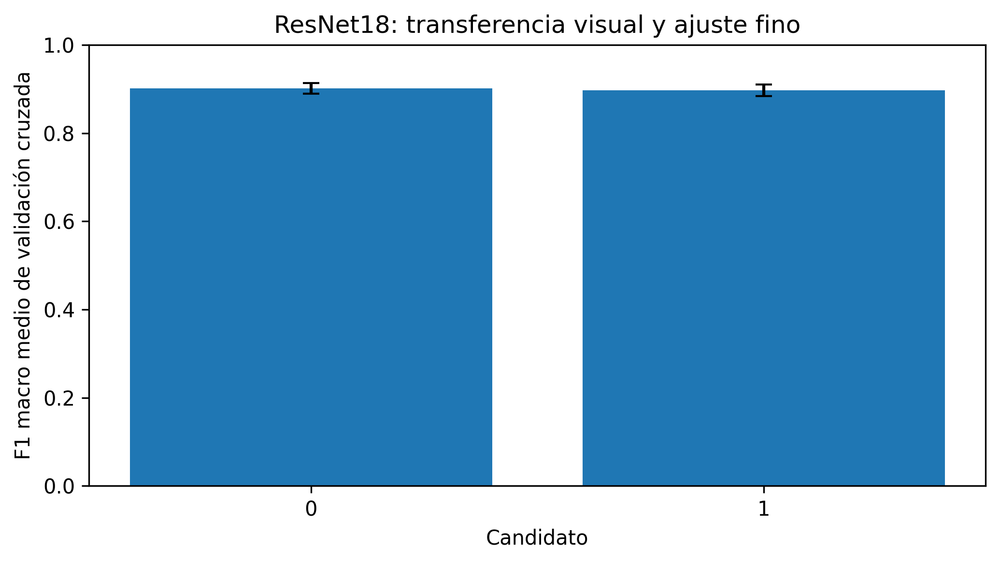
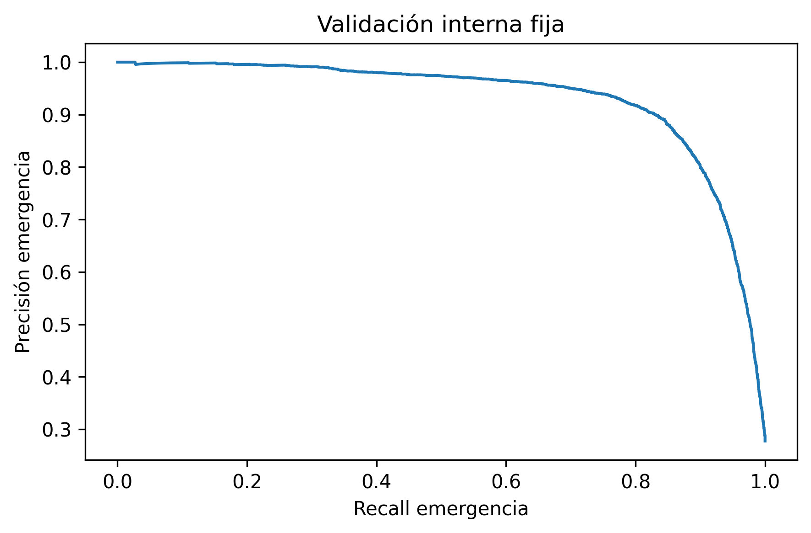
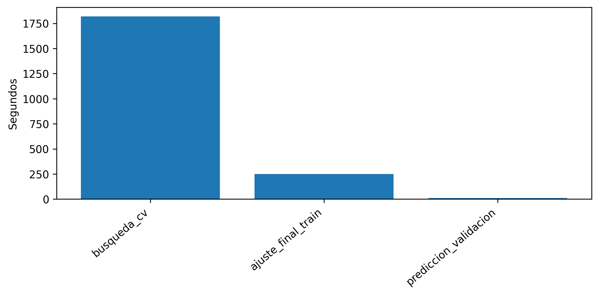
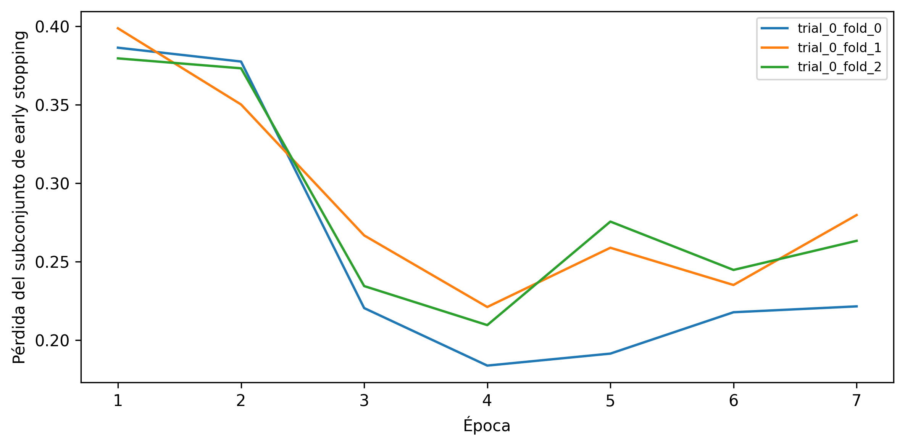
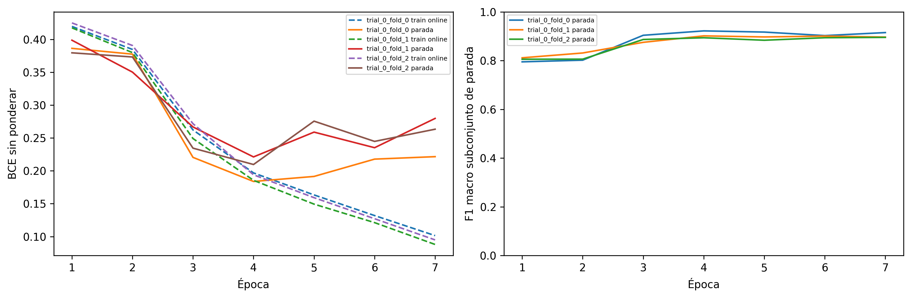

# ResNet18 con transferencia visual: documentación del modelo entrenado

Este documento describe la ejecución entregada del **12 de octubre de 2026**, desde el audio de origen hasta el artefacto final. Explica el procedimiento que realmente ejecutó la notebook, los parámetros guardados y las métricas exportadas. Las fórmulas desarrollan esas operaciones; las interpretaciones se distinguen de las mediciones. Se puede leer de manera independiente de los informes de los otros modelos.

El modelo obtuvo **F1 macro = 0,905709**, **recall de emergencia = 0,822662** y **FPR = 0,033573** en 29 315 segmentos de validación interna fija. El umbral exportado es **`0.6547843813896179`**. La búsqueda OOF no encontró un umbral que satisficiera simultáneamente recall ≥ 0,90 y FPR < 0,10; se utilizó la alternativa prevista de máximo F1 macro OOF. El recall por segmento de la validación fija tampoco alcanza 0,90. **La evaluación externa de LSSiren sigue pendiente.**

## Guía de lectura

- [1. Identidad de la ejecución y fuentes](#seccion-1)
- [2. Corpus, etiquetas y limpieza previa](#seccion-2)
- [3. Preprocesamiento de la señal](#seccion-3)
- [4. Entrada Log-Mel, almacenamiento y normalización](#seccion-4)
- [5. Particiones, grupos y folds](#seccion-5)
- [6. Arquitectura, transferencia y matemática de ResNet18](#seccion-6)
- [7. Entrenamiento profundo y parada interna](#seccion-7)
- [8. Búsqueda de candidatos y ajuste seleccionado](#seccion-8)
- [9. Umbral OOF y restricciones operativas](#seccion-9)
- [10. Resultados de la validación interna fija](#seccion-10)
- [11. Figuras originales y lectura técnica](#seccion-11)
- [12. Entorno, tiempos y costo computacional](#seccion-12)
- [13. Artefacto final, trazabilidad y recarga](#seccion-13)
- [14. Alcance de las conclusiones y trabajo pendiente](#seccion-14)

<a id="seccion-1"></a>

## 1. Identidad de la ejecución y fuentes

| Campo | Valor |
| --- | --- |
| Notebook | [05_resnet18.ipynb](../../notebooks/05_resnet18.ipynb) |
| Modelo | `05_resnet18` |
| Estado de entrenamiento | `COMPLETE` |
| Inicio UTC | `2026-10-12T20:05:27.224108+00:00` |
| Cierre de entrenamiento UTC | `2026-10-12T20:42:53.377137+00:00` |
| Semilla de preparación y entrenamiento | 42 |
| Evaluación externa | `external_evaluated=false`; `holdout_evaluated=false` |
| Resultados originales | `data/results/05_resnet18_resultados/` |
| Modelo original | `data/models/05_resnet18_modelos/models/` |
| Configuración efectiva | [config/training_config.json](evidencia/05_resnet18/config/training_config.json) |
| Experimento congelado | [config/frozen_experiment.json](evidencia/05_resnet18/config/frozen_experiment.json) |
| Estado exportado | [reports/run_status.json](evidencia/05_resnet18/reports/run_status.json) |

La clase positiva es `EMERGENCY=1`; la negativa, `NON_EMERGENCY=0`. El problema es clasificación binaria de ventanas: no distingue ambulancia, bomberos y policía como salidas separadas, no estima distancia ni dirección y no localiza el inicio exacto de un evento. El marco del proyecto se encuentra en [objetivos](../2/2.3/objetivos.md), [alcance](../2/2.5/delimitacion-del-alcance.md) y [modelos considerados](../5/5.1/modelos-considerados.md).

Las tablas y figuras enlazadas en `evidencia/05_resnet18/` y `figuras/05_resnet18/` son copias de las exportaciones, con igualdad de SHA-256 comprobada. Los archivos de `inspeccion/` son derivados identificados: lectura de parámetros y recálculo de métricas existentes, sin volver a entrenar. [El manifiesto](evidencia/manifest.csv) permite distinguir ambos orígenes. Los archivos binarios permanecen en `data/models`; no se incorporan a la documentación.

<a id="seccion-2"></a>

## 2. Corpus, etiquetas y limpieza previa

### 2.1. Origen de la etiqueta binaria

| Corpus | Etiqueta positiva | Etiqueta negativa | Participación |
| --- | --- | --- | --- |
| AudioSet-EV v2 | Rutas documentadas `Positive_files` / `EV_Positives`, contrastadas con metadata | `Negative_files` / `EV_Negatives` | Entrenamiento y validación fija |
| sireNNet | `ambulance`, `firetruck`, `police` | `traffic` | Entrenamiento y validación fija |
| A3Siren-Recordings | `Siren` | `Noise` | Entrenamiento y validación fija, agrupando los canales de cada track |
| LSSiren | `Ambulance` | `Road` | Reserva exclusiva para generalización externa |

Se conserva la procedencia y, en AudioSet, las etiquetas originales cuando están disponibles. La etiqueta de archivo o track se hereda a cada ventana. Una ventana positiva puede contener intervalos sin sirena o ruido dominante: las etiquetas son débiles respecto de la actividad exacta dentro de esos tres segundos. No se introdujo una nueva anotación temporal ni aumento de datos en esta ejecución (`new_augmentation=false`). Las versiones aumentadas que pudiera traer sireNNet pertenecen al corpus de origen.

### 2.2. Qué se excluyó realmente

El inventario inicial contiene **32 429 archivos**. Se excluyeron lógicamente dos audios inválidos de AudioSet-EV v2 y 169 duplicados exactos: 20 de AudioSet, 141 de LSSiren y 8 de sireNNet. Quedaron 32 258 archivos después de esta limpieza. A continuación se descartaron 54 archivos demasiado cortos para una ventana completa: 21 de AudioSet y 33 de LSSiren. La preparación final usa **32 204 archivos** y genera **153 993 segmentos**, incluyendo la reserva externa.

| Corpus | Conservados tras limpieza | Duplicados excluidos | Inválidos excluidos | Cortos excluidos después |
| --- | --- | --- | --- | --- |
| AudioSet-EV v2 | 28 794 | 20 | 2 | 21 |
| sireNNet | 1 667 | 8 | 0 | 0 |
| A3Siren-Recordings | 104 | 0 | 0 | 0 |
| LSSiren | 1 693 | 141 | 0 | 33 |

La deduplicación usa SHA-256 de archivos: detecta igualdad binaria, pero no audios iguales que hayan sido recodificados o modificados. Las alertas de silencio, clipping y posible cancelación al promediar canales se registran; su existencia no equivale a aplicar un filtro nuevo de eliminación. Evidencia: [limpieza](evidencia/preparacion/reports/cleaning_summary.csv), [validaciones finales](evidencia/preparacion/reports/final_preparation_validation.csv) y [alcance de independencia](evidencia/preparacion/reports/independence_scope.json).

<a id="seccion-3"></a>

## 3. Preprocesamiento de la señal

### 3.1. Decodificación, canales, remuestreo y amplitud

El audio se decodifica a valores numéricos, se promedian los canales que contiene cada WAV y se convierte a `float32`. Para un WAV con $C$ canales:

$$
x_{mono}[n]=\frac{1}{C}\sum_{c=1}^C x_c[n].
$$

Los ocho WAV de canal de un track A3 se conservan como fuentes separadas. El promedio anterior se aplica **dentro de cada WAV**, no entre esos ocho archivos. Todos los canales y ventanas de un track comparten grupo para impedir que se distribuyan entre entrenamiento y validación.

Si la tasa original difiere, `librosa.resample(..., res_type="soxr_hq")` lleva la señal a **16 000 Hz**. Después se normaliza el pico de **la grabación completa**, antes de segmentar:

$$
a=\max_n|x_{mono}[n]|,\qquad
\widetilde x[n]=\begin{cases}0,99\,x_{mono}[n]/a,&a>0,\\x_{mono}[n],&a=0.\end{cases}
$$

El factor se calcula después del remuestreo. Esta operación homogeniza el máximo digital de cada grabación, pero no recupera el nivel de presión sonora original, no elimina distorsión por clipping y puede amplificar una señal con pico muy pequeño. El RMS posterior expresa energía relativa dentro de una grabación normalizada, no decibelios SPL calibrados. Como el pico usa toda la grabación, una implementación en flujo continuo necesitaría resolver explícitamente esta dependencia; no se ha medido aquí una normalización causal en línea.

### 3.2. Ventanas y dependencia temporal

Se extraen **48 000 muestras** por ventana (3 s), con salto de **24 000 muestras** (1,5 s): solapamiento del 50 %. Para una señal de $L$ muestras:

$$
N_{ventanas}=\begin{cases}1+\left\lfloor\dfrac{L-48000}{24000}\right\rfloor,&L\ge48000,\\0,&L<48000.\end{cases}
$$

La ventana $i$ comienza en $i\,24000$ y termina antes de $i\,24000+48000$. Se descartan clips cortos y colas incompletas; no hay relleno para producir ventanas de audio adicionales. El relleno de borde de la STFT que se explica enseguida es una operación distinta. Los segmentos solapados están correlacionados y no deben tratarse como grabaciones independientes. Multiplicar el número de ventanas por 3 s cuenta audio repetido por solapamiento, no duración única de captura.

### 3.3. STFT reutilizada para las representaciones

Para cada segmento se calcula una única STFT con ventana Hann periódica de 2 048 muestras, salto de 512, `center=True` y relleno constante cero. Si $x_p$ denota la señal con 1 024 ceros añadidos a cada borde:

$$
D[k,t]=\sum_{n=0}^{2047}x_p[t\,512+n]h[n]e^{-j2\pi kn/2048},\qquad
h[n]=\tfrac12\left(1-\cos\tfrac{2\pi n}{2048}\right).
$$

Se conservan $k=0,\dots,1024$, con $f_k=k\,16000/2048$. La separación entre bins es **7,8125 Hz**, la ventana de análisis dura **128 ms** y los centros de frames están separados **32 ms**. Hay $1+\lfloor48000/512\rfloor=94$ frames por segmento: magnitud y potencia tienen dimensión **1 025 × 94**. Se define $A[k,t]=|D[k,t]|$ y $P[k,t]=A[k,t]^2$. La resolución efectiva también depende de la ventana; la separación entre bins no garantiza distinguir dos tonos separados exactamente por esa cantidad. Estas dimensiones se derivan del código ejecutado y de la [convención de STFT de Librosa 0.11.0](https://librosa.org/doc/0.11.0/generated/librosa.stft.html).

### 3.4. Mel, decibelios y diferencia entre MFCC y Log-Mel

Un banco $B\in\mathbb R^{64\times1025}$ proyecta la potencia a 64 bandas entre 20 y 8 000 Hz:

$$
M[m,t]=\sum_{k=0}^{1024}B[m,k]P[k,t].
$$

El banco usa escala Slaney (`htk=False`) y normalización por área (`norm="slaney"`). Los triángulos están distribuidos según esa escala; no se aplica la fórmula HTK $2595\log_{10}(1+f/700)$ como sustitución. [La API de Mel](https://librosa.org/doc/0.11.0/generated/librosa.filters.mel.html) identifica estas opciones.

Para las redes, el Log-Mel exportado usa $R=\max_{m,t}M[m,t]$, piso $\epsilon=10^{-10}$ y rango de 80 dB:

$$
L_0[m,t]=10\log_{10}\max(M[m,t],\epsilon)-10\log_{10}\max(R,\epsilon),
$$

$$
L[m,t]=\max\left(L_0[m,t],\max_{m,t}L_0[m,t]-80\right).
$$

Así se obtiene una matriz **64 × 94 `float32`**, con máximo relativo 0 dB y piso de hasta −80 dB. La referencia al máximo corresponde al segmento completo; elimina el nivel absoluto de su espectrograma. Una señal enteramente nula produce un caso degenerado con la referencia limitada por el mismo piso, no una medición de intensidad física.

Los MFCC reutilizan $M$, pero transforman a dB con **`ref=1.0`**, no con `ref=max`. Sobre esa matriz de dB, también limitada a 80 dB respecto de su máximo, se aplica DCT-II ortonormal sin lifter y se promedian 13 coeficientes en el tiempo. Confundir ambas referencias cambia especialmente el coeficiente de orden cero y deja de reproducir los insumos empleados.
<a id="seccion-4"></a>

## 4. Entrada Log-Mel, almacenamiento y normalización

La red recibe $L\in\mathbb R^{64\times94}$ por segmento. Las 21 características tabulares también fueron preparadas, pero **no se concatenan ni entran a esta arquitectura**. El tensor conserva bandas de frecuencia y evolución temporal de cada ventana; no es una imagen RGB del audio ni una figura renderizada con un mapa de colores.

### 4.1. Contrato compacto y acceso por filas

La ejecución consume `doppler-prepared-v3`. Cada partición tiene un contenedor `.npy`: train **(118 314, 64, 94)**, validation **(29 315, 64, 94)** y generalization **(6 364, 64, 94)**. Sus cargas numéricas ocupan aproximadamente 2,652 GiB, 0,657 GiB y 0,143 GiB, respectivamente, sin contar cabeceras. La red abre solo los contenedores de desarrollo para su consumo predictivo.

`segment_id` conserva la unión lógica; `representation_path` identifica el contenedor y `representation_row` señala una fila con índice desde cero. La notebook contrasta hashes publicados, dimensiones, finitud y asignación de filas, y rechaza índices repetidos o inválidos. Los lectores mantienen compatibilidad con v2, pero esta ejecución utiliza v3.

Las matrices se abren con `numpy.load(..., mmap_mode="r", allow_pickle=False)`. El mapeo permite recuperar filas sin construir otra matriz completa de desarrollo. Las selecciones por lote y la normalización sí crean buffers temporales. Además, las páginas mapeadas que el sistema mantiene residentes pueden aumentar el RSS; memoria mapeada no significa RAM constante ni ausencia de costo de lectura. [Referencia de NumPy](https://numpy.org/doc/stable/reference/generated/numpy.load.html).

### 4.2. Estadísticas por banda, ajustadas donde corresponde

Para las filas de ajuste $\mathcal F$, con $n_F$ segmentos y $T=94$, se estima por cada banda $m$:

$$
\mu_m=\frac1{n_FT}\sum_{i\in\mathcal F}\sum_t L_i[m,t],\qquad
\sigma_m=\sqrt{\max\left(\frac1{n_FT}\sum_{i\in\mathcal F}\sum_tL_i[m,t]^2-\mu_m^2,10^{-12}\right)}.
$$

$$
Z_i[m,t]=\frac{L_i[m,t]-\mu_m}{\sigma_m}.
$$

Las sumas se acumulan en `float64`, en bloques de 256 segmentos; los 64 valores de media y desviación resultantes se guardan en `float32`. No se normaliza cada posición temporal de forma independiente ni se fuerza cada espectrograma a media cero. El piso de varianza es $10^{-12}$; corresponde a una desviación mínima de $10^{-6}$.

Durante CV, $\mathcal F$ incluye solo el subconjunto que recibe gradientes, excluyendo tanto la parada interna como la validación del fold externo. Para el ajuste final, incluye todos los 118 314 segmentos de train y excluye los 29 315 de validación fija. Las estadísticas finales de CNN y ResNet18 coinciden porque utilizan las mismas filas y representación. Se guardan junto a los pesos: recalcularlas con datos de producción cambia el modelo efectivo.

### 4.3. DataLoader y tensores efectivos

Después de normalizar se añade el canal: un ejemplo es **(1, 64, 94)**. La lectura vectorizada por lote evita abrir un archivo por cada segmento. El `DataLoader` usa `num_workers=0`, `drop_last=False`, generador con semilla 42 y `shuffle=True` durante ajuste; las evaluaciones conservan orden. En CUDA usa `pin_memory=True` y transferencias con `non_blocking=True`. La última tanda puede contener menos ejemplos que el lote configurado.

Contrato consumido: [config/representation_contract.json](evidencia/05_resnet18/config/representation_contract.json). Estadísticas de las 64 bandas: [inspeccion/normalization.csv](evidencia/05_resnet18/inspeccion/normalization.csv). El artefacto [models/inference.json](evidencia/05_resnet18/models/inference.json) guarda forma, umbral y normalización. Los hashes de los contenedores se encuentran en [el manifiesto de preparación](evidencia/preparacion/metadata/representation_containers.csv).

<a id="seccion-5"></a>

## 5. Particiones, grupos y folds

### 5.1. Separación fija antes de segmentar

Se reserva LSSiren completo como `generalization`. Los otros tres corpus se dividen por grupos, antes de crear ventanas. Para cada estrato de corpus y composición de etiquetas del grupo, se ordenan identificadores, se barajan con `numpy.random.default_rng(42)` y se asigna a validación un número de grupos cercano al 20 %, redondeado y limitado para conservar grupos en ambos lados cuando es posible. Esto no exige exactamente un 20 % de segmentos: la duración de las grabaciones y el número de canales varían.

| Partición | Corpus | Emergencia | No emergencia | Segmentos | Archivos | Grupos conocidos |
| --- | --- | --- | --- | --- | --- | --- |
| generalization | LSSiren | 2 888 | 3 476 | 6 364 | 1 660 | 1 660 |
| train | A3Siren-Recordings | 944 | 1 560 | 2 504 | 88 | 11 |
| train | AudioSet-EV v2 | 31 333 | 83 143 | 114 476 | 23 018 | 23 018 |
| train | sireNNet | 997 | 337 | 1 334 | 1 334 | 1 334 |
| validation | A3Siren-Recordings | 40 | 312 | 352 | 16 | 2 |
| validation | AudioSet-EV v2 | 7 848 | 20 782 | 28 630 | 5 755 | 5 755 |
| validation | sireNNet | 249 | 84 | 333 | 333 | 333 |

Totales: **train = 118 314 segmentos / 24 440 archivos / 24 363 grupos**, **validation = 29 315 / 6 104 / 6 090**, **generalization = 6 364 / 1 660 / 1 660**. Train tiene 33 274 positivos y 85 040 negativos; validación fija tiene 8 137 positivos y 21 178 negativos. LSSiren conserva 2 888 positivos y 3 476 negativos únicamente como reserva.

La proporción de emergencia en train es 28,123 %; en validación, 27,757 %. Las cifras corresponden a esta ejecución v3. Los conteos de documentos anteriores —por ejemplo, 118 349 y 29 280— pertenecen a evidencia histórica y no describen estas particiones.

### 5.2. Qué significa un grupo y qué independencia se comprobó

Se preservan los grupos declarados en el paquete. Las relaciones de archivo, track, hash y columnas recuperables `source_video_id`, `original_recording_id`, `augmentation_parent_id` se unen en componentes de dependencia, en vez de sustituir silenciosamente los grupos originales. Una relación conocida que cruce particiones provoca rechazo. Los identificadores de grupo se usan para dividir datos, no como entrada del predictor.

El reporte de entrenamiento registra **cero grupos conocidos cruzando splits**. En A3, 104 archivos pertenecen a 13 tracks: train tiene 11 tracks (6 positivos y 5 negativos) y validación solo 2 (uno positivo y uno negativo). Los ocho canales de cada track están juntos. La agrupación evita fuga entre estos canales, aunque cada canal sigue contribuyendo como un ejemplo distinto al entrenamiento y a la métrica por segmento.

Hay **1 667 archivos de sireNNet sin metadata de padre original o de aumento**. Por ello, la separación garantiza las dependencias identificadas, pero no demuestra independencia de todas las versiones aumentadas aguas arriba. Tampoco se realizó búsqueda de duplicados perceptuales. Una cifra grande de segmentos no elimina estas limitaciones. Evidencia: [tables/leakage_audit.csv](evidencia/05_resnet18/tables/leakage_audit.csv) y [reports/independence_scope.json](evidencia/05_resnet18/reports/independence_scope.json).

### 5.3. Validación cruzada de selección

Solo train se subdivide con `StratifiedGroupKFold(n_splits=3, shuffle=True, random_state=42)`. La estratificación de CV se hace sobre la etiqueta binaria, manteniendo cada grupo indivisible; no se estratifica conjuntamente por corpus y clase. La validación fija no se usa para elegir candidatos ni umbral.

| Fold, índice desde cero | Train del fold externo | Validación del fold externo | Positivos externos | Negativos externos | Grupos externos |
| --- | --- | --- | --- | --- | --- |
| 0 | 79 114 | 39 200 | 11 052 | 28 148 | 8 099 |
| 1 | 78 303 | 40 011 | 11 065 | 28 946 | 8 101 |
| 2 | 79 211 | 39 103 | 11 157 | 27 946 | 8 163 |

Cada uno de los 118 314 segmentos aparece una vez en validación externa de CV, generando una puntuación OOF (*out of fold*). Las cinco notebooks comparten exactamente asignaciones de folds e identificadores de validación fija. El SHA-256 registrado para las asignaciones es:

```text
3528557381804ea80cf8a9fd230bbe0c37f24e721094162609a2c41f83a2154d
```

La distribución de corpus no queda equilibrada automáticamente: el fold 2 contiene 320 segmentos positivos A3 y **ningún segmento negativo A3**. Ambos valores de la etiqueta sí existen globalmente en cada fold. Por ello, los resultados globales de CV no equivalen a una estimación estable por corpus, particularmente en A3. El detalle completo se conserva en [tables/cv_distribution.csv](evidencia/05_resnet18/tables/cv_distribution.csv).

Las métricas de CV y el umbral OOF forman parte de la selección sobre desarrollo. Como se eligió el candidato usando estos folds, su puntuación OOF no es una estimación completamente independiente de esa selección. El procedimiento no implementa una evaluación externa anidada que repita toda la selección. La validación fija aporta otra partición de desarrollo; la evidencia de generalización a otro corpus requiere LSSiren, todavía pendiente.

<a id="seccion-6"></a>

## 6. Arquitectura, transferencia y matemática de ResNet18

### 6.1. Procedencia de la inicialización

La red utiliza `torchvision.models.resnet18` inicializada con **`ResNet18_Weights.IMAGENET1K_V1`**. Los pesos se entrenaron para imágenes de ImageNet, no para sirenas. El SHA-256 registrado del archivo de inicialización es:

```text
f37072fd47e89c5e827621c5baffa7500819f7896bbacec160b1a16c560e07ec
```

La capa original de 1 000 clases se sustituye por `Dropout(0.3) → Linear(512,1)`. El artefacto final guarda el estado completo ajustado; la inicialización preentrenada es un insumo del entrenamiento, no una dependencia que deba descargarse para recargar el resultado.

El tensor normalizado de un canal se **repite tres veces**: $(1,64,94)\to(3,64,94)$. Esos canales son idénticos; no representan tres micrófonos ni una conversión de colores. Se conserva la forma nativa **64 × 94**: no se redimensiona a 224 × 224, no se recorta y no se aplica normalización RGB de ImageNet. La normalización usada es la de bandas acústicas de train. [La documentación de los pesos oficiales](https://docs.pytorch.org/vision/0.26/models/generated/torchvision.models.resnet18.html) describe su origen; las adaptaciones de entrada proceden del código del proyecto.

### 6.2. Etapas y formas de los tensores

| Etapa | Operación | Forma de salida sin lote |
| --- | --- | --- |
| Entrada repetida | Tres copias del mismo Log-Mel | 3 × 64 × 94 |
| Stem | Conv 7 × 7, 3→64, stride 2, padding 3; BatchNorm; ReLU | 64 × 32 × 47 |
| Pooling inicial | MaxPool 3 × 3, stride 2, padding 1 | 64 × 16 × 24 |
| layer1 | 2 BasicBlock, 64 canales, sin reducción | 64 × 16 × 24 |
| layer2 | 2 BasicBlock, 128 canales; primer bloque stride 2 | 128 × 8 × 12 |
| layer3 | 2 BasicBlock, 256 canales; primer bloque stride 2 | 256 × 4 × 6 |
| layer4 | 2 BasicBlock, 512 canales; primer bloque stride 2 | 512 × 2 × 3 |
| Agregación | AdaptiveAvgPool2d(1); Flatten | 512 |
| Cabeza | Dropout 0,3; Linear(512,1) | 1 logit |
| Puntuación | Sigmoide del logit | 1 score de emergencia |

La estructura `[2,2,2,2]` contiene ocho bloques residuales básicos. La denominación ResNet18 cuenta la convolución inicial, 16 convoluciones principales de los bloques y la capa final en la convención arquitectónica; las proyecciones de atajo no se suman como nuevos bloques. El [código oficial de Torchvision 0.26](https://docs.pytorch.org/vision/0.26/_modules/torchvision/models/resnet.html) permite verificar strides, pooling y proyecciones.

### 6.3. Bloque residual y proyección

Cada BasicBlock aplica dos convoluciones 3 × 3 sin bias, con BatchNorm después de cada una; ReLU aparece entre ellas y después de la suma:

$$
F(h)=\mathrm{BN}_2\left(\mathrm{Conv}_2\left(\mathrm{ReLU}\left(\mathrm{BN}_1(\mathrm{Conv}_1(h))\right)\right)\right),\qquad
h'=\mathrm{ReLU}\big(F(h)+P(h)\big).
$$

Cuando no cambian dimensiones, $P(h)=h$. Al entrar a `layer2`, `layer3` y `layer4`, $P$ es una convolución 1 × 1 con stride 2 seguida de BatchNorm para hacer coincidir canales y tamaño. La suma obliga a comparar representaciones compatibles. En el caso de atajo identidad, el Jacobiano de la suma contiene $I+\partial F/\partial h$ antes de ReLU: crea una vía de propagación adicional, aunque no garantiza por sí sola ausencia de problemas de optimización.

Las convoluciones comparten pesos en banda y tiempo. Usar un patrón de imagen para un espectrograma es una transferencia de representación; no prueba que los filtros originales tengan interpretación acústica. La evidencia de utilidad procede de los resultados, con el desglose de corpus que se presenta después.

### 6.4. Parámetros y cabeza binaria

El modelo final tiene **11 177 025 parámetros entrenables en la fase de ajuste fino**. De ellos, **513** pertenecen a la nueva capa lineal ($512$ pesos más un bias); los otros **11 176 512** pertenecen al backbone. Dropout no agrega parámetros. En las primeras dos épocas solo están habilitados los 513 de la cabeza.

El estado contiene **122 entradas**, incluyendo parámetros y buffers de BatchNorm. Por ello, sumar todos los elementos del `state_dict` no es el mismo conteo que sumar `model.parameters()`. Inventario real: [inspeccion/state_tensors.csv](evidencia/05_resnet18/inspeccion/state_tensors.csv). La cifra de parámetros se registra también en [tables/latency.csv](evidencia/05_resnet18/tables/latency.csv).

La agregación final promedia las seis posiciones de cada uno de los 512 canales; la cabeza produce $u=b+w^Ta$ y $p=\sigma(u)$. Se emplea pérdida binaria de logits, sin softmax de 1 000 clases. El lote global efectivo es **128**, es decir, normalmente 64 ejemplos por cada una de las dos T4; no es un lote de 64 global.

### 6.5. Congelamiento, BatchNorm y ajuste fino

Durante épocas 1 y 2, `requires_grad=False` congela el backbone y se entrena la nueva cabeza. Desde época 3, todos sus parámetros se habilitan, con tasa del backbone **0,0001** y tasa de la cabeza **0,001**. El multiplicador es 0,1 y no cambia por época; no hay scheduler.

En **todas** las épocas, cada `BatchNorm2d` se coloca en modo evaluación para conservar medias y varianzas corrientes de la inicialización. Esto evita que distintas réplicas de `DataParallel` estimen nuevas estadísticas con minibatches separados. La transformación es:

$$
\mathrm{BN}(h_c)=\gamma_c\frac{h_c-\mu_{c,guardada}}{\sqrt{v_{c,guardada}+10^{-5}}}+\beta_c.
$$

Congelar esas estadísticas no significa congelar sus parámetros afines durante todo el entrenamiento: $\gamma_c$ y $\beta_c$ quedan congelados en las dos primeras épocas y pueden recibir gradientes desde la tercera, junto con el backbone. `model.train()` mantiene dropout activo y luego el código vuelve a poner las BatchNorm en `eval()`; son controles distintos.

El checkpoint de CV solo es elegible desde época 3. Las primeras dos épocas no incrementan la paciencia ni pueden ser el estado ganador; así se exige que el modelo elegido haya pasado por ajuste fino. El ajuste final de **cuatro épocas** contiene exactamente dos de cabeza y dos de ajuste fino. No se conservó solo un extractor congelado permanentemente.

<a id="seccion-7"></a>

## 7. Entrenamiento profundo y parada interna

### 7.1. Tres roles distintos en cada fold

Cada fold externo separa sus propias filas de train con `StratifiedGroupKFold(5, shuffle=True, random_state=42+fold_externo)`. Se toma **solo la primera partición**: aproximadamente cuatro quintas partes reciben gradientes (`fit`) y una quinta parte controla parada (`early_stopping`). No se ejecuta una búsqueda interna de cinco folds completos. La validación del fold externo queda fuera de ambos subconjuntos y se utiliza para las métricas OOF.

| Fold externo | Rol | Segmentos | Positivos | Negativos | Grupos |
| --- | --- | --- | --- | --- | --- |
| 0 | early_stopping | 15 611 | 4 254 | 11 357 | 3 228 |
| 0 | fit | 63 503 | 17 968 | 45 535 | 13 036 |
| 0 | outer_validation | 39 200 | 11 052 | 28 148 | 8 099 |
| 1 | early_stopping | 15 672 | 4 777 | 10 895 | 3 228 |
| 1 | fit | 62 631 | 17 432 | 45 199 | 13 034 |
| 1 | outer_validation | 40 011 | 11 065 | 28 946 | 8 101 |
| 2 | early_stopping | 15 825 | 4 225 | 11 600 | 3 211 |
| 2 | fit | 63 386 | 17 892 | 45 494 | 12 989 |
| 2 | outer_validation | 39 103 | 11 157 | 27 946 | 8 163 |

Los grupos son disjuntos entre los tres roles. Las asignaciones internas de CNN y ResNet18 coinciden. Tanto la normalización de bandas como el peso positivo se calculan con `fit`, sin usar la parada interna. Los pesos positivos de estos ajustes son:

| Fold | Peso positivo $n_-/n_+$ |
| --- | --- |
| 0 | 2,534228 |
| 1 | 2,592875 |
| 2 | 2,542701 |

### 7.2. Función de pérdida y ponderación

Con un logit $u_i$, $p_i=\sigma(u_i)$ y $q=n_-/n_+$:

$$
\ell_i=-q\,y_i\log p_i-(1-y_i)\log(1-p_i),\qquad
\mathcal L=\frac1B\sum_{i=1}^B\ell_i.
$$

Se implementa con `BCEWithLogitsLoss(pos_weight=q)` para combinar sigmoide y entropía cruzada de forma numéricamente estable. Solo el término positivo se multiplica por $q$. El divisor es el número de ejemplos del lote, **no la suma de pesos**. En el ajuste final $q=85040/33274=2,555749$. La [API de PyTorch 2.11](https://docs.pytorch.org/docs/2.11/generated/torch.nn.BCEWithLogitsLoss.html) especifica esa semántica.

El gradiente por logit es $q(p_i-1)$ para un positivo y $p_i$ para un negativo, antes de dividir por $B$. El balance aumenta la contribución de positivos, pero no impone recall de 0,90 ni un FPR determinado. Como modifica el riesgo de ajuste, una salida sigmoide tampoco demuestra calibración con la prevalencia real.

### 7.3. AdamW, clipping y precisión mixta

AdamW usa momentos $m_t=\beta_1m_{t-1}+(1-\beta_1)g_t$ y $v_t=\beta_2v_{t-1}+(1-\beta_2)g_t^2$, con corrección de sesgo $\widehat m_t=m_t/(1-\beta_1^t)$ y $\widehat v_t=v_t/(1-\beta_2^t)$. La actualización, esquemáticamente, es:

$$
\theta_t=(1-\eta\lambda)\theta_{t-1}-\eta\frac{\widehat m_t}{\sqrt{\widehat v_t}+\epsilon},\qquad
\beta_1=0,9,\ \beta_2=0,999,\ \epsilon=10^{-8}.
$$

La reducción por $\lambda$ está desacoplada del gradiente de la pérdida. En este código, el `weight_decay` se aplica a todos los parámetros incluidos en el optimizador, sin crear una excepción separada para biases o normalización. En ResNet, un parámetro congelado sin gradiente no recibe actualización. [Definición de AdamW](https://docs.pytorch.org/docs/2.11/generated/torch.optim.AdamW.html).

Antes de actualizar se desescala el gradiente de AMP y se limita su norma global a **5,0** mediante `clip_grad_norm_`:

$$
g\leftarrow g\min\left(1,\frac5{\|g\|_2+\epsilon_c}\right).
$$

El optimizador usa `zero_grad(set_to_none=True)`. AMP está habilitado en CUDA: `autocast` selecciona precisión por operación y `GradScaler` escala/desescala gradientes para reducir problemas de rango. Los pesos exportados permanecen en el dtype del estado guardado, principalmente `float32`; AMP no convierte todo el archivo a un modelo cuantizado.

`DataParallel` reparte el lote global de **128** en hasta dos GPU. La ejecución reporta dos **Tesla T4 de 15 360 MiB cada una**. Se fijan semillas de Python, NumPy y Torch; `cudnn.benchmark=False` y `cudnn.deterministic=True` reducen variación, pero no garantizan igualdad bit a bit entre versiones, dispositivos o rutas de precisión.

Las pérdidas y contadores de confusión de entrenamiento se acumulan en el dispositivo. Se transfieren resúmenes al final de la época y hay logs periódicos cada 100 batches. Se mantiene una comprobación de pérdida finita por lote; por tanto, no se ha eliminado toda sincronización. La evaluación usa modo `eval()` y contexto de inferencia, desactivando dropout y gradientes.

### 7.4. Regla exacta de parada

El presupuesto es **15 épocas máximas**, paciencia **3** y mejora mínima **0,0001**. La parada evalúa **BCE sin ponderación** sobre las filas internas, con probabilidades limitadas a $[10^{-7},1-10^{-7}]$ antes del logaritmo. Un checkpoint mejora cuando $\mathcal L_{stop}<\mathcal L_{mejor}-0,0001$. Cada época elegible sin esa mejora incrementa paciencia; al alcanzar tres, termina y se restaura el mejor estado.

Las métricas `inner_stop_f1`, recall y FPR usan umbral 0,5, pero **no deciden el checkpoint**: lo decide la pérdida. En ResNet, la elegibilidad comienza después de las dos épocas de cabeza. La validación fija no decide la parada.

`train_loss` es BCE ponderada; `train_loss_unweighted` es BCE sin ponderación calculada en batches de entrenamiento. `online_train_f1` agrega predicciones obtenidas mientras los parámetros cambian y dropout está activo. No es la evaluación retrospectiva del checkpoint final sobre todo train; una comparación de curvas debe tener presente esa diferencia.

### 7.5. Épocas efectivamente ejecutadas

| Ajuste | Épocas ejecutadas | Checkpoint elegido | BCE interna del elegido | F1 interno del elegido | Suma de tiempos de época, s |
| --- | --- | --- | --- | --- | --- |
| trial_0_fold_0 | 7 | 4 | 0,183841 | 0,921811 | 302,453846 |
| trial_0_fold_1 | 7 | 4 | 0,221168 | 0,901391 | 283,870194 |
| trial_0_fold_2 | 7 | 4 | 0,209638 | 0,893663 | 288,785700 |
| trial_1_fold_0 | 7 | 4 | 0,185698 | 0,916988 | 296,583465 |
| trial_1_fold_1 | 6 | 3 | 0,231589 | 0,894380 | 243,364095 |
| trial_1_fold_2 | 7 | 4 | 0,235685 | 0,888969 | 298,220226 |
| final_train | 4 | 4 | — | — | 249,188725 |

El ajuste final usa la mediana, redondeada, de las mejores épocas del candidato seleccionado: **4 épocas**. Se inicia un modelo nuevo, se estima normalización con todo train y se entrena con sus 118 314 segmentos durante ese número fijo. No se reutiliza directamente uno de los modelos de folds ni se crea un ensemble de sus checkpoints. En el ajuste final no existe subconjunto de parada y se conserva la última época prevista.

La suma de segundos de época no es idéntica a `fit_seconds`: el timer de ajuste incluye trabajo que rodea el registro de épocas, como escritura de logs y checkpoints. **No incluye calcular el normalizador, construir/inicializar el modelo ni preparar el optimizador y loaders**, porque empieza después de esas operaciones. El timer global `busqueda_cv` sí engloba esos preparativos de sus ajustes. `ajuste_final_train` reutiliza el `fit_seconds` devuelto y, por tanto, tampoco expresa todo el tiempo desde la llamada hasta tener el modelo final. Registro completo: [tables/epoch_history.csv](evidencia/05_resnet18/tables/epoch_history.csv).

### 7.6. Evolución del ajuste final sobre train completo

| Época final | BCE ponderada online | BCE sin ponderar online | F1 macro online | Recall online | Tiempo de época, s |
| --- | --- | --- | --- | --- | --- |
| 1 | 0,590207 | 0,403322 | 0,787392 | 0,808469 | 55,032560 |
| 2 | 0,562614 | 0,383305 | 0,800681 | 0,819469 | 55,310980 |
| 3 | 0,370712 | 0,242336 | 0,888644 | 0,863196 | 69,618872 |
| 4 | 0,277410 | 0,180676 | 0,918278 | 0,899140 | 69,226312 |

Estas filas provienen de `final_train`, no de las curvas de parada de los folds. La pérdida ponderada es la que recibe gradientes; la otra permite comparar la escala de BCE sin balance, con las reservas sobre su medición online. No hay una columna de pérdida de validación fija por época: esa partición se conserva fuera del entrenamiento y se evalúa con el modelo final.

<a id="seccion-8"></a>

## 8. Búsqueda de candidatos y ajuste seleccionado

### 8.1. Presupuesto realmente explorado

| trial | lr | weight_decay | dropout |
| --- | --- | --- | --- |
| 0,000000 | 0,001000 | 0,000100 | 0,300000 |
| 1,000000 | 0,000300 | 0,000100 | 0,500000 |

Se compararon **2 candidatos × 3 folds = 6 ajustes de selección**. Los candidatos anteriores son el conjunto completo ejecutado; el informe no supone una búsqueda más amplia de kernels, arquitecturas o regularización.

### 8.2. Regla de elección y resultados de CV

La selección ordena por **F1 macro medio descendente**, después **recall medio descendente** y, solo si persiste empate, **suma del tiempo de ajuste ascendente**. Se exige completar los tres folds. Estas métricas utilizan el umbral predeterminado **0.5**, antes de buscar el umbral operativo OOF. La desviación estándar se calcula entre tres folds con divisor muestral (`ddof=1`); las barras de error no son intervalos de confianza.

| Candidato | F1 macro medio | Desv. estándar F1 | Recall medio | FPR medio | Tiempo de ajuste total, s | Folds completos |
| --- | --- | --- | --- | --- | --- | --- |
| 0 | 0,901465 | 0,012278 | 0,860313 | 0,056353 | 875,283342 | 3 |
| 1 | 0,897031 | 0,012673 | 0,854613 | 0,059159 | 838,353479 | 3 |

El candidato con lr=0,001 y dropout=0,3 gana frente a lr=0,0003 y dropout=0,5; ambos mantienen weight_decay=0,0001. La diferencia de F1 medio es pequeña en relación con la dispersión entre folds y no se ejecutó una prueba de significación. El backbone mantiene una tasa diez veces menor que la cabeza en ambos candidatos.

Detalle de los folds del candidato **0**:

| Fold | Filas con gradientes/ajuste | Filas de evaluación externa del fold | F1 macro | Recall | FPR | ROC-AUC | AP | Ajuste, s | Predicción, s |
| --- | --- | --- | --- | --- | --- | --- | --- | --- | --- |
| 0 | 63 503 | 39 200 | 0,909274 | 0,829352 | 0,032507 | 0,962798 | 0,940256 | 302,509307 | 14,940755 |
| 1 | 62 631 | 40 011 | 0,887313 | 0,874650 | 0,079873 | 0,958707 | 0,932867 | 283,925650 | 15,307908 |
| 2 | 63 386 | 39 103 | 0,907809 | 0,876938 | 0,056681 | 0,964259 | 0,944944 | 288,848385 | 15,638031 |

Para las redes, `train_segments` cuenta las filas `fit`, sin incluir la parada interna; por eso no coincide con todo el train del fold externo mostrado en la sección 5. Para los modelos clásicos coincide con ese train completo. Las filas de evaluación externa del fold siguen siendo las mismas entre modelos.

### 8.3. Configuración final congelada

| Parámetro congelado | Valor |
| --- | --- |
| lr | 0.001 |
| weight_decay | 0.0001 |
| dropout | 0.3 |
| final_epochs | 4 |

Se ajusta un estimador final nuevo con todas las filas de train. Los modelos clásicos vuelven a aprender sus transformaciones y parámetros; las redes vuelven a estimar su normalizador y entrenan el número de épocas fijado desde CV. El umbral se conserva a partir de las puntuaciones OOF del candidato elegido, sin buscar otro sobre la validación fija.

Fuentes: [tables/hyperparameter_candidates.csv](evidencia/05_resnet18/tables/hyperparameter_candidates.csv), [tables/hyperparameter_summary.csv](evidencia/05_resnet18/tables/hyperparameter_summary.csv), [tables/cv_results.csv](evidencia/05_resnet18/tables/cv_results.csv) y [tables/selected_parameters.csv](evidencia/05_resnet18/tables/selected_parameters.csv).

<a id="seccion-9"></a>

## 9. Umbral OOF y restricciones operativas

### 9.1. Barrido exacto de puntuaciones

El candidato elegido aporta una puntuación OOF a cada uno de los **118 314 segmentos de train**, predicha por un modelo cuyo conjunto de ajuste y parada no incluía su grupo. Se ordenan scores descendentes y se acumulan TP y FP por bloques de valores iguales. Los umbrales son los scores únicos; la comparación de clase es **`score >= threshold`**. Se añade un umbral `nextafter(max_score, +inf)` para incluir la solución sin predicciones positivas. Por eso el barrido contiene **12 146 umbrales candidatos**.

Tratar todos los empates como bloque evita resultados que dependan del orden arbitrario de ejemplos con el mismo score. El costo principal es ordenar, de orden $O(n\log n)$, y un barrido lineal; no se recalculan miles de matrices completas ni se utiliza una rejilla aproximada de 1 000 puntos.

El conjunto admisible se define:

$$
\mathcal T_{viable}=\{\tau:\mathrm{recall}(\tau)\ge0,90\ \land\ \mathrm{FPR}(\tau)<0,10\}.
$$

Si existe, se escoge el máximo F1 macro dentro de él. Si está vacío, se toma el máximo F1 macro de todo el barrido, con desempate por mayor recall y después mayor umbral. La igualdad FPR = 0,10 no sería suficiente: el límite es **estricto**.

### 9.2. Resultado y evidencia de inviabilidad

El reporte registra **`feasible_on_training_oof=false`**. La búsqueda no garantiza cumplimiento por el hecho de fijar estas metas. Los dos extremos siguientes permiten comprobar por qué no hay intersección:

| Punto del barrido OOF | Umbral | Recall | FPR | F1 macro |
| --- | --- | --- | --- | --- |
| Menor FPR que alcanza recall ≥ 0,90 | 0,320183247 | 0,900012021 | 0,101246472 | 0,880691848 |
| Mayor recall con FPR < 0,10 | 0,324556440 | 0,898869989 | 0,099952963 | 0,881273258 |

Para obtener el recall requerido en OOF se necesita al menos FPR **0,101246472**; al restringir FPR se alcanza como máximo recall **0,898869989**. Los valores describen el conjunto OOF de desarrollo y su curva discreta, no una frontera demostrada en producción.

El umbral final es **`0.6547843813896179`**, elegido por la alternativa explícita de máximo F1 macro. Comparación OOF recomputada:

| Política | Umbral | F1 macro | Precisión positiva | Recall | FPR | TN | FP | FN | TP |
| --- | --- | --- | --- | --- | --- | --- | --- | --- | --- |
| Predeterminado | 0,500000 | 0,901293 | 0,856126 | 0,860371 | 0,056573 | 80 229 | 4 811 | 4 646 | 28 628 |
| Seleccionado OOF | 0,654784 | 0,905427 | 0,905843 | 0,821422 | 0,033408 | 82 199 | 2 841 | 5 942 | 27 332 |

La media de F1 entre folds de la sección anterior puede diferir del F1 calculado sobre todas las predicciones OOF juntas: F1 es una función no lineal de conteos, y los folds tienen tamaños diferentes. Esta tabla usa la unión de predicciones OOF, no el promedio de sus F1.

ROC-AUC y AP no cambian al mover el umbral sobre los mismos scores. El punto OOF seleccionado no es una nueva ejecución de entrenamiento ni la métrica de validación fija. No se recalibraron scores al pasar del modelo de folds al ajuste con train completo.

Fuentes: [reports/threshold_selection.json](evidencia/05_resnet18/reports/threshold_selection.json) y [inspeccion/documentation_calculations.json](evidencia/05_resnet18/inspeccion/documentation_calculations.json). El barrido íntegro permanece en `data/results/05_resnet18_resultados/tables/threshold_search.csv`; las 118 314 predicciones originales, en `predictions/selected_oof_predictions.csv`.

<a id="seccion-10"></a>

## 10. Resultados de la validación interna fija

### 10.1. Unidad, umbral y fórmulas de evaluación

El estimador final entrenado con train se evalúa sobre **29 315 segmentos** de grupos reservados de los mismos corpus de desarrollo, usando el umbral OOF congelado. Los conteos se definen respecto de `EMERGENCY=1`: TP positivos detectados, FN positivos omitidos, FP negativos declarados emergencia y TN negativos correctamente rechazados.

$$
\mathrm{accuracy}=\frac{TP+TN}{TP+TN+FP+FN},\quad
\mathrm{precision}_+=\frac{TP}{TP+FP},\quad
\mathrm{recall}_+=\frac{TP}{TP+FN},\quad
\mathrm{FPR}=\frac{FP}{FP+TN}.
$$

$$
F1_+=\frac{2TP}{2TP+FP+FN},\qquad
F1_-=\frac{2TN}{2TN+FP+FN},\qquad
F1_{macro}=\frac{F1_++F1_-}2.
$$

Las clases se promedian con igual peso en F1 macro; esto no iguala el peso de corpus ni grupos. La precisión responde cuántas alertas son verdaderas dentro de la muestra; FPR responde qué fracción de los negativos genera alertas. No son complementos entre sí. Si una precisión o un F1 tiene denominador nulo, el evaluador usa `zero_division=0`.

ROC-AUC resume el ordenamiento continuo de positivos sobre negativos; admite la lectura $P(s_+>s_-)+\tfrac12P(s_+=s_-)$. AP acumula precisión a medida que crece recall por niveles de score:

$$
AP=\sum_k(R_k-R_{k-1})P_k,
$$

considerando puntos ordenados hacia recall creciente. AP no es necesariamente el área calculada por interpolación trapezoidal de la curva PR. Ambos valores usan scores, sin reducirlos primero a predicciones binarias. No se exportó una gráfica ROC en estas ejecuciones. [Convenciones de métricas de scikit-learn](https://scikit-learn.org/1.6/modules/model_evaluation.html#precision-recall-f-measure-metrics).

### 10.2. Matriz de confusión y métricas globales

| Etiqueta real / predicción | No emergencia | Emergencia |
| --- | --- | --- |
| No emergencia | 20 467 | 711 |
| Emergencia | 1 443 | 6 694 |

| Métrica por segmento | Valor |
| --- | --- |
| Accuracy | 0,926522 |
| Precisión de emergencia | 0,903984 |
| Recall de emergencia | 0,822662 |
| F1 macro | 0,905709 |
| FPR | 0,033573 |
| ROC-AUC | 0,962987 |
| Average Precision (AP) | 0,930496 |
| F1 de emergencia, derivado | 0,861408 |
| F1 de no emergencia, derivado | 0,950009 |
| Tasa de omisión, 1 − recall | 0,177338 |
| Especificidad, 1 − FPR | 0,966427 |

Ejemplos de sustitución: recall = 6694 / 8 137 = **0,822662**; FPR = 711 / 21 178 = **0,033573**; accuracy = (20467 + 6694) / 29 315 = **0,926522**. El clasificador que siempre declara no emergencia obtendría accuracy **0,722429**, por lo que accuracy sola no describe la detección de sirenas.

El modelo omite **1 443** ventanas positivas. El FPR global es inferior a 0,10, pero **recall < 0,90**, por lo que no satisface ambos criterios por segmento. Además, estos criterios están medidos en una partición interna de desarrollo; su cumplimiento externo no se ha comprobado.

### 10.3. Desglose por corpus

| Corpus | Segmentos | Precisión positiva | Recall | F1 macro | FPR | ROC-AUC | AP |
| --- | --- | --- | --- | --- | --- | --- | --- |
| A3Siren-Recordings | 352 | 0,023333 | 0,175000 | 0,072786 | 0,939103 | 0,110377 | 0,068189 |
| AudioSet-EV v2 | 28 630 | 0,939138 | 0,821865 | 0,916956 | 0,020114 | 0,968300 | 0,947347 |
| sireNNet | 333 | 1,000000 | 0,951807 | 0,954321 | 0,000000 | 0,995936 | 0,998819 |

| Corpus | TN | FP | FN | TP |
| --- | --- | --- | --- | --- |
| A3Siren-Recordings | 19 | 293 | 33 | 7 |
| AudioSet-EV v2 | 20 364 | 418 | 1 398 | 6 450 |
| sireNNet | 84 | 0 | 12 | 237 |

AudioSet presenta F1 macro de aproximadamente 0,917, y sireNNet 0,954; en este último no hay FP entre los 84 negativos observados. Ese cero es un conteo de una muestra finita, no una garantía de FPR poblacional nulo. A3 muestra el contraste más fuerte: 293 de 312 negativos son FP y solo 7 de 40 positivos son TP. Su accuracy de 0,074, AP de 0,068 y ROC-AUC de 0,110 revelan un fallo severo en los dos tracks de esa validación.

AudioSet aporta **28 630 de 29 315 segmentos (97,663 %)**. Las métricas globales están dominadas por ese corpus, aunque F1 macro balancee las dos clases. A3 aporta 352 segmentos, pero provienen de **solo dos tracks**: uno de emergencia con 40 ventanas y otro negativo con 312. Una gran cantidad de errores puede estar concentrada en una misma grabación; no corresponde presentarla como 352 experimentos independientes.

La prevalencia positiva es 27,4118 % en AudioSet, 74,7748 % en sireNNet y 11,3636 % en A3. Una política siempre negativa lograría accuracy de 88,6364 % en A3: por eso su accuracy se interpreta junto con recall, FPR, ranking y conteos. Diferencias de captura, etiqueta y distribución pueden explicar parte de la variación, pero estos resultados no identifican causalmente cuál factor produjo el fallo. No se invierten etiquetas ni se retoca el umbral mirando A3 después de evaluar.

### 10.4. Intervalos por bootstrap de grupos

La notebook genera **500 repeticiones** con semilla 42. En cada repetición toma 6 090 grupos de validación con reemplazo y concatena todos los segmentos de cada grupo elegido, repitiéndolos cuando el grupo se selecciona varias veces. Después calcula las métricas por segmento con el modelo y umbral fijos. Los percentiles 2,5 y 97,5 forman los intervalos aproximados del 95 %:

| Métrica | Límite inferior | Límite superior | Repeticiones finitas |
| --- | --- | --- | --- |
| f1_macro | 0,876956 | 0,922022 | 500 |
| recall_emergency | 0,806498 | 0,838090 | 500 |
| fpr | 0,017603 | 0,067132 | 500 |
| roc_auc | 0,948933 | 0,971047 | 500 |

El remuestreo por grupos conserva el bloque de ventanas correlacionadas y los canales agrupados. Las métricas de cada remuestreo continúan siendo por segmento: un grupo largo aporta más filas. El bootstrap no está estratificado por corpus ni etiqueta y no vuelve a entrenar ni seleccionar hiperparámetros o umbral. Por tanto, los intervalos son condicionales al modelo y partición observados, no incluyen toda la incertidumbre del proceso de modelado y no son una validación externa. Con solo dos tracks A3, tampoco producen evidencia abundante e independiente de ese dominio.

El límite superior de recall, **0,838090**, sigue por debajo de 0,90. El punto de FPR y su intervalo se interpretan por separado; que el punto esté debajo de 0,10 no hace que todo el intervalo tenga que estarlo. La comparación de intervalos entre modelos no sustituye una prueba pareada sobre sus errores compartidos.

### 10.5. Agregación por grupo: «algún segmento positivo»

Para cada par `(dataset, group_id)` se define:

$$
y_g=\max_{i\in g}y_i,\qquad s_g=\max_{i\in g}s_i,\qquad
\widehat y_g=\mathbf1[s_g\ge\tau].
$$

Hay **6 090 grupos**, con 1 828 positivos y 4 262 negativos. Con el mismo umbral, la matriz es:

| Etiqueta real del grupo / predicción | No emergencia | Emergencia |
| --- | --- | --- |
| No emergencia | 4 054 | 208 |
| Emergencia | 79 | 1 749 |

| Métrica por grupo | Valor |
| --- | --- |
| Accuracy | 0,952874 |
| Precisión de emergencia | 0,893715 |
| Recall de emergencia | 0,956783 |
| F1 macro | 0,944994 |
| FPR | 0,048803 |
| ROC-AUC | 0,990606 |
| Average Precision (AP) | 0,980628 |

El máximo puede detectar un grupo positivo aunque muchas de sus ventanas se omitan, y puede convertir un grupo negativo en falsa alarma con un único segmento erróneo. Bajo una hipótesis ilustrativa de ventanas independientes con FPR $p$, la probabilidad de alguna falsa alarma en $m$ ventanas sería $1-(1-p)^m$; **esa independencia no se cumple necesariamente aquí** y la expresión no se utiliza para calcular el reporte.

El resultado por grupo no reemplaza al resultado por segmento ni demuestra sensibilidad por evento temporal, latencia de detección o falsas alarmas por hora. Puede superar una meta en una unidad de análisis mientras falla en otra. A3 agrupa canales del track; AudioSet y sireNNet utilizan las dependencias recuperadas. Definición exportada: [reports/group_metric_definition.json](evidencia/05_resnet18/reports/group_metric_definition.json).

Fuentes numéricas: [tables/validation_metrics.csv](evidencia/05_resnet18/tables/validation_metrics.csv), [tables/validation_by_corpus.csv](evidencia/05_resnet18/tables/validation_by_corpus.csv), [tables/validation_cluster_bootstrap_ci.csv](evidencia/05_resnet18/tables/validation_cluster_bootstrap_ci.csv) y [tables/validation_group_any_event.csv](evidencia/05_resnet18/tables/validation_group_any_event.csv). Las métricas globales, por corpus y por grupo se recomputaron desde `validation_predictions.csv` y coinciden con estas exportaciones.

<a id="seccion-11"></a>

## 11. Figuras originales y lectura técnica

Todas las imágenes de esta sección provienen de la ejecución entregada. Se conservaron sin redibujarlas ni agregar puntos o anotaciones a sus archivos. Cada PNG tiene una versión SVG para ampliar o exportar.

### 11.1. F1 macro de candidatos



Cada barra es el F1 macro medio de tres folds al umbral predeterminado; las barras de error muestran desviación estándar muestral. Gana el candidato 0, con media 0,901465. El eje de candidato es un identificador de configuración, no el número de épocas ni una progresión temporal. El gráfico no muestra el F1 posterior al ajuste del umbral.

[Versión SVG](figuras/05_resnet18/validacion_cruzada.svg).

### 11.2. Matriz de confusión de validación fija


Filas: etiqueta real; columnas: predicción. Los conteos son TN=20467, FP=711, FN=1443, TP=6694, usando el umbral 0.6547843813896179. Son cantidades absolutas por segmento, sin normalización por corpus ni duración. El color resalta volumen, por lo que debe leerse junto a los conteos y tasas.

[Versión SVG](figuras/05_resnet18/validacion_matriz_confusion.svg).

### 11.3. Curva precisión–recall



La curva barre los scores del modelo final sobre la validación fija; AP=0,930496. Su extremo de recall completo refleja la prevalencia positiva global, aproximadamente 0,277571. El punto operativo congelado tiene recall 0,822662 y precisión 0,903984; la imagen original no lo marca por separado. La curva PR no representa FPR ni demuestra por sí sola el cumplimiento de recall/FPR simultáneos.

[Versión SVG](figuras/05_resnet18/validacion_precision_recall.svg).

### 11.4. Costos registrados



La figura exportada grafica las fases de `runtime_rows`: búsqueda CV, ajuste final y predicción de validación. La tabla completa de costos añade descubrimiento, verificación y lectura. Los ejes están en segundos; no incluyen toda la experiencia de ejecución, esperas manuales o descarga como fases independientes. En redes, hay timers anidados de verificación y lectura que no deben sumarse como tiempos disjuntos.

[Versión SVG](figuras/05_resnet18/costo_computacional.svg).

### 11.5. BCE del subconjunto interno de parada



Las tres curvas del candidato 0 alcanzan su mínima BCE interna en época 4. Hay una caída marcada al comenzar el ajuste fino en época 3 y las pérdidas vuelven a subir después de la cuarta; los tres ajustes terminan en época 7 por paciencia. La coincidencia de mínimos permite fijar cuatro épocas finales, pero no convierte esa cantidad en una garantía para otros corpus. Las líneas son los tres folds del candidato seleccionado, no tres corpus y no la validación fija.

[Versión SVG](figuras/05_resnet18/curvas_entrenamiento.svg).

### 11.6. Pérdidas comparables y F1 de parada



Panel izquierdo: BCE sin ponderar de entrenamiento online en líneas discontinuas y BCE de parada en líneas continuas. Panel derecho: F1 macro de parada con umbral 0,5. Ambos paneles usan el candidato elegido; el modelo final no se vuelve a escoger mirando estas figuras. La BCE de parada decide el checkpoint, aunque el máximo de F1 ocurra en otra época. La pérdida online se midió con pesos cambiantes y dropout activo.

[Versión SVG](figuras/05_resnet18/loss_f1_detalle.svg).

<a id="seccion-12"></a>

## 12. Entorno, tiempos y costo computacional

### 12.1. Entorno efectivamente registrado

| Componente | Valor |
| --- | --- |
| Python exportado | 3.13.15 |
| NumPy | 2.1.3 |
| pandas | 2.3.3 |
| scikit-learn | 1.6.1 |
| SciPy | 1.16.3 |
| Matplotlib | 3.10.0 |
| joblib | 1.6.0 |
| CPU disponibles | 4 |
| RAM física del entorno, GiB | 31,347 |
| PyTorch | 2.11.0+cu128 |
| Torchvision | 0.26.0+cu128 |
| CUDA | 12.8 |
| cuDNN, código reportado | 91 900 |
| GPU utilizadas | 2 |
| GPU | 2 × Tesla T4, 15 360 MiB cada una |
| Paralelismo | DataParallel |
| AMP | Habilitado |
| Lote global | 128 |
| Workers del DataLoader | 0 |

Estas son las versiones del **entrenamiento en Kaggle**, no las del entorno local usado después para leer tablas. El entorno de preparación registró Librosa **0.11.0**, SoundFile **0.14.0** y remuestreo `soxr_hq`. Las rutas originales de datasets, reserva de disco, `prepared_cache`, heartbeat y demás opciones están conservadas en [config/training_config.json](evidencia/05_resnet18/config/training_config.json) y [la configuración de preparación](evidencia/preparacion/config/preparation_config.json).

### 12.2. Tiempos exportados de las fases

| Fase | Segundos |
| --- | --- |
| descubrimiento_insumos | 45,115876 |
| verificacion_hashes_publicados | 2,661950 |
| lectura_y_auditoria_metadata | 8,928987 |
| verificacion_hashes_publicados | 31,279432 |
| lectura_representaciones | 32,209310 |
| busqueda_cv | 1818,528418 |
| ajuste_final_train | 249,219689 |
| prediccion_validacion | 11,550927 |

Los tiempos son mediciones de esa ejecución, con los insumos disponibles y el estado de caché correspondiente. No representan estimaciones de complejidad teórica ni un benchmark repetido con igualdad de condiciones entre todas las ejecuciones. En redes, la segunda verificación de hashes está dentro del timer de lectura de representaciones: sumar ambas filas contaría trabajo repetido en el total. El tiempo de búsqueda incluye el trabajo de sus candidatos y folds; tampoco debe sumarse otra vez el total de `fit_seconds` de esos folds.

Para referencia del trabajo compartido anterior, la preparación registró descubrimiento 73,617 s, inventario 500,400 s y extracción 2 016,066 s. Su timer `total_through_validation` es 5 126,702 s y **no es otra fase disjunta para sumar**. Ese costo común de preparar audio no está incluido en la latencia de ningún clasificador.

### 12.3. Inferencia sobre representaciones precomputadas

| Medición | Valor |
| --- | --- |
| p50, lote de un ejemplo en una GPU, ms | 3,401943 |
| p95, lote de un ejemplo en una GPU, ms | 3,577746 |
| Repeticiones de latencia | 100 |
| Lote global de throughput | 128 |
| GPU de throughput | 2 |
| Throughput, segmentos/s | 2882,883519 |
| Parámetros | 11 177 025 |
| Archivo final, MiB | 42,706431 |

La latencia usa el modelo sin wrapper, un tensor de un ejemplo ya normalizado y residente en una GPU. Incluye solo el forward con AMP, tras 20 calentamientos y con sincronizaciones CUDA antes/después de cada una de 100 repeticiones. El throughput usa el modelo final con DataParallel, tres forwards de calentamiento y diez forwards cronometrados con el lote global indicado. No incluye disco, traslado CPU→GPU, decodificación, STFT, Log-Mel, normalización ni segmentación. No es latencia de una alerta extremo a extremo.

Los eventos registran RSS altos al cierre: aproximadamente 26,816 GiB. Esa lectura puntual no es un pico independiente de memoria GPU ni se atribuye únicamente a parámetros: incluye estructuras, temporales y páginas de representaciones mapeadas. `epoch_history.csv` registra por GPU máximos asignados y reservados; memoria reservada por el allocator no equivale a memoria total física ocupada por todo el proceso.

Los modelos clásicos se midieron en CPU y las redes en GPU. Las tasas no son una comparación de rendimiento a igualdad de hardware, y una notebook en Kaggle no prueba las restricciones temporales de un prototipo en vehículo. Ventana de 3 s, salto de 1,5 s y tiempos de preparación son componentes adicionales para una evaluación de respuesta completa.

Fuentes: [reports/environment.json](evidencia/05_resnet18/reports/environment.json), [tables/computational_cost.csv](evidencia/05_resnet18/tables/computational_cost.csv) y [tables/latency.csv](evidencia/05_resnet18/tables/latency.csv).

<a id="seccion-13"></a>

## 13. Artefacto final, trazabilidad y recarga

### 13.1. Qué se conserva

| Archivo o grupo | Contenido y función |
| --- | --- |
| `data/models/05_resnet18_modelos/models/model.pt` | Estado final del modelo ajustado con todas las filas de train |
| [models/inference.json](evidencia/05_resnet18/models/inference.json) | Umbral y contrato de inferencia; también normalización en redes |
| [config/frozen_experiment.json](evidencia/05_resnet18/config/frozen_experiment.json) | Parámetros elegidos, umbral, hashes de entradas y folds, y alcance de desarrollo |
| [config/training_config.json](evidencia/05_resnet18/config/training_config.json) | Configuración efectiva completa de la ejecución |
| [reports/artifact_hashes.json](evidencia/05_resnet18/reports/artifact_hashes.json) | Hashes publicados de configuración, insumos y artefactos |
| `predictions/validation_predictions.csv` en resultados originales | segment_id, corpus, archivo, grupo, etiqueta, score y clase de validación fija |
| `predictions/selected_oof_predictions.csv` en resultados originales | Predicción OOF elegida para cada fila de train |
| `logs/events.jsonl` y `logs/training.log` en resultados originales | Eventos, etapas, duración y diagnósticos de recursos |

El modelo entregado ocupa **44 780 939 bytes**. Su SHA-256 se recalculó localmente y coincide con el hash publicado:

```text
e0dc2eaa1415f66d7442a8db7cf249129520ece20d575df35dc0aefb29f89d2a
```

El `inference.json` y todas las configuraciones de `data/models` también coinciden con sus equivalentes y hashes de `data/results`. Un peso sin su transformación de entrada, normalización, orden de características y umbral no constituye el mismo predictor efectivo.

### 13.2. Identidad del paquete y asignaciones

El archivo [PREPARATION_READY.json](evidencia/preparacion/PREPARATION_READY.json) certifica la preparación validada y registra:

```text
schema_version: doppler-prepared-v3
config_sha256: 99ce56b293aa68b45200ecd833b58da177d6391d4834d79cc8d7328b3a0cfba3
file_split_sha256: 59b34975f30f52ad8725ae116957c2079501d2de9321a68c72999bef363b19f7
files: 32204
segments: 153993
features_scaled: false
external_evaluated: false
```

`config_sha256` corresponde a la identidad de configuración serializada canónicamente por la preparación. El hash del **archivo** `config/preparation_config.json` en `input_sha256` es `daed1f14b16c9cf9653abc2095d66592e125f582e69e1b3497691368f8763521`: son objetos de hash distintos, por lo que esos valores no deben compararse como si fuesen el mismo digest.

Las asignaciones OOF tienen hash `3528557381804ea80cf8a9fd230bbe0c37f24e721094162609a2c41f83a2154d`. La reanudación de preparación contrasta fuentes, configuración, plan de filas y checksums antes de reutilizar resultados; los ZIP se generan temporalmente y se verifican antes de publicar el nombre final. Esas garantías corresponden al código de preparación, no a que el entrenamiento final guarde todo el estado para reanudar un optimizador.

**Estado del snapshot de preparación:** su `reports/run_status.json` contiene `RUNNING`, mientras `PREPARATION_READY.json` indica `READY` y las validaciones finales pasan. El código crea el ZIP completo antes de escribir `preparation_complete` y `COMPLETE`; por eso un snapshot de ese ZIP conserva el estado anterior. No se ha reescrito la evidencia. Los cinco reportes de entrenamiento sí registran `COMPLETE`. El READY habilita el consumo del paquete validado; no debe citarse ese JSON de estado de preparación como si dijera COMPLETE.

### 13.3. Contenido del checkpoint y prueba registrada

`model.pt` contiene `state_dict`, 64 medias y 64 desviaciones, `model_kind`, parámetros seleccionados, umbral, tipo de score, `input_shape=[64,94]`, `class_map` y configuración. El estado se guarda sin prefijo de wrapper multi GPU. La función `load_exported_model` usa `torch.load(..., weights_only=True)`, construye la arquitectura sin inicialización preentrenada, carga con `strict=True` y devuelve modelo en `eval()`, normalizador y umbral.

La ejecución registra una recarga **aprobada sobre 8 ejemplos de validación**, con `rtol=0.0001` y `atol=1e-05`. El criterio numérico es $|a-b|\le\mathrm{atol}+\mathrm{rtol}|b|$, junto con igualdad del umbral. En ResNet18, la comparación utiliza el modelo sin `DataParallel` en ambos lados y `amp=False`, en el mismo dispositivo. Se contrasta el contenido exportado con una referencia FP32 equivalente; las puntuaciones de validación y el benchmark se obtuvieron con la ruta AMP configurada. La prueba no exige igualdad bit a bit entre rutas multi GPU/AMP y una ruta distinta.

La prueba detecta diferencias en ese subconjunto, pero no es una reevaluación completa del modelo recargado sobre 29 315 segmentos. El SHA-256 verifica integridad del archivo completo, mientras la prueba de ocho scores verifica comportamiento de una muestra. Reporte original: [reports/model_reload_check.json](evidencia/05_resnet18/reports/model_reload_check.json).

### 13.4. Uso correcto de la exportación

Una vez disponibles las clases y la función de recarga definidas en la notebook, el flujo de inferencia es cargar el artefacto, aplicar el mismo extractor de Log-Mel a una ventana de tres segundos y normalizar con los parámetros guardados. El siguiente ejemplo parte de una matriz **ya preparada**, no de audio crudo:

```python
from pathlib import Path
import numpy as np
import torch

artifact_path = Path("data/models/05_resnet18_modelos/models/model.pt")
model, (mean, std), threshold = load_exported_model(artifact_path, device="cpu")
# prepared_logmel: matriz float32 (64, 94), con el contrato de preparación v3.
normalized = (prepared_logmel - mean[:, None]) / std[:, None]
batch = torch.from_numpy(normalized.astype(np.float32))[None, None]
with torch.inference_mode():
    score = torch.sigmoid(model(batch)).item()
prediction = int(score >= threshold)
```

La entrada es un canal en ambos modelos; ResNet repite los canales dentro de `forward`. El snippet CPU sirve para explicar la transformación y no reproduce el benchmark AMP/T4. No debe compararse como si fuese la misma ruta numérica del reporte. Las etiquetas de producción no se usan para inferir y el umbral no se vuelve a estimar por batch.

La exportación final **no contiene estado de AdamW, GradScaler ni todos los estados aleatorios de entrenamiento**. Los checkpoints de CV conservan pesos, normalización, parámetros y época elegida, pero no constituyen un checkpoint completo para continuar exactamente el optimizador. Los eventos TensorBoard originales complementan el CSV; no fueron copiados como resultados nuevos.

### 13.5. Reproducción del experimento

1. Ejecutar o montar la misma preparación v3 con las fuentes declaradas, tasas, ventanas y reglas de etiquetas registradas. Contrastar READY, hashes de insumos y contratos; no sustituir otra preparación solo porque sus columnas se llamen igual.
2. Adjuntar los insumos a Kaggle y ejecutar la notebook autocontenida de este modelo con la configuración efectiva entregada. Para redes se requieren GPU; para la inicialización de ResNet se necesitan los pesos oficiales descargados o un archivo configurado.
3. Mantener el split fijo, grupos, semilla, tres folds y conjunto de candidatos. Conservar la asignación interna de parada para las redes y ajustar transformaciones solo con filas de ajuste.
4. Elegir candidato con la regla de F1 medio, obtener OOF, fijar umbral con restricciones y fallback, y ajustar nuevamente con train completo.
5. Evaluar validación fija una vez con la política congelada y comparar conteos, métricas, artefactos y entorno. Si cambian insumos o configuración, etiquetar la salida como otra ejecución; no presentar variación como reproducción exacta.
6. Mantener LSSiren fuera de selección, escalamiento, gradientes, parada y umbral. Su evaluación pertenece a la fase externa pendiente del proyecto.

La semilla favorece repetibilidad, pero no garantiza identidad binaria de archivos o scores en distinto software/hardware. El repositorio, las exportaciones y sus hashes permiten rastrear esta ejecución; no se publicó un commit de Git ni un lockfile completo del entorno dentro del experimento, así que no se añade un identificador ficticio.

<a id="seccion-14"></a>

## 14. Alcance de las conclusiones y trabajo pendiente

- Obtiene el mayor F1 macro global de los cinco modelos entregados y un artefacto mucho mayor que la CNN, pero el orden de F1 no prueba significación estadística ni selección de un modelo listo para producción.
- El recall global es 0,823 y A3 registra FPR 0,939. La ventaja global queda condicionada a una mezcla dominada por AudioSet; no representa transferencia exitosa a todos los dominios.
- Los tres canales repetidos, la resolución nativa y BatchNorm con estadísticas fijas son decisiones concretas de esta transferencia. No se ejecutó una ablación que aísle sus efectos.

Las conclusiones están limitadas por las etiquetas heredadas, dependencias de aumentos de sireNNet no identificadas, correlación de ventanas, contribución de grupos largos y solo dos tracks A3 en validación fija. El entrenamiento balancea clases, pero no equilibra automáticamente corpus ni grupos. Comparar los cinco modelos sobre los mismos datos es útil para el desarrollo; una elección basada en esa comparación debe seguir tratándose como selección interna.

Permanecen pendientes, conforme al alcance definido: **evaluación externa sobre LSSiren**, evaluación de robustez y prototipo. No hay resultados nuevos de ruido, SNR, distancia, localización, falsos positivos por hora, inferencia en un vehículo o latencia de detección temporal en estos archivos. Las tasas del benchmark se refieren a representaciones precomputadas y al hardware de Kaggle.

El fallo de A3 merece examinar anotaciones y condiciones acústicas dentro de las fases previstas, conservando la trazabilidad y sin reajustar silenciosamente este experimento. Las diferencias de corpus son una observación; atribuirlas a un micrófono, una frecuencia o una estrategia de entrenamiento concretos sería una hipótesis que aún requiere contraste.

## Fuentes del proyecto y navegación

- [Criterios de éxito: recall ≥ 0,90 y FPR < 0,10](../2/2.4/criterios-de-exito.md).
- [Protocolo de evaluación interna](../4/4.5/4.5.5/protocolo-de-evaluacion-interna.md).
- [Protocolo de generalización entre corpus](../4/4.5/4.5.6/protocolo-de-generalizacion-entre-corpus.md).
- [Contrato de preparación y convenciones](../contrato-preparacion.md).
- [Índice comparativo de los cinco modelos](README.md).
- [Procedencia, validación y alcance de las copias documentales](evidencia/README.md).

Las referencias de bibliotecas junto a cada fórmula aclaran convenciones de las API; los conteos, parámetros, tiempos y resultados de este informe proceden de las notebooks y exportaciones entregadas. No se reemplazó ninguna ejecución histórica ni se generaron nuevas puntuaciones de modelos para escribirlo.
